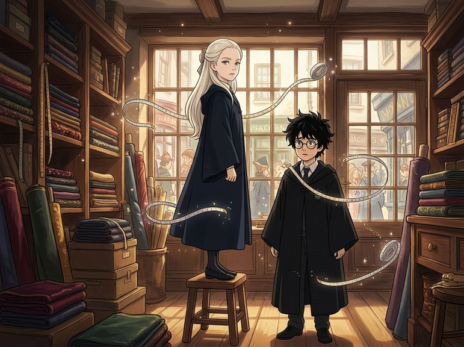

# Chương 01: Năm Nhất: Tiệm Áo Chùng Madam Malkin
**Tên gốc:** *First Year: Madam Malkin's*  
**Tác giả:** [Sergio Xalambrí (`sergiodxa`)](https://www.wattpad.com/1661197533-dracaena-malfoy-and-the-boy-who-lived-first-year)  
**Phiên bản:** Bản Viết Cô Đọng (Tóm lược cốt truyện & diễn biến tâm lý)

*Dracaena Malfoy và Harry Potter lần đầu gặp gỡ trên bục thử đồ tại Tiệm Áo Chùng Madam Malkin (Hẻm Xéo).*

> "Cậu đã làm một tấm kính biến mất và thả anh họ mình vào chuồng rắn mà lại không tin nổi có một chiếc nón biết nói sao?"

### Bối cảnh & Khởi đầu tại Hẻm Xéo
Dracaena Malfoy đã chờ đợi mười một năm để được đặt chân đến trường Phù thủy và Pháp thuật Hogwarts, nhưng cô hoàn toàn không hào hứng với việc phải đứng yên trên bục gỗ trong tiệm may của Madam Malkin để thử áo chùng. Sáng hôm đó, cha cô — Lucius Malfoy — đã đưa hai mẹ con đến Ngân hàng Gringotts và tiệm sách Phú Quý và Cơ Hàn (*Flourish and Blotts*). Dracaena đã sắm đủ bộ sách giáo khoa mới tinh, một chiếc kính viễn vọng, một vạc bạc, ba đôi găng tay da rồng và bộ bút lông chim công tiệp màu mực viết sau mười phút thương lượng căng thẳng với cha. Nỗi bất công duy nhất trong ngày là học sinh năm nhất không được phép mang chổi bay riêng.

Khi mẹ cô — phu nhân Narcissa Malfoy — đang ngồi đọc sách bên khung cửa sổ, chuông cửa tiệm leng keng vang lên. Một cậu bé trạc tuổi cô bước vào: dáng người nhỏ nhắn, gầy gò, mái tóc đen rối bù như vừa thua một trận chiến với chiếc lược, mặc bộ đồ Muggle rộng thùng thình cũ kỹ. Madam Malkin xếp cậu đứng lên chiếc bục ngay cạnh Dracaena.

### Cuộc trò chuyện kỳ lạ giữa hai thế giới
Quan sát vẻ lúng túng của cậu bé trước chiếc thước dây tự động, Dracaena lập tức nhận ra cậu chưa từng thấy đồ vật có phép thuật. Khi cậu thật thà thú nhận mình mới phát hiện ra bản thân là phù thủy gần đây, Dracaena vô cùng kinh ngạc. Để khai thác thêm, cô hỏi về những lần bộc phát phép thuật vô tình của cậu. Cậu bé ngần ngại một chút rồi mỉm cười kể lại chuyện từng làm biến mất tấm kính chuồng trăn ở sở thú khiến gã anh họ rơi tọt vào trong.

Dracaena bật cười thành tiếng — một tiếng cười thật sự chứ không phải kiểu cười xã giao lịch thiệp mà mẹ cô vẫn dạy. Đổi lại, khi cậu hỏi cô từng làm gì, Dracaena miễn cưỡng tiết lộ "sự cố nhà kính": cô từng vô tình làm một bụi hoa cẩm tú cầu nổi điên tấn công con công trắng của cha mình, khiến cả nhà phải đốt bỏ cái cây. Cậu bé bật cười sảng khoái và nhận xét gia đình cô thật kỳ lạ.

Bản năng kiêu hãnh của gia tộc lập tức trỗi dậy. Dracaena tự hào giới thiệu cha mình là Lucius Malfoy và mình là Dracaena Malfoy. Thế nhưng, đáp lại cô chỉ là cái gật đầu bình thản: *"Rất vui được gặp bạn."* Cậu bé hoàn toàn chưa từng nghe danh gia tộc Malfoy. Khi biết cha mẹ cậu đều là phù thủy nhưng đã qua đời và cậu phải sống với dì dượng Muggle ghét phép thuật, Dracaena buột miệng bảo việc dì dượng giấu cậu về Hogwarts là "ngu ngốc", rồi tận tình giảng giải cho cậu về bốn Nhà của Hogwarts (dĩ nhiên khẳng định Slytherin là nhất), về Chiếc Nón Phân Loại biết nói, và về môn thể thao Quidditch trên chổi bay.

### Cái tên "Harry" và lời trêu chọc của Narcissa
Sự ngây ngô nhưng thẳng thắn của cậu bé khiến Dracaena cảm thấy vô cùng mới mẻ: cậu không hề nịnh bợ danh tiếng nhà Malfoy, cũng không sợ làm cô phật lòng. Hai người tranh luận sôi nổi từ vị trí Tầm thủ cho đến chuyện nam nữ chơi chung đội Quidditch. Đúng lúc đó, Rubeus Hagrid — người giữ khóa khổng lồ của Hogwarts — xuất hiện bên ngoài cửa sổ cùng hai cây kem, giục cậu bé đi mua đũa phép và gọi tên cậu: *"Harry!"*

Trước khi rời tiệm cùng mẹ, Dracaena quay lại nhìn Harry. Cậu mỉm cười hẹn gặp lại cô ở Hogwarts, và cô kiêu kỳ đáp: *"Cứ cho là Chiếc Nón Phân Loại tìm được chỗ để xếp cậu vào đã."* Khi bước ra phố, Narcissa nhẹ nhàng nhắc rằng cô vẫn chưa hỏi họ của cậu bé. Dù cố tỏ ra kênh kiệu và bảo rằng cậu ta vừa ngốc vừa mặc đồ xấu, Dracaena lại lỡ lời thú nhận với mẹ rằng mình đã kể cho Harry nghe chuyện bụi hoa cẩm tú cầu. Narcissa mỉm cười thật sự và hỏi: *"Con vừa kết bạn đấy à?"* Dracaena đỏ mặt phủ nhận, tự nhủ có hàng ngàn người tên Harry ở nước Anh — nhưng hình ảnh cậu bé có mái tóc rối bù ấy vẫn vương vấn trong tâm trí cô.
