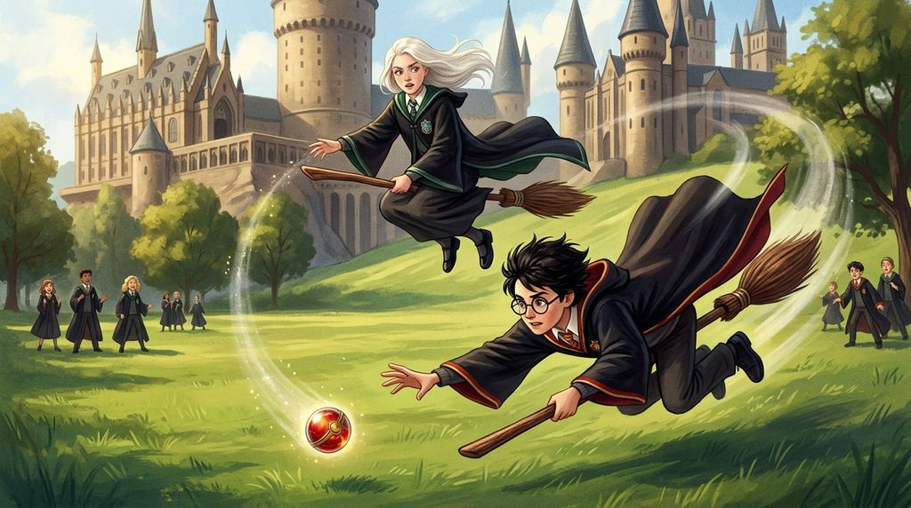

# Chương 04: Năm Nhất: Những Giờ Học Đầu Tiên
**Tên gốc:** *First Year: Lessons*  
**Tác giả:** [Sergio Xalambrí (`sergiodxa`)](https://www.wattpad.com/1661199083-dracaena-malfoy-and-the-boy-who-lived-first-year)  
**Phiên bản:** Bản Viết Cô Đọng (Tóm lược cốt truyện & diễn biến tâm lý)

*Giờ học bay đầu tiên và cú lao mình ngoạn mục trên không trung của Harry Potter.*

> "Cậu có thể đã gãy cổ rồi đấy, đồ ngốc!"

### Cuộc đua ngầm trên lớp học & Tiết Độc Dược đầu tiên
Tuần học đầu tiên tại Hogwarts nhanh chóng biến thành một cuộc cạnh tranh không khoan nhượng. Dracaena nhận ra mình rất thích việc học ở trường vì điểm số là thứ rõ ràng, đo đếm được. Tuy nhiên, cô gặp phải một đối thủ vô cùng phiền phức ở phía Gryffindor: Hermione Granger, người luôn giơ tay cao đến mức suýt trật khớp vai trong mọi tiết Biến Hình và Bùa Chú.

Trong tiết Độc Dược đầu tiên dưới hầm ngục cùng Giáo sư Severus Snape — cha đỡ đầu của Dracaena — bầu không khí thiên vị diễn ra rõ rệt. Khi Snape liên tục dồn ép Harry bằng hàng loạt câu hỏi hóc búa về cây phụ tử (*monkshood* và *wolfsbane*) cùng đá Bezoar để làm bẽ mặt cậu trước cả lớp, Dracaena ban đầu cảm thấy hả hê. Nhưng khi nhìn gương mặt căng thẳng và ánh mắt bướng bỉnh không chịu khuất phục của Harry, niềm vui chiến thắng của cô bỗng nhiên nhạt đi. Cô nhận ra Snape đang tấn công Harry vì người cha quá cố của cậu chứ không phải vì bản thân Harry.

### Giờ học bay và Quả cầu Nhớ của Neville
Sự kiện bùng nổ vào chiều thứ Năm trong tiết học bay đầu tiên cùng bà Hooch. Dracaena vốn đã được cha dạy bay từ nhỏ nên vô cùng tự tin. Thế nhưng, ngay khi bắt đầu, chiếc chổi của Neville Longbottom lại mất kiểm soát, hất cậu bé rơi xuống đất gãy cổ tay và làm rơi Quả cầu Nhớ (*Remembrall*) trên bãi cỏ. Khi bà Hooch đưa Neville đi bệnh xá và cấm toàn bộ học sinh chạm vào chổi, Dracaena nhặt được Quả cầu Nhớ.

Muốn chọc tức Harry và thử xem cậu sẽ phản ứng thế nào, Dracaena cầm quả cầu phóng chổi bay vọt lên không trung, thách thức cậu lên lấy. Cô không ngờ rằng cậu bé mới biết đến phép thuật vỏn vẹn một tháng lại lập tức cưỡi chổi lao vút lên bầu trời với bản năng thiên bẩm đáng kinh ngạc. Khi thấy cơn giận làm mờ mắt cậu và bà McGonagall có thể xuất hiện bất cứ lúc nào, Dracaena ném mạnh quả cầu ra xa. Harry lao thẳng xuống theo một cú bổ nhào tử thần, bắt gọn quả cầu chỉ cách mặt đất vài tấc trước sự sững sờ của cả lớp.

### Lời thách đấu Quidditch
Giáo sư McGonagall xuất hiện và lập tức dẫn Harry đi. Thay vì bị đuổi học như lời đồn của Pansy và Ron, chiều hôm đó cả trường xôn xao khi biết Harry Potter đã trở thành Tầm thủ trẻ nhất của đội Quidditch Gryffindor trong suốt một thế kỷ. Vừa tức giận vì cậu dám mạo hiểm mạng sống, vừa chạm tự ái vì luật cấm học sinh năm nhất chỉ được phá lệ cho riêng Potter, Dracaena chặn cậu ở hành lang và tuyên bố chắc nịch rằng năm sau cô nhất định sẽ vào đội tuyển Slytherin để đánh bại cậu trên sân đấu.
