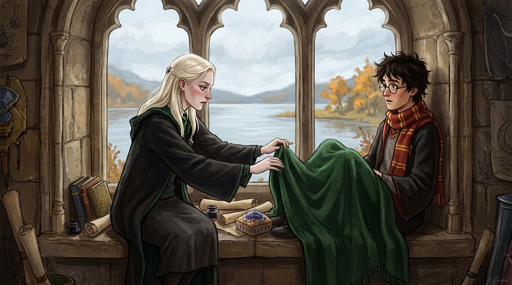

# Chương 06: Năm Nhất: Những Ngoại Lệ
**Tên gốc:** *First Year: Exceptions*  
**Tác giả:** [Sergio Xalambrí (`sergiodxa`)](https://www.wattpad.com/1661199247-dracaena-malfoy-and-the-boy-who-lived-first-year)  
**Phiên bản:** Bản Viết Cô Đọng (Tóm lược cốt truyện & diễn biến tâm lý)

*Ba quy tắc bất thành văn tại phòng cửa sổ và những bí mật dưới gầm cầu thang được hé lộ.*

> "Quy tắc số ba: Bất cứ điều gì nói ra trong căn phòng này sẽ ở lại trong căn phòng này."

### Ba quy tắc của Phòng Cửa Sổ
Đến tháng Mười, căn phòng cửa sổ đã có những quy tắc bất thành văn riêng.
- **Quy tắc thứ nhất:** Không mang chuyện bạn bè vào phòng (không nhắc đến Ron, Pansy, Hermione hay bất kỳ ai có thể biến cuộc trò chuyện thành trận cãi vã; riêng việc nói xấu giáo viên thì được phép, trừ Giáo sư Snape).
- **Quy tắc thứ hai:** Ai đến trước sẽ được ngồi phía bên trái bệ cửa sổ — nơi rộng hơn, nhiều nắng hơn và có cột đá tựa lưng êm ái (dù có hôm Harry đến trước, Dracaena vẫn ngang ngược ngồi ép sát vào chân cậu cho đến khi cậu phải nhượng bộ).
- **Quy tắc thứ ba:** Mọi điều nói ra trong căn phòng này sẽ mãi mãi ở lại trong căn phòng này. Ngoài hành lang họ vẫn là Potter và Malfoy đối đầu nhau, nhưng bên trong cánh cửa gỗ ấy là một thế giới hoàn toàn tách biệt.

### Gầm cầu thang & Chiếc tất cũ
Trong một buổi chiều trò chuyện về tiền tệ Muggle và tiền tiêu vặt, Dracaena vô tình chạm phải "những tấm ván sàn mục" trong quá khứ của Harry. Cô bàng hoàng khi biết vào ngày sinh nhật, dì dượng Dursley chỉ ném cho cậu một chiếc tất cũ của dượng Vernon, và suốt mười năm trời cậu phải ngủ trong căn phòng xép tối tăm dưới gầm cầu thang trong khi gã anh họ Dudley có tới hai phòng ngủ.

Cơn giận dữ trào lên trong lồng ngực Dracaena — bởi theo quan niệm của cô, một khi đứa trẻ đã thuộc về gia đình thì gia đình có nghĩa vụ phải bảo vệ và chăm sóc nó. Cô thậm chí đòi viết thư bảo cha mình là Lucius Malfoy đến dọa cho nhà Dursley một trận, khiến Harry bật cười thật sự trước ý tưởng đó nhưng vẫn bắt cô hứa giữ kín theo "Quy tắc số ba". Kể cả khi thời tiết trở lạnh và Dracaena vô tình lỡ lời nhắc đến mẹ của Harry khi hai người giành nhau chiếc chăn len của Narcissa gửi, cô đã lần đầu tiên biết nói lời *"Xin lỗi"* và lặng lẽ đắp một góc chăn lên chân cậu.

### Đêm Halloween & "Ngoại lệ" mang tên Hermione Granger
Vào ngày lễ Halloween, trong giờ Bùa Chú học ghép với Gryffindor, khi Dracaena còn đang loay hoay với bùa chú bay *Wingardium Leviosa*, chiếc lông vũ của Hermione Granger đã bay vút lên hoàn hảo. Việc một cô bé gốc Muggle lại đứng đầu lớp khiến hệ tư tưởng thuần huyết mà Dracaena được dạy từ nhỏ bị lung lay — cô tự trấn an rằng Granger chỉ là một "ngoại lệ" (*exception*). Tan học, khi nghe Ron Weasley lớn tiếng chê bai Hermione không có bạn bè khiến cô bé bật khóc chạy đi, Dracaena bất ngờ cảm thấy khó chịu thay vì hả hê, và đồng tình với nhận xét của Daphne rằng sỉ nhục người khác như vậy thật kém sang.

Tối hôm đó, Giáo sư Quirrell lao vào Đại Sảnh Đường báo tin có Quỷ khổng lồ (*Troll*) trong hầm ngục. Giữa lúc hỗn loạn, Dracaena thoáng thấy Harry và Ron lén tách khỏi hàng ngũ để đi cứu Hermione đang khóc trong nhà vệ sinh nữ. Cô trải qua nửa tiếng đồng hồ bồn chồn lo lắng tột độ trong phòng sinh hoạt chung Slytherin cho đến khi Giáo sư Snape xuất hiện với vết thương ở cổ chân và xác nhận Potter vẫn còn sống. Chiều hôm sau tại phòng cửa sổ, Dracaena mắng Harry một trận tơi bời vì thói coi thường mạng sống, rồi lúng túng viện cớ: *"Nếu cậu bị quỷ khổng lồ giết trước khi thi đấu Quidditch với tôi vào năm sau, người ta sẽ bảo tôi sợ cạnh tranh!"* Khi nghe Harry kể rằng Hermione đã nói dối Giáo sư McGonagall để nhận lỗi thay cho hai cậu, Dracaena khẽ lẩm bẩm rằng có lẽ Granger lại là một "ngoại lệ" nữa.
