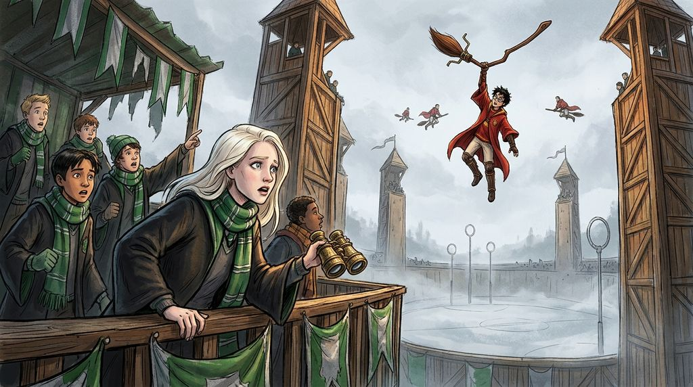

# Chương 07: Năm Nhất: Trận Đấu Đầu Tiên
**Tên gốc:** *First Year: The Match*  
**Tác giả:** [Sergio Xalambrí (`sergiodxa`)](https://www.wattpad.com/1661202891-dracaena-malfoy-and-the-boy-who-lived-first-year)  
**Phiên bản:** Bản Viết Cô Đọng (Tóm lược cốt truyện & diễn biến tâm lý)

*Trận Quidditch mở màn mùa giải và sự cố cây chổi Nimbus 2000 bị yểm bùa giữa không trung.*

> "Giáo sư Snape không hề muốn giết cậu, Potter! Cậu lúc nào cũng suy diễn!"

### Trận Quidditch mở màn giữa Gryffindor và Slytherin
Tháng Mười Một mang đến cái lạnh cắt da và trận đấu Quidditch đầu tiên của mùa giải giữa Slytherin và Gryffindor. Trên khán đài rợp sắc xanh bạc của Slytherin, Dracaena đứng cạnh Pansy, Theo và Blaise, mắt không rời khỏi chấm đỏ đang bay lượn trên chiếc Nimbus 2000. Dù miệng tuyên bố mong Slytherin nghiền nát Gryffindor, cô không khỏi thán phục tốc độ và sự linh hoạt bẩm sinh của Harry trên không trung.

Giữa lúc trận đấu đang gay cấn và Marcus Flint liên tục phạm lỗi thô bạo, chiếc chổi Nimbus 2000 của Harry đột nhiên giật mạnh và lồng lộn mất kiểm soát ở độ cao hàng chục mét, hất cậu văng khỏi yên chổi, chỉ còn bám trụ bằng một tay. Nỗi kinh hoàng bóp nghẹt lồng ngực Dracaena. Trong khi cả sân vận động la hét, cô nhìn về phía khán đài giáo viên và thấy Giáo sư Snape đang nhìn chằm chằm vào Harry, miệng lẩm bẩm thần chú liên tục, trước khi áo chùng của ông bất ngờ bốc cháy do Hermione Granger lén phóng hỏa từ phía dưới. Ngay tức khắc, Harry trèo lại được lên chổi, lao xuống sát mặt đất và bắt được trái Snitch bằng... miệng trong một tư thế vô cùng kỳ quặc, mang về chiến thắng cho Gryffindor.

### Cuộc tranh cãi nảy lửa về Giáo sư Snape
Chiều hôm sau tại phòng cửa sổ, niềm nhẹ nhõm vì Harry an toàn nhanh chóng biến thành một trận cãi vã kịch liệt. Harry cùng Ron và Hermione tin chắc rằng Giáo sư Snape đã cố tình nguyền rủa cây chổi của cậu để giết cậu, và chính vết thương trên chân Snape vào đêm Halloween là do con chó ba đầu canh giữ thứ gì đó trên hành lang cấm tầng ba cắn.

Dracaena kiên quyết bảo vệ cha đỡ đầu của mình. Cô khẳng định một bậc thầy Độc dược kiêm Trưởng nhà Slytherin như Snape không bao giờ làm chuyện ngu ngốc và lộ liễu như thế trước mặt cả trường. Dù không bên nào thuyết phục được bên nào, Harry vẫn lén tiết lộ cho cô nghe một mảnh ghép nhỏ về việc có thứ gì đó cực kỳ quan trọng đang được giấu trong lâu đài — khởi đầu cho những bí mật mà cậu vừa muốn chia sẻ vừa sợ kéo cô vào vòng nguy hiểm.
