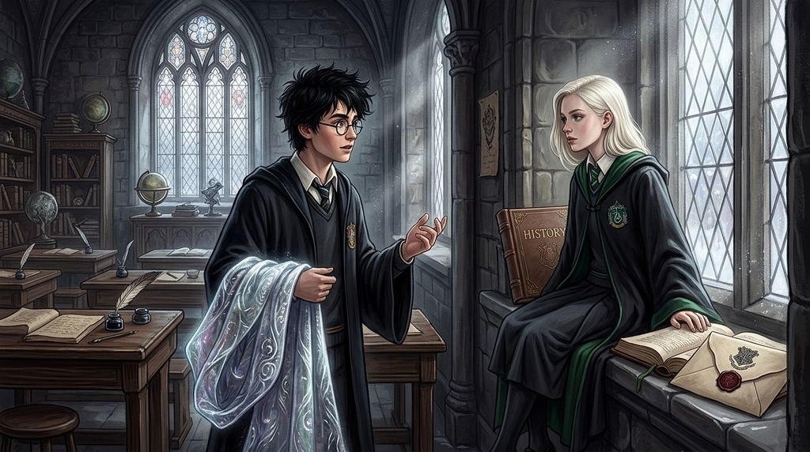

# Chương 09: Năm Nhất: Gia Sản & Những Khuôn Mẫu
**Tên gốc:** *First Year: Inheritance*  
**Tác giả:** [Sergio Xalambrí (`sergiodxa`)](https://www.wattpad.com/1661457267-dracaena-malfoy-and-the-boy-who-lived-first-year)  
**Phiên bản:** Bản Viết Cô Đọng (Tóm lược cốt truyện & diễn biến tâm lý)

*Những suy tư của Dracaena về gia thế, dòng máu thuần huyết và những định kiến được truyền lại từ thế hệ trước.*

> "Có những câu trả lời cậu tự tin vì cậu thực sự tin vào chúng, và có những câu trả lời chỉ vì cậu đã được thừa kế từ người khác."

### Sức nặng của sự kế thừa
Bước sang học kỳ mùa xuân, những cuộc trò chuyện trong phòng cửa sổ bắt đầu chạm đến những chủ đề sâu sắc hơn cả bài tập về nhà. Harry vô tình tiết lộ một phần về món quà Giáng Sinh bí ẩn mà cậu nhận được (Tấm Áo Khoác Tàng Hình của cha cậu) và tấm gương Ảo Ảnh (*Mirror of Erised*) nơi cậu nhìn thấy cha mẹ đã khuất của mình. Qua cách Harry khao khát tìm hiểu từng mảnh ký ức nhỏ nhoi về James và Lily Potter, Dracaena nhận ra một sự đối lập kỳ lạ: Harry không được thừa kế bất cứ định kiến hay khuôn mẫu gia đình nào, trong khi cô lại được thừa kế quá nhiều.

Trong các buổi học và qua những bức thư của cha, Dracaena luôn được nhắc nhở về vị thế của gia tộc Malfoy, về tầm quan trọng của dòng máu thuần huyết, lịch sử lâu đời và việc phải giữ khoảng cách với những người không cùng đẳng cấp. Thế nhưng, khi ngồi đối diện Harry — người luôn đặt câu hỏi *"Tại sao?"* trước mọi quy tắc bất thành văn của giới phù thủy — Dracaena lần đầu tiên cảm thấy lúng túng khi phải giải thích những điều mà trước nay cô vốn coi là hiển nhiên (*"Obviously"*).

### Những vết nứt trong định kiến
Khi thảo luận về bài tập Lịch sử Pháp thuật và cách giới phù thủy nhìn nhận người Muggle cũng như phù thủy sinh ra từ gia đình Muggle, Harry không hề lớn tiếng giảng đạo lý, mà chỉ nhìn cô với ánh mắt như thể cậu có thể phân biệt rõ đâu là suy nghĩ thật của Dracaena, và đâu là những câu chữ cô lặp lại từ cha mình. Cảm giác bị nhìn thấu ấy khiến Dracaena vừa bực bội vừa trăn trở. Cô bắt đầu nhận ra rằng việc trở thành một bản sao hoàn hảo của gia tộc đôi khi không dễ dàng như cô từng nghĩ, nhất là khi có một cậu con trai nhà Gryffindor cứ liên tục làm xáo trộn trật tự thế giới của cô.
