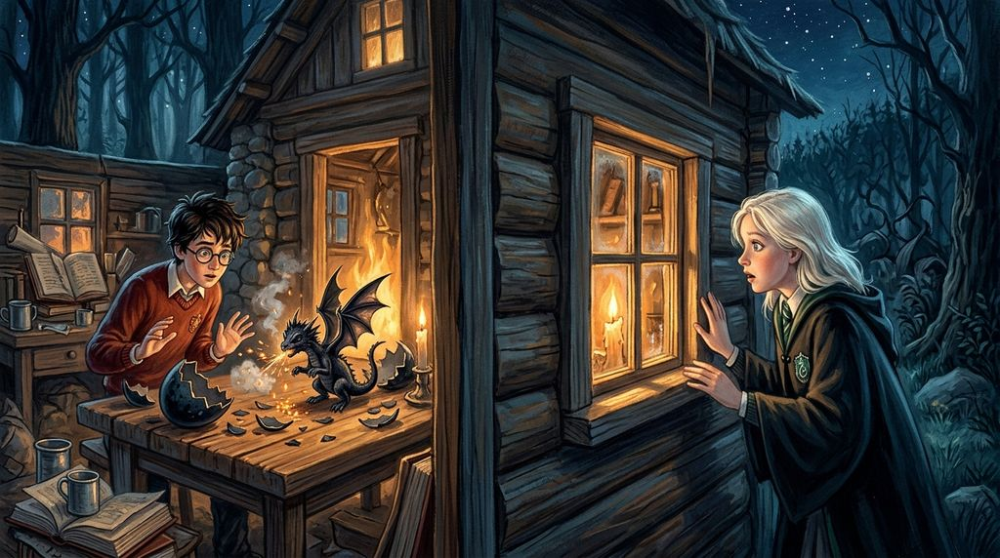

# Chương 10: Năm Nhất: Con Rồng Của Hagrid
**Tên gốc:** *First Year: The Dragon*  
**Tác giả:** [Sergio Xalambrí (`sergiodxa`)](https://www.wattpad.com/1661457372-dracaena-malfoy-and-the-boy-who-lived-first-year)  
**Phiên bản:** Bản Viết Cô Đọng (Tóm lược cốt truyện & diễn biến tâm lý)

*Bí mật về chú rồng Na Uy lưng có gai Norbert trong căn chòi gỗ của Hagrid và đêm bị bắt phạt cấm túc.*

> "Lão Hagrid đang nuôi một con rồng trong một căn nhà bằng gỗ! Cậu có hiểu chữ 'bằng gỗ' nghĩa là gì không?"

### Bí mật trong căn chòi gỗ
Vào tháng Tư, Dracaena nhận thấy Harry, Ron và Hermione có những biểu hiện vô cùng lén lút: họ thường xuyên thì thầm ở góc thư viện và chạy xuống chòi của lão Hagrid vào những giờ giấc kỳ quặc. Sự tò mò cộng với cảm giác bị gạt ra ngoài rìa khiến Dracaena quyết định tự mình đi tìm hiểu. Một buổi tối, cô lẻn xuống khuôn viên trường và nhìn qua khe cửa sổ căn chòi gỗ của Hagrid — nơi cô tận mắt chứng kiến một quả trứng rồng Na Uy lưng có gai (*Norwegian Ridgeback*) vừa nở ra chú rồng con Norbert.

Chiều hôm sau tại phòng cửa sổ, Dracaena đối chất thẳng thắn với Harry: *"Hagrid đang nuôi một con rồng bất hợp pháp trong một ngôi nhà bằng gỗ!"* Dù kinh ngạc khi cô biết chuyện, Harry buộc phải thừa nhận họ đang tìm cách thuyết phục Hagrid gửi con rồng đến chỗ anh trai của Ron là Charlie ở Romania trước khi nó đốt cháy cả căn chòi hoặc làm lộ chuyện. Khi Ron bị con rồng cắn sưng vù tay và phải vào bệnh xá, Dracaena — dù ngoài mặt trêu chọc sự liều lĩnh ngu ngốc của nhóm Gryffindor — vẫn giữ lời hứa không tố giác chuyện con rồng với Giáo sư Snape hay cha mình.

### Đêm định mệnh trên hành lang tháp Thiên Văn
Đêm Harry và Hermione dùng Áo Khoác Tàng Hình đưa con rồng Norbert lên đỉnh tháp Thiên Văn để giao cho bạn của Charlie, Dracaena cũng lén rời ký túc xá sau giờ giới nghiêm (vừa để xem họ có thực sự tống khứ được con rồng đi không, vừa vì Neville Longbottom cũng đang chạy đi tìm báo động cho Harry). Không may, Giáo sư McGonagall đã bắt gặp Dracaena trước, rồi lần lượt tóm gọn cả Neville, Harry và Hermione khi hai người kia để quên Áo Khoác Tàng Hình trên tháp.

Cả bốn học sinh đều bị trừ điểm nặng nề và nhận án phạt cấm túc. Điều tệ hại nhất đối với Harry là cậu bị cả trường — kể cả chính Nhà Gryffindor — quay lưng tẩy chay vì làm mất 150 điểm; còn đối với Dracaena, án phạt cấm túc đã đẩy cô và Harry vào cùng một chuyến đi định mệnh vào Rừng Cấm.
