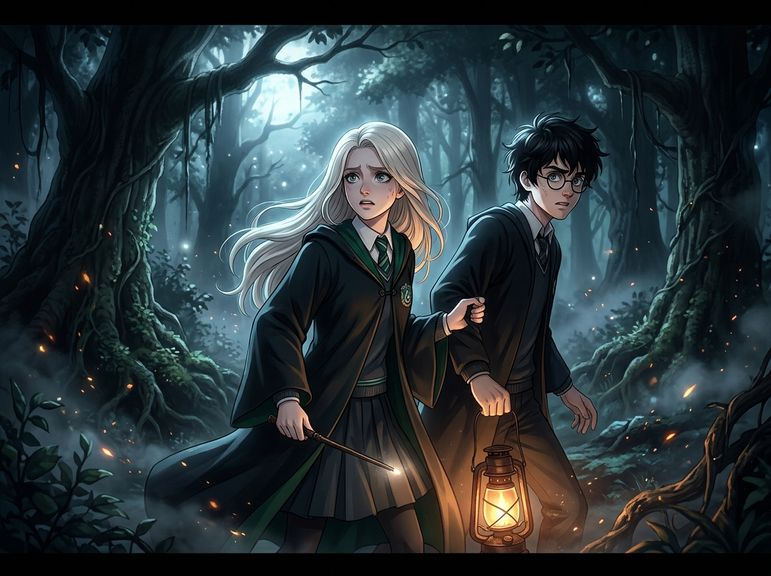

# Chương 11: Năm Nhất: Khu Rừng Cấm
**Tên gốc:** *First Year: The Forest*  
**Tác giả:** [Sergio Xalambrí (`sergiodxa`)](https://www.wattpad.com/1661590251-dracaena-malfoy-and-the-boy-who-lived-first-year)  
**Phiên bản:** Bản Viết Cô Đọng (Tóm lược cốt truyện & diễn biến tâm lý)

*Trong Rừng Cấm tối tăm, Dracaena nắm chặt cánh tay Harry và giương đũa phép run rẩy đối mặt với bóng đen uống máu kỳ lân.*

> "Mình đã suýt bỏ chạy... Nhưng cậu đã không chạy. Vì cậu vẫn ở lại."

### Hình phạt lúc nửa đêm & Con chó săn nhát gan
Đúng 10 giờ 45 tối thứ Sáu, bất chấp lời xúi giục của Pansy rằng hãy "tự đầu độc nhẹ" hoặc giả vờ ngất xỉu để trốn ở bệnh xá, Dracaena khoác áo chùng bước ra sảnh chính chịu phạt cùng Harry, Hermione và Neville. Lão Filch hả hê dẫn cả bốn đứa xuống chòi của Hagrid, nơi họ biết được nhiệm vụ kinh hoàng của đêm nay: đi sâu vào Rừng Cấm để tìm một con kỳ lân đang bị thương nặng, để lại những vệt máu màu bạc sáng rực trên nền đất tối.

Khi Hagrid chia nhóm, Dracaena lập tức đòi đi cùng con chó săn khổng lồ Fang vì nghĩ nó to xác như một con ngựa nhỏ thì sẽ bảo vệ được mình (dù Hagrid đã cảnh báo Fang là một kẻ nhát cáy), đồng thời chỉ định luôn: *"Potter cũng đi cùng Fang."* Đi giữa rừng sâu âm u, khi một tiếng tru bất ngờ vang lên kèm tiếng cành cây gãy sát bên cạnh, cả Dracaena và Harry đều giật mình. Trong bóng tối, hai bàn tay họ vô tình chạm vào nhau và siết chặt lấy nhau suốt vài giây trước khi Dracaena đỏ mặt rút tay lại, chữa thẹn rằng cô "tưởng nhầm cậu là con chó". Để xua tan nỗi sợ khi đi lệch khỏi đường mòn theo vết máu bạc, Dracaena kể cho Harry nghe chuyện cha cô đặt tên La Mã cổ đại (Septimus, Octavian, Cassius) cho sáu con công trắng ở nhà, còn Harry kể về con rùa của Dudley và cô cú tuyết Hedwig — món quà sinh nhật đầu tiên cậu nhận được.

### Bóng đen uống máu kỳ lân & Hai giọt nước mắt
Bước ra một khoảng rừng trống dưới ánh trăng, họ phát hiện xác con kỳ lân trắng muốt nằm bất động. Ngay lúc đó, một bóng đen trùm kín đầu trườn tới, cúi xuống uống dòng máu bạc từ cổ con kỳ lân. Khi sinh vật đó ngẩng đầu lên nhìn họ, con chó Fang lập tức cụp đuôi bỏ chạy. Harry ôm chặt vết sẹo trên trán, đau đớn khuỵu xuống đất.

Bản năng bảo toàn mạng sống gào thét bảo Dracaena hãy bỏ chạy tìm Hagrid. Thế nhưng, nhìn Harry đang quằn quại dưới đất trước bóng đen đang tiến lại gần, cô siết chặt cánh tay cậu bằng cả hai tay và nói: *"Không."* Một tay vẫn giữ chặt Harry, tay kia cô rút đũa phép ra, giọng vỡ òa trong nước mắt nhưng vẫn chĩa thẳng đũa phép về phía sinh vật kinh hoàng kia: *"Lùi lại! Biến đi!"* Đúng khoảnh khắc bóng đen lao tới, nhân mã Firenze phóng vọt ra đánh đuổi kẻ tấn công.

### Lời hứa dưới bóng đêm
Khi nguy hiểm qua đi, Dracaena nhận ra mình vẫn đang ôm chặt cánh tay Harry, gương mặt đẫm nước mắt tựa sát vào vai cậu. Trước khi Firenze đưa Harry rời đi, cô bắt cậu hứa không được kể chuyện cô khóc cho bất kỳ ai, và Harry lập tức cam kết: *"Mình sẽ không nói đâu."* Khi trở về lâu đài sau nửa đêm, tại hành lang vắng dẫn xuống hầm ngục, Dracaena nghẹn ngào thú nhận với Harry rằng cô đã sợ hãi đến mức không nghĩ ra nổi bùa chú nào và đã suýt bỏ chạy. Harry nhìn thẳng vào mắt cô, dịu dàng đáp: *"Nhưng cậu đã không chạy. Vì cậu vẫn ở lại."* Lời công nhận chân thành ấy xóa tan mọi mặc cảm của cô gái mười một tuổi, gắn kết hai người bằng một sợi dây tin tưởng sâu sắc hơn bao giờ hết.
