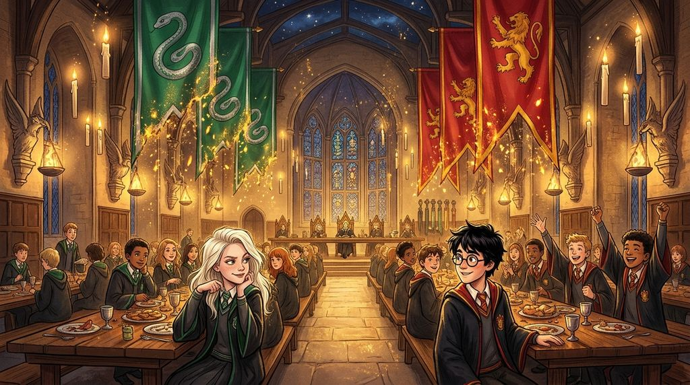

# Chương 12: Năm Nhất: Bữa Tiệc Cuối Năm
**Tên gốc:** *First Year: The Last Feast*  
**Tác giả:** [Sergio Xalambrí (`sergiodxa`)](https://www.wattpad.com/1661590442-dracaena-malfoy-and-the-boy-who-lived-first-year)  
**Phiên bản:** Bản Viết Cô Đọng (Tóm lược cốt truyện & diễn biến tâm lý)

*Cuộc hội ngộ sau ba ngày bất tỉnh ở bệnh xá và lời tiễn biệt tại Ngã Tư Vua cuối năm học đầu tiên.*

> "Cậu có thể viết thư nếu cậu cần... Chúc may mắn nhé, Potter."

### Kỳ thi cuối năm & Linh cảm chẳng lành
Mùa thi cuối năm đến gần — điều mà Dracaena vô cùng yêu thích vì điểm số luôn công bằng và văn minh, ngoại trừ sự tồn tại của chiếc lịch ôn tập tô màu tỉ mỉ của Hermione Granger. Ba ngày trước kỳ thi, Harry đến phòng cửa sổ với hai bàn tay trắng và hỏi cô liệu Giáo sư Snape có từng nhắc gì về cách vượt qua một con chó ba đầu hay không. Nhận ra Harry lại đang giấu mình một âm mưu nguy hiểm liên quan đến "Hòn Đá", Dracaena đếm trên đầu ngón tay những lần cậu suýt chết (Quỷ khổng lồ, Rồng, Rừng Cấm) và bắt cậu hứa phải báo cho cụ Dumbledore thay vì tự mình hành động ngu ngốc.

Thế nhưng, ngay sau môn thi cuối cùng, Dracaena nhìn thấy Harry, Ron và Hermione vội vã rẽ lên cầu thang đá với vẻ mặt khẩn cấp. Sáng hôm sau, cả ba đều biến mất. Qua mạng lưới tin tức của Theo và Blaise, Dracaena biết được Harry đang nằm bất tỉnh trong bệnh xá. Quá lo lắng, cô tự mình tìm đến bệnh xá. Dù bị bà Pomfrey chặn lại ngoài cửa (kể cả khi cô đem danh nghĩa cha mình là Ủy viên Hội đồng Quản trị ra hù dọa), cô cũng thở phào khi biết cậu vẫn còn sống và đã qua cơn nguy kịch. Trước khi rời đi, cô để lại lời nhắn đậm chất Malfoy: *"Hãy nhắn với cậu ta rằng Slytherin kỳ vọng cậu ta phải đủ khỏe mạnh để thua cuộc một cách đàng hoàng vào năm sau."*

### Sự thật về Quirrell và Kẻ-Mà-Ai-Cũng-Biết-Là-Ai-Đấy
Ngày thứ ba, khi Dracaena đang ngồi một mình trong phòng cửa sổ, Harry bước vào với gương mặt xanh xao nhưng vẫn còn sống. Cậu kể cho cô nghe về Hòn Đá Phù Thủy của Nicolas Flamel, về việc Giáo sư Quirrell mới là kẻ phản diện mang theo linh hồn của Voldemort sau chiếc khăn xếp, và thừa nhận: *"Giáo sư Snape đã cố bảo vệ mình. Mình đã sai."* Dracaena vừa đắc thắng vì mình đã đúng về Snape suốt nhiều tháng qua, vừa bàng hoàng khi biết Harry đã phải đối mặt trực tiếp với kẻ sát hại cha mẹ cậu — cũng chính là bóng đen trong Rừng Cấm. Khi biết bà Pomfrey đã mách lại chuyện cô đến thăm bệnh xá, Dracaena đỏ mặt bỏ về trong tiếng cười của Harry.

### Chiếc Cúp Nhà bị "đánh cắp" & Lời hẹn mùa hè ở Ngã Tư Vua
Trong bữa tiệc cuối năm, Đại Sảnh Đường ban đầu được trang hoàng rợp cờ xanh và bạc mừng Slytherin giành Cúp Nhà. Tuy nhiên, cụ Dumbledore bất ngờ cộng hàng loạt điểm phút chót cho Hermione, Ron, Harry và Neville, biến toàn bộ cờ hiệu thành màu đỏ vàng của Gryffindor. Dracaena phẫn nộ gọi đó là "đòn tâm lý chiến" bất công vì đã để Slytherin ăn mừng trước rồi mới tước cúp; khi bắt gặp ánh mắt có lỗi và khẩu hình *"Xin lỗi"* của Harry từ bàn bên kia, cô chỉ lên lá cờ đỏ và nhép miệng trả: *"Đồ ăn cắp"* khiến cậu bật cười.

Trên chuyến tàu trở về Luân Đôn, Dracaena dặn Harry có thể viết thư cho cô vào mùa hè nếu nhà Dursley đối xử tệ với cậu. Tại nhà ga Ngã Tư Vua, khi tận mắt nhìn thấy gã dượng Vernon to béo mặt đỏ gay, bà dì Petunia gầy nhẳng và tên anh họ Dudley đang quát tháo Harry, Dracaena định nói hết sự thật về chiếc tủ gầm cầu thang cho cha mình nghe. Nhưng thấy cái lắc đầu khẽ của Harry, cô giữ trọn "Quy tắc số ba" và chỉ nói vừa đủ với cha: *"Họ hàng của Potter ghét phép thuật, và họ cũng ghét cả cậu ấy nữa."* Lucius Malfoy trầm ngâm nhìn theo gia đình Dursley và xác nhận Harry biết cách liên lạc với thế giới phù thủy nếu cần. Trước khi khuất bóng giữa đám đông, Harry ngoái đầu nhìn lại, và cả hai khẽ giơ tay chào nhau.
