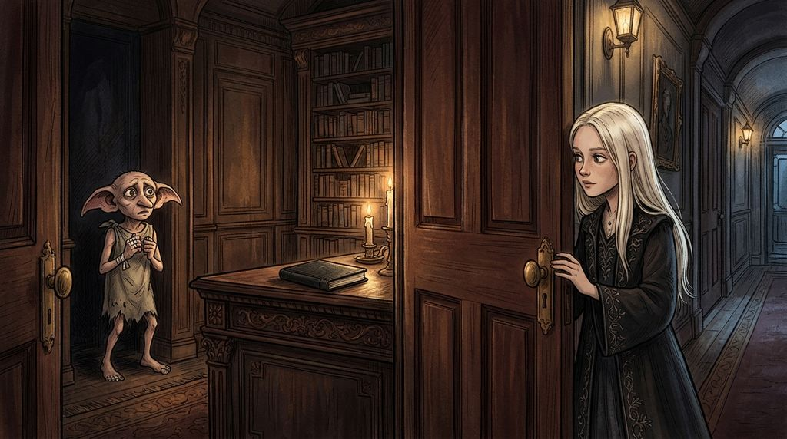

# Chương 13: Năm Hai: Mùa Hè Không Thư Từ
**Tên gốc:** *Second Year: No Letters*  
**Tác giả:** [Sergio Xalambrí (`sergiodxa`)](https://www.wattpad.com/1661817144-dracaena-malfoy-and-the-boy-who-lived-second-year)  
**Phiên bản:** Bản Viết Cô Đọng (Tóm lược cốt truyện & diễn biến tâm lý)

*Mùa hè dài đằng đẵng tại Thái ấp Malfoy, những bàn tay băng bó của gia tinh Dobby và cuốn sổ đen bí ẩn trong thư phòng.*

> "Harry Potter đã không viết thư. Dracaena nhận ra điều đó vào ngày thứ tư của kỳ nghỉ hè."

### Những cánh thư không bao giờ tới
Kỳ nghỉ hè bắt đầu tại Thái ấp Malfoy, và Harry Potter hoàn toàn không viết một lá thư nào. Đến ngày thứ bảy, Dracaena cố tình ngừng nhìn ra cửa sổ mỗi bữa sáng để chờ cú. Sang ngày thứ mười lăm, cô ngồi vào bàn định viết thư trước cho cậu nhưng viết rồi lại xóa, cuối cùng đốt sạch tờ giấy da vì lòng tự trọng không cho phép. Đến ngày thứ mười tám, Narcissa tinh ý nhận ra sự bồn chồn của con gái. Khi Dracaena thú nhận mình lo lắng cho Harry ở nhà Dursley và lỡ miệng tiết lộ mình nhớ cả ngày sinh nhật 31 tháng 7 của cậu, Narcissa trấn an cô rằng nếu Potter thực sự gặp nguy hiểm, gia đình Malfoy sẽ không làm ngơ.

### Bàn tay băng bó của Dobby & Cơn chấn động trên bàn ăn
Một chiều nọ, gia tinh Dobby làm vỡ cốc trong phòng khách. Dracaena phát hiện những ngón tay của Dobby quấn băng trắng và mu bàn tay có vết thương mới đỏ ửng. Khi Dobby định tự đập đầu trừng phạt mình và lắp bắp *"Dobby không thể nói"*, Dracaena đã lập tức ngăn con gia tinh lại.

Tối hôm đó, khi Lucius hỏi kỹ về lý do Harry phải nằm viện cuối năm học, Dracaena kể lại chuyện Quirrell âm mưu đánh cắp Hòn Đá Phù Thủy và việc Kẻ-Mà-Ai-Cũng-Biết-Là-Ai-Đấy đã bám vào Quirrell. Bầu không khí trên bàn ăn lập tức đóng băng: gương mặt Narcissa cắt không còn giọt máu, bàn tay bà run rẩy, còn Lucius — lần đầu tiên trong đời Dracaena nhìn thấy — thoáng lộ vẻ sợ hãi trước khi lập tức bỏ dở bữa tối để vào thư phòng.

### Chiếc tủ khóa kín & Cuốn sổ màu đen
Những tuần tiếp theo, Lucius trở nên vô cùng bận rộn và kín tiếng. Một lần bước vào thư phòng không gõ cửa, Dracaena bắt gặp cha đang vội vã đóng sập một chiếc tủ bí mật và yêu cầu cô tin tưởng rằng có những chuyện cô không nên biết để được an toàn. Hai ngày sau, đi ngang qua khe cửa thư phòng hé mở, cô thoáng thấy một cuốn sổ nhỏ màu đen cũ kỹ, sờn rách nằm trên bàn làm việc của cha — một vật quá đỗi tầm thường so với gu thẩm mỹ xa hoa của Lucius — cùng ánh mắt hoảng hốt của Dobby khi đứng gần đó. Đầu tháng Tám, khi danh sách sách giáo khoa năm hai toàn tác phẩm của Gilderoy Lockhart gửi tới, Lucius mang theo một chiếc cặp da nhỏ bí ẩn và dẫn Dracaena tiến vào Hẻm Xéo cùng Hẻm Knockturn.
