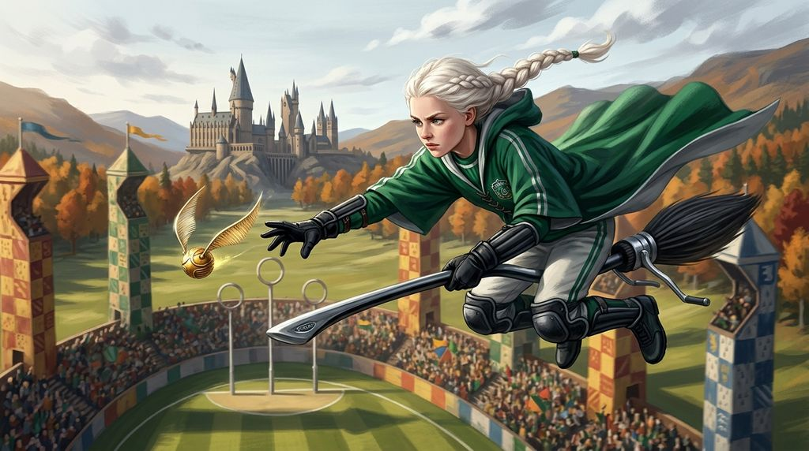

# Chương 15: Năm Hai: Đội Tuyển Quidditch
**Tên gốc:** *Second Year: The Team*  
**Tác giả:** [Sergio Xalambrí (`sergiodxa`)](https://www.wattpad.com/1661844824-dracaena-malfoy-and-the-boy-who-lived-second-year)  
**Phiên bản:** Bản Viết Cô Đọng (Tóm lược cốt truyện & diễn biến tâm lý)

*Dracaena vượt qua kỳ sát hạch khắc nghiệt của Marcus Flint để chính thức trở thành Tầm thủ của đội tuyển Slytherin.*

> "Mình đã viết thư cho cậu vào đầu tháng Bảy... nhưng không hiểu sao cậu không bao giờ hồi âm."

### Sự thật về những lá thư bị đánh cắp trên tàu
Trên chuyến tàu tốc hành trở lại Hogwarts vào ngày 1 tháng 9, Harry và Ron hoàn toàn vắng mặt — mãi đến bữa tiệc tối cả trường mới xôn xao tin hai cậu đã lái một chiếc xe hơi Muggle biết bay vượt hàng trăm dặm tới trường và đâm sầm vào Cây Liễu Roi. Vài ngày sau, khi gặp lại nhau trên hành lang và trong phòng cửa sổ, khúc mắc lớn nhất của mùa hè cuối cùng cũng được tháo gỡ: Harry khẳng định cậu **đã viết thư** cho cô vào đầu tháng Bảy, nhưng không hiểu vì sao cả cô lẫn Ron, Hermione đều không hồi âm một chữ nào. Dù chưa rõ nguyên nhân vì sao lá thư biến mất, việc biết Harry thực sự có viết thư cho mình khiến tảng đá đè nặng trong lòng Dracaena suốt hai tháng hè lập tức tan biến.

### Cuộc sát hạch Tầm thủ của Slytherin
Tuần thứ hai của năm học, đội trưởng Marcus Flint tổ chức buổi tuyển chọn vị trí Tầm thủ mới cho đội Quidditch Slytherin. Dracaena quyết tâm chứng minh năng lực bằng chính thực lực của mình chứ không phải bằng tiền bạc của cha. Dưới sự giám sát khắt khe của Flint, cô phải vượt qua các bài kiểm tra tốc độ, phản xạ né Bludger và khả năng phát hiện trái Snitch ở khoảng cách xa hơn bất kỳ ứng viên năm ba hay năm tư nào.

Bằng kỹ thuật bay điêu luyện đã rèn luyện suốt mùa hè (đến mức làm hỏng ba luống hoa ở Thái ấp), Dracaena xuất sắc giành lấy vị trí Tầm thủ chính thức. Ngay sau khi cô trúng tuyển, Lucius Malfoy giữ đúng lời hứa: ông gửi tặng toàn bộ đội tuyển Slytherin bảy cây chổi đua tối tân nhất thế giới — **Nimbus 2001**. Đối với Dracaena, cô đã tự mình giành được vị trí rồi cha mới tài trợ thiết bị cho đội, nhưng trong mắt người ngoài, câu chuyện lại mang một màu sắc hoàn toàn khác.
