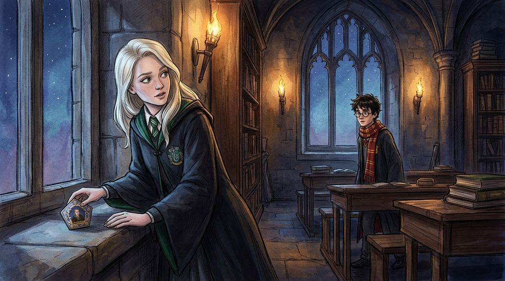

# Chương 17: Năm Hai: Người Kế Vị Slytherin
**Tên gốc:** *Second Year: The Heir*  
**Tác giả:** [Sergio Xalambrí (`sergiodxa`)](https://www.wattpad.com/1662638853-dracaena-malfoy-and-the-boy-who-lived-second-year)  
**Phiên bản:** Bản Viết Cô Đọng (Tóm lược cốt truyện & diễn biến tâm lý)

*Hỏa đình mỏng manh qua tấm thẻ Agrippa trong phòng cửa sổ và dòng chữ máu trên bức tường đêm Halloween.*

> "PHÒNG CHỨA BÍ MẬT ĐÃ ĐƯỢC MỞ RA. KẺ THÙ CỦA NGƯỜI KẾ VỊ, HÃY DÈ CHỪNG."

### Thỏa thuận đình chiến một phần & Tấm thẻ Agrippa thứ hai
Suốt mười hai ngày sau cuộc cãi vã, Dracaena cố tình tránh mặt Harry bằng cách dành toàn bộ thời gian rảnh trong phòng sinh hoạt chung Slytherin (ăn vụng bánh quy giấu dưới gầm giường của Daphne, chơi bài nổ cùng Blaise, Theo, Millicent) và lao vào tập Quidditch điên cuồng dưới sự chỉ huy tàn nhẫn của Marcus Flint. Khi họ tình cờ gặp lại ở phòng cửa sổ, Dracaena ngồi ở bàn học chứ không ngồi lên bệ cửa sổ. Phải đến buổi gặp tiếp theo, khi Harry mở lời hỏi thăm: *"Flint đang cố giết cậu đấy à?"* vì thấy hai Tấn thủ nện Bludger vào cô lúc tập luyện, bầu không khí băng giá mới dịu bớt. Vài ngày sau, khi quay lại phòng, Dracaena tìm thấy một tấm thẻ Ếch Sô-cô-la hình **Agrippa** do Harry cố tình để lại trên bệ đá phía cô — một lời làm hòa không lời khiến cô khẽ mỉm cười và cất vào ngăn kéo.

### Đêm Halloween kinh hoàng & Bà Norris bị hóa đá
Tối thứ Bảy lễ Halloween, khi cả nhóm Slytherin rời bàn tiệc trở về hầm ngục, đám đông phía trước đột ngột dừng khựng lại. Trên bức tường đá giữa hai ngọn đuốc là dòng chữ đỏ rực: **PHÒNG CHỨA BÍ MẬT ĐÃ ĐƯỢC MỞ RA. KẺ THÙ CỦA NGƯỜI KẾ VỊ, HÃY DÈ CHỪNG.** Bên dưới là con mèo Bà Norris của lão Filch bị treo cứng đờ, bất động, còn Harry, Ron và Hermione đang đứng ngay giữa hiện trường. Khi ánh mắt hoang mang của Harry chạm phải ánh mắt cô giữa đám đông hỗn loạn, Dracaena biết chắc chắn Potter không phải là thủ phạm.

Đêm đó và trong tiết Lịch sử Pháp thuật tuần kế tiếp, Giáo sư Binns buộc phải kể lại truyền thuyết về Salazar Slytherin và con quái vật trong Phòng Chứa Bí Mật được tạo ra để "thanh trừng những kẻ không xứng đáng" (học sinh gốc Muggle) khỏi trường. Trong khi một số nam sinh Slytherin thì thầm chữ *"Tuyệt vời"*, Dracaena lại cảm thấy bất an: đối với cô, niềm tự hào về gia tộc và văn hóa thuần huyết hoàn toàn khác với việc thả một con quái vật đi tấn công học sinh.

### Lá thư của Lucius & Giọng nói vô hình
Dracaena viết thư về nhà báo tin và khẳng định *"Potter không làm chuyện đó"*. Ngay sáng hôm sau, Narcissa gửi thư nghiêm cấm cô đi lại một mình hay tự ý điều tra theo kiểu của Potter; còn Lucius cho biết truyền thuyết về Phòng Chứa đã có từ lâu nhưng các gia tộc cổ xưa rất giỏi biến tin đồn thành truyền thống, đồng thời đặt nghi vấn về trách nhiệm bảo vệ học sinh của cụ Dumbledore.

Khi gặp lại Harry tại phòng cửa sổ, Dracaena nói thẳng cô biết cậu không hại con mèo. Nhìn nét mặt ngập ngừng của Harry, cô gặng hỏi và biết được một bí mật đáng sợ: ngay trước khi tìm thấy Bà Norris, Harry đã nghe thấy một giọng nói lạnh lẽo phát ra từ trong tường đang đe dọa giết chóc — một giọng nói mà cả Ron lẫn Hermione đều không hề nghe thấy. Tối hôm đó, khi viết thư về cho cha, Dracaena định ghi lại chuyện giọng nói bí ẩn ấy, nhưng nhớ tới **Quy tắc số ba**, cô đã gạch xóa hoàn toàn dòng chữ đó để giữ trọn bí mật cho Harry.
