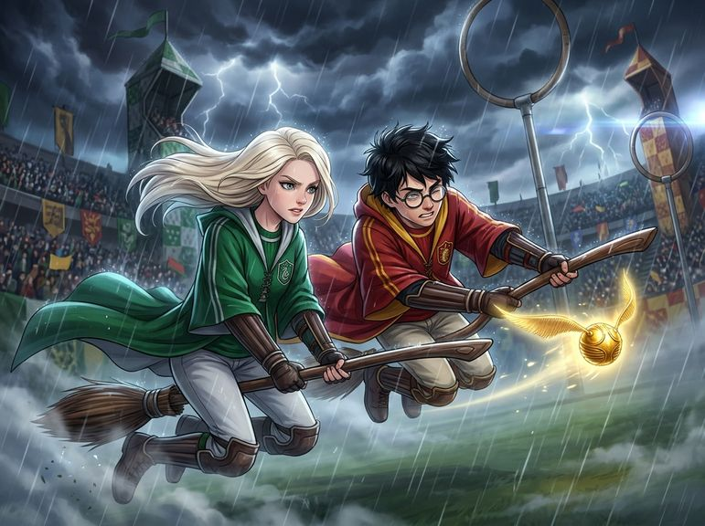

# Chương 18: Năm Hai: Quả Bóng Bludger Điên Loạn
**Tên gốc:** *Second Year: The Bludger*  
**Tác giả:** [Sergio Xalambrí (`sergiodxa`)](https://www.wattpad.com/1662638934-dracaena-malfoy-and-the-boy-who-lived-second-year)  
**Phiên bản:** Bản Viết Cô Đọng (Tóm lược cốt truyện & diễn biến tâm lý)

*Cuộc rượt đuổi nghẹt thở dưới mưa giữa hai Tầm thủ khi quả bóng Bludger bị yểm bùa điên cuồng lao vào Harry.*

> "Đó là một con gia tinh... Nó đã chặn tất cả thư từ của chúng ta trong mùa hè."

### Vụ cá cược trước giờ G
Trước trận đấu Quidditch được mong chờ nhất giữa Slytherin và Gryffindor, trong phòng cửa sổ, Harry và Dracaena đã bắt tay giao kèo một vụ cá cược đầy kiêu hãnh: ai để đối phương bắt được trái Snitch trước sẽ phải thừa nhận người kia là Tầm thủ giỏi hơn. Sáng thứ Bảy, giữa tiếng hò reo vang dội của cả sân vận động, hai Tầm thủ bay vút lên bầu trời đối mặt nhau.

Tuy nhiên, chỉ sau vài phút thi đấu, Dracaena phát hiện ra một điều bất thường: một quả bóng sắt Bludger cứ liên tục quay đầu truy sát một mình Harry Potter bất chấp hai anh em sinh đôi nhà Weasley đã đánh văng nó đi xa. Thậm chí khi cô bay xuống báo cho đội trưởng Marcus Flint, gã chỉ cười khoái trá. Phẫn nộ vì muốn thắng Harry một cách công bằng chứ không phải nhờ một quả bóng bị yểm bùa giết người, Dracaena đã bay lại gần hét lớn *"CÚI XUỐNG!"* cứu Harry thoát chết trong gang tấc.

### Cú lao mình một tay & Tai nạn không xương của Lockhart
Khi trái Snitch vàng óng ánh xuất hiện gần cột gôn Slytherin, cả Dracaena và Harry cùng bổ nhào lao xuống với tốc độ xé gió, vừa bay song song vừa đấu khẩu. Đúng lúc đó, quả Bludger điên loạn lao tới đập gãy nát cánh tay phải của Harry. Dracaena hoàn toàn có thể vượt lên bắt trái Snitch khi cậu bị thương, nhưng cô đã khựng lại một tích tắc vì sốc. Ngược lại, Harry dùng một tay trái còn lại tăng tốc lao vút đi, chộp gọn trái Snitch ngay trước khi quả Bludger bay sượt qua giữa hai người, khiến chổi của họ va vào nhau và cả hai cùng ngã nhào xuống mặt cỏ.

Tỉnh dậy với đầu gối trầy xước và cổ tay bong gân, Dracaena kinh hoàng chứng kiến Gilderoy Lockhart "chữa trị" cho Harry bằng cách làm biến mất toàn bộ xương trong cánh tay cậu. Trong bệnh xá, trước khi bị bà Pomfrey đuổi ra ngoài, Dracaena tuyên bố hủy vụ cá cược vì Harry đã "gian lận bằng cách hoàn toàn coi thường mạng sống của mình".

### Colin Creevey bị hóa đá & Bí mật về con Gia tinh
Sáng hôm sau, cả trường rúng động khi cậu bé năm nhất Colin Creevey được tìm thấy bị hóa đá ngay gần bệnh xá với chiếc máy ảnh trên tay. Khi Harry xuất viện và trở lại phòng cửa sổ với cánh tay đã mọc lại đủ xương, cậu tiết lộ cho Dracaena một sự thật chấn động: chính một con gia tinh bí ẩn đã yểm bùa quả Bludger, khóa rào chắn ở Sân ga 9¾ và **chặn toàn bộ thư từ** của cả hai trong mùa hè để ép Harry phải rời khỏi Hogwarts vì "những điều kinh khủng sắp xảy ra".

Biết chắc chắn Harry đã thực sự viết thư cho mình vào tháng Bảy (và thậm chí còn viết thư trêu chọc đàn công nhà cô), một niềm vui ấm áp lan tỏa trong lòng Dracaena, xóa tan hoàn toàn nỗi ấm ức của mùa hè. Dù ký ức về đôi bàn tay băng bó của Dobby và cuốn sổ đen trong thư phòng của cha thoáng hiện lên trong tâm trí, Dracaena vội vã gạt đi vì không thể tin gia tinh nhà mình lại làm chuyện đó.
