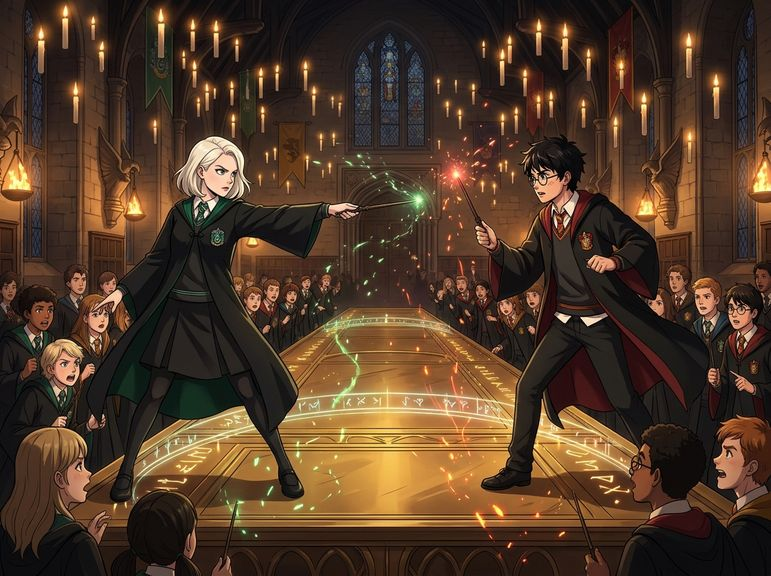

# Chương 19: Năm Hai: Câu Hỏi Trong Phòng Cửa Sổ
**Tên gốc:** *Second Year: The Question*  
**Tác giả:** [Sergio Xalambrí (`sergiodxa`)](https://www.wattpad.com/1662639011-dracaena-malfoy-and-the-boy-who-lived-second-year)  
**Phiên bản:** Bản Viết Cô Đọng (Tóm lược cốt truyện & diễn biến tâm lý)

*Màn đấu tay đôi nảy lửa giữa Dracaena Malfoy và Harry Potter tại Câu lạc bộ Đấu Tay Đôi trước khi con rắn đen xuất hiện.*

> "Cậu là Người Kế Vị của Slytherin phải không? — Cậu biết tôi mà, Potter."

### Câu hỏi làm đóng băng Phòng Cửa Sổ
Sau vụ tấn công Colin Creevey, nỗi sợ hãi bao trùm Hogwarts. Nhận thấy Harry cứ nhìn mình với ánh mắt suy tư kỳ lạ suốt ba ngày liền, chiều hôm đó trong phòng cửa sổ, Dracaena đặt bút xuống và yêu cầu cậu hỏi thẳng điều cậu đang giấu trong lòng. Sau một hồi ngập ngừng trước những nghi ngờ về Lucius Malfoy, Harry nhìn thẳng vào cô và hỏi: *"Cậu có phải là Người Kế Vị của Slytherin không?"*

Căn phòng chìm vào sự im lặng tuyệt đối. Dù chính cô đã bảo cậu hỏi thẳng, câu hỏi ấy vẫn cứa một nhát sắc lẻm vào lòng Dracaena. Cô trả lời *"Không"*, rồi nghẹn ngào nói: *"Cậu biết tôi mà (You know me)."* Chỉ vì một từ tồi tệ cô từng thốt ra với Granger trên sân Quidditch, giờ đây Harry lại nghi ngờ cô có thể đang điều khiển một con quái vật đi sát hại học sinh. Khi cô hỏi ngược lại *"Cậu có tin câu trả lời của tôi không?"*, Harry chần chừ một nhịp quá lâu rồi mới đáp: *"Mình nghĩ là có (I think so)."*

Sự thiếu tin tưởng ấy khiến trái tim Dracaena lạnh giá. Cô thu dọn sách vở bỏ đi, để lại sau lưng năm tuần lễ chiến tranh lạnh: cả hai vẫn lui tới phòng cửa sổ nhưng luôn tránh mặt nhau, người này rời đi thì người kia mới bước vào.

### Câu lạc bộ Đấu Tay Đôi & Xà Ngữ (Parseltongue)
Giữa tháng Mười Hai, Gilderoy Lockhart thành lập Câu lạc bộ Đấu Tay Đôi tại Đại Sảnh Đường. Sau khi Giáo sư Snape hất văng Lockhart ngay ở màn thị phạm đầu tiên khiến cả Dracaena lẫn Harry cùng bật cười, Snape đã gọi tên *"Potter"* và *"Malfoy"* lên sàn đấu. Mọi khúc mắc phức tạp bỗng chốc nhường chỗ cho sự cạnh tranh đơn thuần: Harry tung bùa cù lét *Rictusempra*, Dracaena đáp trả bằng bùa nhảy múa *Tarantallegra*, trước khi nghe theo lời thì thầm của Snape và niệm chú **Serpensortia** biến ra một con rắn đen khổng lồ.

Khi Lockhart làm con rắn nổi điên và lao về phía cậu học sinh nhà Hufflepuff là Justin Finch-Fletchley, Harry đã nhảy xuống chắn trước mặt Justin và phát ra những tiếng rít kỳ lạ để ra lệnh cho con rắn dừng lại. Cả Đại Sảnh Đường chết lặng: Harry Potter là một **Xà Khẩu (Parselmouth)** — năng lực gắn liền với Salazar Slytherin. Trong một khoảnh khắc trớ trêu, vị thế hoàn toàn đảo ngược: nửa trường Hogwarts giờ đây tin rằng chính Harry mới là Người Kế Vị.

### Sự bảo vệ thầm lặng của Dracaena
Ngày hôm sau, Justin Finch-Fletchley và con ma Nick Suýt Mất Đầu được tìm thấy bị hóa đá, và Harry tình cờ lại có mặt ngay tại hiện trường. Trong bữa tối, khi đám nam sinh Slytherin lớn tiếng khẳng định Potter chắc chắn là hung thủ vì biết nói Xà Ngữ, Dracaena đã đập mạnh chiếc cốc xuống bàn, đanh thép phản bác: *"Việc cậu ta có mặt ở đó không phải là bằng chứng, đó là vị trí địa lý! Tôi đang bảo vệ trí thông minh tối thiểu đấy!"* Tối đó, cô viết thư cho cha, thẳng thắn bày tỏ niềm tin rằng Potter vô tội vì cậu thậm chí còn không biết mình có khả năng nói chuyện với rắn cho đến tận hôm qua — dù trong lòng cô vẫn chưa tha thứ cho câu nói *"Mình nghĩ là có"* của cậu.
