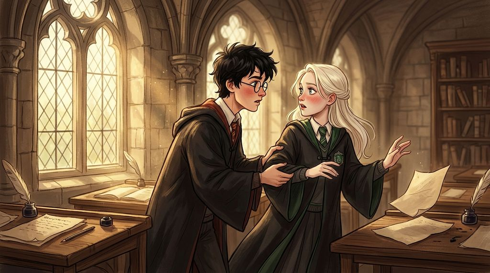

# Chương 22: Năm Hai: Gần Như Bình Thường
**Tên gốc:** *Second Year: Almost Normal*  
**Tác giả:** [Sergio Xalambrí (`sergiodxa`)](https://www.wattpad.com/1662639214-dracaena-malfoy-and-the-boy-who-lived-second-year)  
**Phiên bản:** Bản Viết Cô Đọng (Tóm lược cốt truyện & diễn biến tâm lý)

*Khoảnh khắc Harry đỡ lấy tay Dracaena trên bệ cửa sổ và lời thú nhận 'Thỉnh thoảng' bên hộp Ếch Sô-cô-la.*

> "— Cậu thích mình mà. — Thỉnh thoảng thôi. — Mình cũng vậy."

### Sự thấu hiểu không cần lời giải thích
Sau hai ngày vắng mặt kể từ Lễ Tình Nhân, Harry xuất hiện trở lại trong phòng cửa sổ với vẻ bận tâm kín đáo. Thay vì nổi giận tra hỏi như trước, Dracaena dần nhận ra rằng sự riêng tư không đồng nghĩa với sự phản bội — cũng giống như việc cô không kể cho cậu nghe mọi bức thư của cha mình. Đầu tháng Ba, khi Harry đến phòng với vẻ tức giận trầm ngâm và tiết lộ rằng *"Có thứ gì đó rất quan trọng vừa bị lấy cắp khỏi phòng ngủ của mình"* (cuốn nhật ký của Tom Riddle), Dracaena không gặng hỏi đó là vật gì mà chỉ nhẹ nhàng châm chọc hệ thống an ninh tệ hại của nhà Gryffindor, giúp đôi vai căng thẳng của Harry giãn ra.

Ngay cả sự hiện diện của Hermione cũng trở nên dễ chịu hơn: một buổi sáng, khi thấy bài luận của Harry đầy vết mực đỏ do Hermione sửa giúp, Dracaena đã cầm lấy và chỉ ra thêm ba lỗi nữa mà Granger bỏ sót, cảm thấy vô cùng thỏa mãn vì vừa chứng tỏ được năng lực vừa thắng được Granger.

### Cơn mưa tháng Ba & Lần đầu gọi tên hai chữ "Bạn bè"
Một buổi chiều mưa tầm tã tháng Ba, sau buổi tập Quidditch ướt sũng, hai người ngồi sát bên nhau trên bệ cửa sổ. Harry kể chuyện Dudley từng đâm xe đạp vào bụi rậm hồi nhỏ khiến Dracaena cười đến mức phải đặt sách xuống. Khi tiếng cười lắng xuống, vai Harry tựa nhẹ vào vai cô. Nhìn màn mưa bên ngoài, Dracaena chợt nhận ra mình để ý mọi thói quen nhỏ nhất của cậu: cách cậu cắn đuôi bút lông, cách cậu dụi mắt khi mệt, và cách cậu gọi tên *"Malfoy"* trong căn phòng này hoàn toàn khác với ngoài lớp học. Lần đầu tiên sau gần hai năm, cô thầm thừa nhận trong tâm trí từ mà cô từng ghét bỏ: họ là **Bạn bè** — và cô thực sự thích con người của Harry Potter.

### Đốm xanh trong mắt & Một chữ "Thỉnh thoảng"
Sang tháng Tư, khi Dracaena vô tình khen Hermione "có lẽ cũng có một phẩm chất vớt vát được là tính ngăn nắp", Harry cười lớn và giơ cao mảnh giấy nháp dọa sẽ đi mách Hermione. Trong lúc nhổm người giành lại tờ giấy trên bệ cửa sổ hẹp, Dracaena mất thăng bằng. Harry lập tức chụp lấy cánh tay cô, còn tay cô bám chặt vào vai cậu.

Cả hai đứng khựng lại ở khoảng cách cực kỳ gần. Qua cặp kính trượt nhẹ trên sống mũi Harry, lần đầu tiên Dracaena nhìn thấy những đốm màu xanh lục nhạt li ti trong đôi mắt cậu, và nhịp tim cô đập chệch đi một nhịp đầy bối rối. Khi trả lại tờ giấy, Harry buột miệng nói một cách tự nhiên: *"Cậu thích mình mà (You like me)."* Câu nói ấy khiến Dracaena thức trắng ba tiếng đồng hồ đêm đó dưới ánh đèn xanh của ký túc xá Slytherin.

Cuối tháng Tư, khi Harry mang hai hộp Ếch Sô-cô-la tới phòng cửa sổ và lặp lại câu trêu chọc *"Cậu thích mình mà"*, gương mặt Dracaena thoáng ửng hồng nhưng lần này cô đã có câu trả lời: *"Thỉnh thoảng thôi (Occasionally)."* Nụ cười của Harry dịu lại, cậu nhìn ra ngoài khung cửa sổ ngập nắng chiều và khẽ đáp: *"Mình cũng vậy (Same)."* Hai bờ vai chạm nhẹ vào nhau trong sự bình yên hiếm hoi trước cơn bão lớn.
