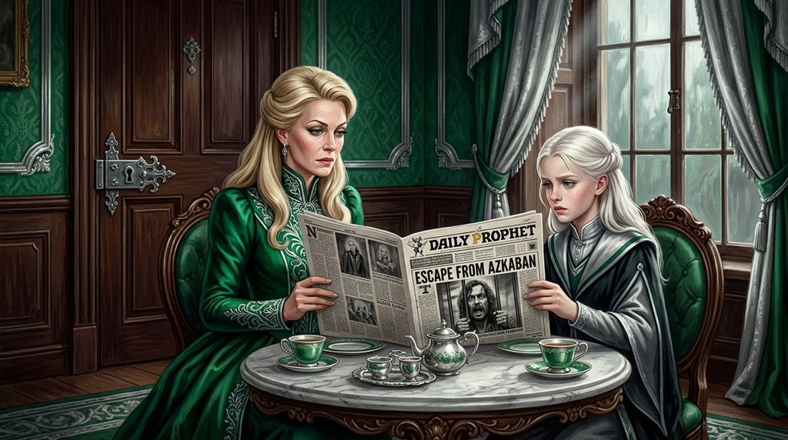

# Chương 25: Năm Ba: Cái Tên Của Người Anh Họ
**Tên gốc:** *Third Year: The Cousin's Name*  
**Tác giả:** [Sergio Xalambrí (`sergiodxa`)](https://www.wattpad.com/story/416871248-dracaena-malfoy-and-the-boy-who-lived)  
**Phiên bản:** Bản Viết Cô Đọng (Tóm lược cốt truyện & diễn biến tâm lý)

*Mùa hè nặng nề tại Thái ấp Malfoy khi tin tức Sirius Black vượt ngục Azkaban làm rúng động giới phù thủy.*

> "Ông ta mang máu nhà Black, Dracaena. Và mục tiêu duy nhất mà ông ta vượt ngục để truy sát chính là Harry Potter."

### Mùa hè lạnh lẽo sau sự cố Phòng Chứa Bí Mật
Mùa hè năm thứ hai tại Thái ấp Malfoy trôi qua trong bầu không khí căng thẳng chưa từng có. Cha cô — Lucius Malfoy — vừa bị phế truất khỏi Hội đồng Quản trị trường Hogwarts sau vụ bê bối cuốn nhật ký của Tom Riddle, đồng thời mất đi con gia tinh Dobby vào tay Harry Potter. Những cánh cửa gỗ sồi trong dinh thự thường xuyên đóng sầm lại, và Dracaena học cách bước đi thật khẽ qua các hành lang đá cẩm thạch.

Khác với mùa hè năm trước, năm nay Dracaena không hề ngóng ra cửa sổ chờ đợi một con cú trắng như tuyết nào cả. Câu nói của cô với mẹ tại sân ga Ngã Tư Vua hồi tháng Sáu — *"Chúng con không còn là bạn nữa, mẹ ạ"* — vẫn nằm nguyên đó, sắc lạnh như một mảnh kính vỡ. Cô tự nhủ rằng mọi thứ đã kết thúc: Harry đã nghi ngờ cô đồng lõa với cha mình, còn cô đã quá mệt mỏi khi phải đứng giữa hai thế giới không thể dung hòa.

### Cái tên Sirius Black trên bàn điểm tâm
Vào tuần cuối cùng của tháng Bảy, tờ *Nhật Báo Tiên Tri* được đặt xuống bàn ăn sáng với dòng tít lớn màu đen chiếm trọn trang nhất: **SIRIUS BLACK VƯỢT NGỤC AZKABAN**. Lần đầu tiên Dracaena thấy sắc mặt điềm tĩnh thường ngày của mẹ mình — phu nhân Narcissa Malfoy — tái nhợt đi.

Khi Lucius rời khỏi phòng ăn để tới Bộ Pháp thuật, Narcissa gọi Dracaena vào phòng trà riêng và khóa cửa lại bằng bùa *Colloportus*. Bà cho cô biết sự thật mà trước đây cô chỉ nghe thoáng qua: Sirius Black chính là anh họ ruột của mẹ cô, con trai cả của gia tộc Black cao quý, kẻ đã phản bội gia đình rồi lại sát hại mười ba người chỉ bằng một lời nguyền. Nhưng điều khiến tim Dracaena thắt lại là lời cảnh báo tiếp theo của mẹ: giới chức Bộ Pháp thuật đều biết Sirius Black vượt ngục chỉ vì một mục đích duy nhất — tìm đến Hogwarts để giết Harry Potter, kẻ đã làm sụp đổ Chúa tể Hắc ám.

### Nỗi lo lắng không dám gọi tên
Đêm hôm đó, Dracaena mở ngăn kéo bàn học được khóa bằng bùa chú riêng, lấy ra xấp thẻ Ếch Sô-cô-la và mảnh giấy da dê cũ kỹ có nét chữ nguệch ngoạc của Harry từ mùa Giáng Sinh năm nhất. Cô vẫn giận cậu vì câu hỏi *"Cậu có biết không?"* trên hành lang ngày hôm ấy, nhưng ý nghĩ về một kẻ sát nhân điên loạn mang dòng máu họ ngoại của mình đang lùng sục Harry khiến cô không sao chợp mắt được. Dù tự hứa sẽ không bao giờ quay lại căn phòng cửa sổ trên tầng ba nữa, Dracaena vẫn lặng lẽ xếp thêm hai hộp Ếch Sô-cô-la vào đáy rương trước ngày lên tàu.
