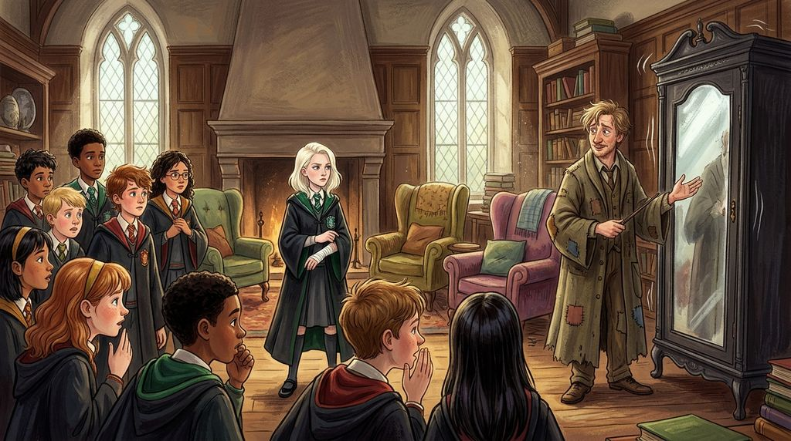

# Chương 28: Năm Ba: Ông Kẹ Trong Tủ Quần Áo
**Tên gốc:** *Third Year: The Boggart in the Wardrobe*  
**Tác giả:** [Sergio Xalambrí (`sergiodxa`)](https://www.wattpad.com/story/416871248-dracaena-malfoy-and-the-boy-who-lived)  
**Phiên bản:** Bản Viết Cô Đọng (Tóm lược cốt truyện & diễn biến tâm lý)

*Cuộc hội ngộ sau bốn tháng xa cách bên bệ cửa sổ đá tầng ba khi hoàng hôn mùa thu buông xuống.*

> "Tôi không bước lên trước tủ quần áo của Lupin không phải vì tôi sợ Ông Kẹ, Potter. Mà vì tôi không muốn cả nhà Slytherin nhìn thấy thứ mà tôi sợ mất nhất."

### Tiết học Phòng chống Nghệ thuật Hắc ám của Giáo sư Lupin
Giáo sư Remus Lupin nhanh chóng trở thành vị giáo sư được yêu thích nhất của hầu hết học sinh năm ba — ngoại trừ phần lớn nhà Slytherin, những người hùa theo lời chê bai về chiếc áo chùng sờn rách của ông. Trong tiết thực hành đối phó với **Ông Kẹ (Boggart)** trong phòng giáo viên, khi chiếc tủ quần áo rung lắc dữ dội, từng học sinh lần lượt bước lên hô câu thần chú *Riddikulus*.

Khi đến lượt Dracaena, cô đột ngột lùi lại phía sau Pansy Parkinson, viện cớ cánh tay bị Bằng mã cào vẫn chưa cử động mạnh được. Giáo sư Lupin nhìn cô bằng ánh mắt điềm đạm, thấu suốt đến kỳ lạ rồi khẽ gật đầu cho qua, tương tự như cách ông đã chủ động nhảy ra chắn trước mặt Harry trong tiết học của nhà Gryffindor vì sợ Ông Kẹ biến thành Chúa tể Voldemort.

### Nỗi sợ không thể để ai nhìn thấy
Chỉ có một mình Dracaena hiểu vì sao cô không dám đứng trước Ông Kẹ trước mặt cả lớp Slytherin. Cô biết rõ nếu cánh cửa tủ kia bật mở, thứ bước ra sẽ không phải là một con nhện khổng lồ hay một xác ướp, mà sẽ là hình ảnh Harry Potter nằm bất động dưới nền đất lạnh lẽo của Khu Rừng Cấm, hoặc gương mặt lạnh lùng của cha cô khi bắt cô phải chọn giữa gia tộc Malfoy và mạng sống của cậu bé có vết sẹo hình tia chớp.

Buổi chiều hôm đó, không thể chịu đựng thêm sự xa cách kéo dài suốt từ tháng Năm, Dracaena rẽ vào hành lang vắng vẻ phía đông tầng ba. Cánh cửa gỗ sồi nặng nề đã khép hờ từ trước.

### Cuộc hội ngộ sau bốn tháng
Khi cô đẩy cửa bước vào, ánh nắng chiều tháng Mười nhuộm vàng lớp bụi lơ lửng trong căn phòng học bỏ trống. Harry đang ngồi ở phía bên trái bệ cửa sổ đá — chỗ ngồi của người đến trước theo Quy tắc số Hai. Trên phiến đá giữa hai chỗ ngồi là vỏ giấy vàng của thanh sô-cô-la mà cô đã đưa cho cậu trên tàu tốc hành Hogwarts, được xếp phẳng phiu bên cạnh một hộp Ếch Sô-cô-la mới nguyên.

Harry ngước lên nhìn cô. Không ai rút đũa phép, cũng không ai quay lưng bỏ đi. *"Cậu đến muộn sáu tuần đấy, Malfoy,"* Harry lên tiếng trước, giọng hơi khàn đi. Dracaena khép cửa lại, bước tới ngồi xuống phía bên phải bệ cửa sổ và đáp: *"Tôi phải đợi đến khi cậu bớt ngốc đi đã, Potter."*
