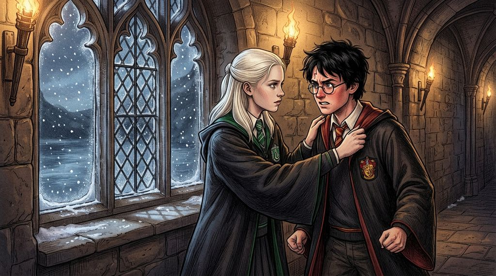

# Chương 31: Năm Ba: Máu Gia Tộc Black
**Tên gốc:** *Third Year: Blood of the Blacks*  
**Tác giả:** [Sergio Xalambrí (`sergiodxa`)](https://www.wattpad.com/story/416871248-dracaena-malfoy-and-the-boy-who-lived)  
**Phiên bản:** Bản Viết Cô Đọng (Tóm lược cốt truyện & diễn biến tâm lý)

*Chiều tuyết rơi trước kỳ nghỉ Giáng Sinh khi Dracaena tiết lộ cho Harry nghe về gia phả nhà Black và cầu xin cậu đừng đi tìm Sirius Black để trả thù.*

> "Gia tộc của mẹ mình đã tạo ra đủ bi kịch rồi, Harry. Đừng để lòng thù hận biến cậu thành một phần trong bi kịch đó."

### Sự thật tại quán Ba Cây Chổi
Chuyến đi thăm làng Hogsmeade cuối cùng trước kỳ nghỉ Giáng Sinh diễn ra dưới lớp tuyết dày trắng xóa. Trong khi Dracaena đi dạo qua các cửa hiệu cùng Pansy và Daphne Greengrass, cô không hề biết rằng Harry đã sử dụng Bản Đồ Đạo Tặc và Tấm Áo Khoác Tàng Hình để lẻn vào làng, rồi vô tình nghe được cuộc trò chuyện giữa bà Rosmerta, Bộ trưởng Fudge và giáo sư McGonagall tại quán Ba Cây Chổi: rằng Sirius Black từng là bạn thân nhất của James Potter, là cha đỡ đầu của Harry, và chính là kẻ đã phản bội cha mẹ cậu.

Chiều tối hôm sau, khi Dracaena bước vào căn phòng cửa sổ tầng ba, cô sững sờ khi thấy Harry đang đứng tựa trán vào mặt kính lạnh buốt, cả người run lên vì một cơn thịnh nộ và đau đớn tột cùng mà cô chưa từng thấy ở cậu bao giờ.

### Cuộc đối thoại về tấm thảm gia phả nhà Black
Dưới Quy tắc số Ba của căn phòng, Harry nghẹn ngào kể cho cô nghe toàn bộ những gì cậu vừa biết được ở Hogsmeade — và ánh mắt cậu tối sầm lại khi tuyên bố rằng nếu Sirius Black xuất hiện trước mặt cậu, cậu sẽ tự tay giết chết hắn.

Dracaena bước tới trước mặt Harry, đặt cả hai bàn tay lên vai áo chùng của cậu để buộc cậu phải nhìn thẳng vào mình. Lần đầu tiên, cô kể cho cậu nghe về **Gia tộc Black** bên ngoại của mình: về tấm thảm thêu gia phả cổ xưa nơi tên của Sirius Black đã bị bà ngoại cô dùng bùa chú đốt cháy thành một vết đen, về người dì ruột Bellatrix Lestrange đang bị giam trong ngục Azkaban vì sự cuồng tín mù quáng, và về việc dòng máu nhà Black luôn mang trong mình một sự cực đoan nguy hiểm.

### Lời cầu xin giữ lấy bản chất của Harry
*"Ông ta là anh họ của mẹ mình, Harry,"* Dracaena nói, giọng run lên nhưng kiên quyết. *"Và ông ta là một kẻ sát nhân đã mất trí sau mười hai năm ở Azkaban. Cha mẹ cậu đã hy sinh mạng sống để cậu được sống tiếp, chứ không phải để cậu lao đầu vào chỗ chết vì muốn trả thù một bóng ma của gia tộc nhà Black."*

Sự chân thành và nỗi sợ mất cậu hiện rõ trong đôi mắt xám của Dracaena khiến cơn giận mù quáng trong lòng Harry dịu lại. Cậu nắm lấy cổ tay cô, khẽ gật đầu hứa sẽ không tự mình đi tìm cái chết, và cả hai cùng ngồi lặng lẽ bên khung cửa sổ nhìn tuyết rơi phủ kín mặt Hồ Đen.
