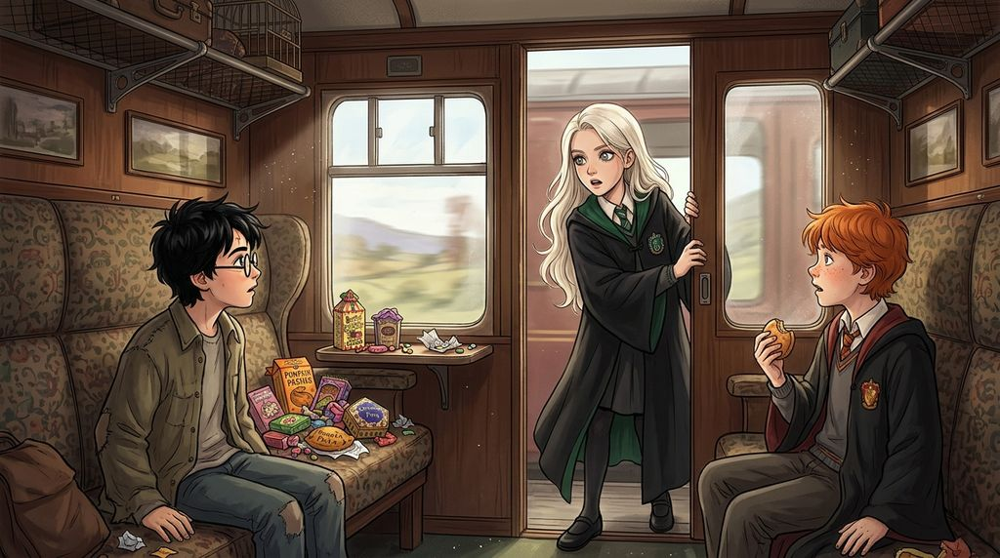

# Chương 02: Năm Nhất: Chuyến Tàu Tốc Hành Hogwarts
**Tên gốc:** *First Year: The Hogwarts Express*  
**Tác giả:** [Sergio Xalambrí (`sergiodxa`)](https://www.wattpad.com/1661198883-dracaena-malfoy-and-the-boy-who-lived-first-year)  
**Phiên bản:** Bản Dịch Chi Tiết (Sát nguyên tác từng phân cảnh & hội thoại)

*Cuộc chạm trán căng thẳng trên hành lang tàu tốc hành Hogwarts khi Dracaena nhận ra cậu bé ở tiệm may chính là Harry Potter.*

> "Nếu cậu muốn dành bảy năm tới bên cạnh những kẻ như thế, Potter, thì cứ tự nhiên."

Dracaena Malfoy đã dành cả tháng vừa qua để không nghĩ về Harry.

Việc này trở nên khó khăn hơn đáng kể bởi thực tế là mẹ cô cứ liên tục nhắc đến cậu. Không phải lúc nào cũng nhắc — như thế thì trẻ con quá. Narcissa Malfoy tinh tế hơn nhiều. Chỉ một lần duy nhất, Dracaena phạm sai lầm thảm khốc khi buột miệng tự hỏi liệu những học sinh lớn lên trong gia đình Muggle có được học lớp phụ đạo nhập môn nào trước khi vào trường hay không. Narcissa đã mỉm cười bên tách trà, và Dracaena đã giận không nói chuyện với mẹ suốt hai mươi bảy phút.

Ngày một tháng Chín, tại Sân ga Chín Ba Phần Tư, Lucius Malfoy đặt tay lên vai con gái bên cạnh đoàn tàu tốc hành Hogwarts đỏ rực, căn dặn cô phải viết thư về nhà hai lần một tuần, giữ điểm số cao hơn tất cả mọi người, tránh xa những thứ nguy hiểm và luôn nhớ mình là một Malfoy. Narcissa ôm chặt lấy cô và thì thầm: "Nhớ viết thư cho mẹ nhé. Đừng chỉ viết cho cha con. Và hãy cố tận hưởng thời gian ở trường."

Khi bước lên tàu, Dracaena nhanh chóng nhập hội cùng những người bạn quen thuộc: Pansy Parkinson, Millicent Bulstrode với một đống kẹo khổng lồ, Daphne Greengrass đang đọc sách bên cửa sổ, cùng Vincent Crabbe và Gregory Goyle. Mọi thứ đều quen thuộc và đúng chuẩn mực — cho đến khi một cậu nam sinh thò đầu vào khoang thông báo tin chấn động:

"Harry Potter đang ở trên tàu đấy. Cậu ta là học sinh năm nhất, đang ngồi chung khoang với em trai của Fred Weasley."

Cả khoang tàu xôn xao bàn tán, riêng Dracaena ngồi im lặng. Một cảm giác bất an kỳ lạ thắt lại trong dạ dày cô.

*Harry.* Cha mẹ đều có phép thuật nhưng đã mất. Được nuôi dưỡng bởi dì dượng Muggle. Không biết gì về Hogwarts hay Quidditch.

"Ồ," Dracaena khẽ thốt lên, rồi lập tức đứng dậy. "Mình cần đi kiểm tra một thứ."

Bất chấp sự ngăn cản của Dracaena, Pansy, Millicent, Crabbe và Goyle đều nhất quyết đi theo. Khi biết Dracaena từng gặp một cậu con trai ở Hẻm Xéo mà quên hỏi họ của người ta, cả đám đều nhìn cô như sinh vật lạ.

Đi dọc theo những tiếng xầm xì trên hành lang, Dracaena dừng lại trước một khoang tàu có cửa hé mở. Bên trong là một cậu bé tóc đỏ ngồi đối diện với cậu bé có mái tóc đen rối bù. Khi cậu bé tóc đen quay đầu lại, mái tóc rẽ ra để lộ vết sẹo hình tia chớp trên trán.

Dracaena quên mất cả cách thở.

Harry nhận ra cô, gương mặt thoáng vẻ ngạc nhiên rồi nở một nụ cười rõ rệt: "Dracaena."

Chưa từng có ai khiến cái tên của chính cô nghe giật mình đến thế.

"Harry," cô lấy lại bình tĩnh đáp lời, rồi nhìn chằm chằm vào trán cậu. "Cậu là Harry Potter."

"Ừ."

"Cậu đã để mặc tôi giảng giải về Hogwarts và Quidditch cho chính Harry Potter!" Mặt Dracaena nóng bừng lên.

"Thì lúc đó mình thực sự cần được giải thích mà," Harry mỉm cười vô tội. "Cô ấy đã giúp mình rất nhiều."

Nhìn thấy Harry ngồi cạnh một đứa nhà Weasley với mái tóc đỏ và bộ áo chùng cũ, Dracaena quyết định mình phải tiếp tục gánh vác trách nhiệm chỉ dẫn cho cậu biết đâu mới là những gia đình quan trọng.

"Cậu nên sang ngồi cùng bọn tôi," Dracaena lên tiếng mời.

Ánh mắt cô chạm phải cậu bé tóc đỏ. Cậu ta thách thức hỏi có vấn đề gì với chiếc áo chùng của mình. Bản năng kiêu ngạo khiến Dracaena nhướng mày đáp trả: "Chẳng có vấn đề gì cả, nếu cậu thích mặc lại đồ mà ba người khác đã mặc trước mình."

Sự thỏa mãn chỉ kéo dài đúng một giây. Harry không còn mỉm cười nữa.

"Tại sao chuyện đó lại quan trọng?" Giọng Harry trầm xuống. "Bạn đang đem bạn ấy ra làm trò cười đấy."

Hành lang đột nhiên trở nên chật chội trước bao ánh mắt hiếu kỳ. Không thể lùi bước trước mặt bạn bè, Dracaena tiếp tục buông lời mỉa mai nhà Weasley chỉ giỏi "nhận diện món đồ rẻ tiền nhất trong phòng".

"Dừng lại đi," Harry nói nhỏ nhưng đanh thép, đồng thời bước dịch lại gần cậu bạn tóc đỏ. Một sự lựa chọn được đo bằng từng phân. "Mình đã có chỗ ngồi rồi. Cùng với bạn ấy."

Gương mặt Dracaena nóng rát. Cô nhận ra mình đã đinh ninh rằng cậu sẽ đồng ý. Cậu đã nhớ cô, đã mỉm cười và gọi tên cô là Dracaena — vậy mà giờ đây cậu lại chọn một đứa nhà Weasley mới quen buổi sáng thay vì cô. Dracaena cầu viện đến lớp phòng vệ lâu đời nhất của mình: sự kiêu ngạo.

"Nếu cậu muốn dành bảy năm tới bên cạnh những kẻ như thế, Potter, thì cứ tự nhiên."

Cái tên bật ra thật tự nhiên. *Potter.* Không còn là *Harry* nữa.

Trở về khoang tàu trong sự im lặng nặng nề, khi Millicent hỏi liệu Potter có vào Slytherin không, Dracaena nhìn ra ngoài cửa sổ đáp ngắn gọn: "Không. Potter sẽ vào Gryffindor. Bởi vì cậu ta thà chứng tỏ quan điểm còn hơn đưa ra lựa chọn khôn ngoan."

Khi đoàn tàu dừng lại ở ga Hogsmeade và tòa lâu đài Hogwarts hiện ra rực rỡ bên kia Hồ Đen, ánh mắt họ chạm nhau giữa đám đông. Dracaena kiên quyết tự nhủ cô sẽ không để cậu làm hỏng Hogwarts của mình. Nếu Potter đã muốn một cuộc đối đầu, cô sẽ cho cậu ta một cuộc đối đầu.
