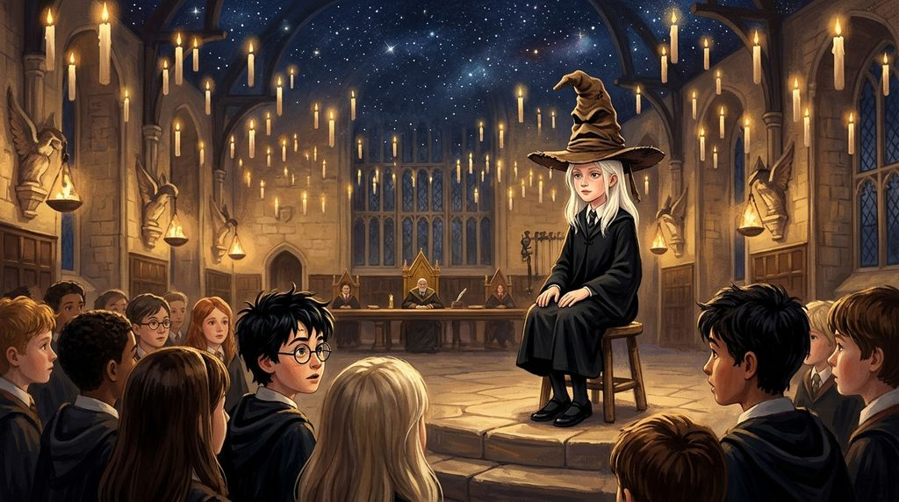

# Chương 03: Năm Nhất: Nhà Slytherin
**Tên gốc:** *First Year: Slytherin*  
**Tác giả:** [Sergio Xalambrí (`sergiodxa`)](https://www.wattpad.com/1661199019-dracaena-malfoy-and-the-boy-who-lived-first-year)  
**Phiên bản:** Bản Dịch Chi Tiết (Sát nguyên tác từng phân cảnh & hội thoại)

*Lễ Phân Loại dưới bầu trời sao nhân tạo của Đại Sảnh Đường và lời phán xét của Chiếc Nón Phân Loại.*

> "Chính xác là người mà con được kỳ vọng phải trở thành... nhưng hãy cẩn thận với điều đó."

Hồ Đen lạnh và phẳng lặng như một tấm gương đen khổng lồ.

Dracaena ngồi trên chiếc thuyền gỗ đầu tiên cùng Pansy, Daphne và Theodore Nott. Ánh đèn lồng từ con thuyền của lão Hagrid phía trước hắt những vệt vàng dài trên mặt nước. Khi tòa lâu đài Hogwarts hiện ra sừng sững trên vách đá với hàng trăm ô cửa sổ rực sáng giữa bầu trời đêm, ngay cả những học sinh vốn lớn lên cùng những câu chuyện về Hogwarts cũng đồng loạt im bặt.

Giáo sư McGonagall đón các học sinh năm nhất tại sảnh đá cẩm thạch rộng lớn. Bà có gương mặt nghiêm nghị, búi tóc chặt và ánh mắt như thể đã nhìn thấu toàn bộ những trò nghịch ngợm mà bọn trẻ dự định thực hiện trong bảy năm tới.

Trong lúc chờ đợi ở phòng phụ, ánh mắt Dracaena vô thức lướt qua đám đông. Harry Potter đang đứng cạnh cậu bé nhà Weasley ở phía bên kia phòng. Cậu có vẻ đang lo lắng, bàn tay khẽ vuốt lại mái tóc đen vốn chẳng bao giờ chịu nằm yên. Cô không bước tới. Cô đã nói hết những gì cần nói trên tàu tốc hành.

Cánh cửa lớn mở ra, dẫn họ vào Đại Sảnh Đường.

Bốn chiếc bàn dài chật kín học sinh trong áo chùng đen. Hàng ngàn ngọn nến lơ lửng giữa không trung, và phía trên cao là trần nhà được phù phép giống hệt bầu trời đêm đầy sao ngoài kia.

"Trần nhà không có thật đâu," một cô bé tóc nâu xù đứng gần đó thì thầm rất nhanh với ai đó. "Nó chỉ được yểm bùa để trông giống bầu trời ngoài trời thôi, mình đã đọc trong cuốn *Lịch sử Hogwarts*."

Dracaena liếc nhìn cô bé đó. Chắc chắn là một học sinh thông thái thích thể hiện.

Giáo sư McGonagall đặt một chiếc ghế đẩu bốn chân và một chiếc nón phù thủy cũ kỹ, vá chằng vá chịt lên trước mặt toàn trường. Đúng như lời Dracaena đã nói ở tiệm Madam Malkin, vành nón rách toạc ra và bắt đầu hát. Dracaena liếc nhìn sang phía Harry. Mắt cậu mở to hết cỡ, gương mặt pha trộn giữa kinh ngạc và nhẹ nhõm — có lẽ vì cậu nhận ra cô đã không bịa chuyện về chiếc nón biết nói.

Cuộn giấy da được mở ra.

"Granger, Hermione!"

Cô bé tóc nâu xù chạy gần như lao tới chiếc ghế. Chiếc nón suy nghĩ một lát rồi hô lớn: **"GRYFFINDOR!"**

Dracaena khoanh tay. Hoàn toàn phù hợp.

Những cái tên tiếp theo lần lượt được gọi. Millicent Bulstrode vào Slytherin. Vincent Crabbe và Gregory Goyle vào Slytherin. Daphne Greengrass vào Slytherin.

"Malfoy, Dracaena!"

Dracaena bước lên phía trước. Lưng cô thẳng tắp. Cằm hơi nâng nhẹ. Cô biết cha mẹ mình đã đứng ở chính vị trí này hàng chục năm trước. Cô cũng biết cả phòng ăn đang nhìn theo mái tóc bạch kim đặc trưng của gia tộc cô.

Cô ngồi xuống ghế. Giáo sư McGonagall đặt chiếc nón lên đầu cô.

Vành nón hơi rộng, sụp xuống che khuất tầm mắt. Ngay lập tức, một giọng nói nhỏ nhẹ, khô khốc vang lên trong tâm trí cô:

*Chà, một người nhà Malfoy nữa. Đã lâu rồi đấy.*

Dracaena ngồi im.

*Thông minh. Rất thông minh,* chiếc nón thì thầm. *Lòng kiêu hãnh không thiếu. Tham vọng cũng rất rõ ràng. Con biết chính xác mình là ai, phải không? Hoặc ít nhất... con biết rất rõ mình được kỳ vọng phải trở thành ai.*

Dracaena khẽ nhíu mày dưới vành nón. *Tôi là một Malfoy. Tôi thuộc về Slytherin.*

*Đúng vậy, Slytherin sẽ giúp con đạt được những điều con muốn,* giọng nói tiếp tục, trầm ngâm hơn một chút. *Nhưng có một sự tò mò rất thú vị ở đây. Một chút bướng bỉnh không chịu chấp nhận những câu trả lời có sẵn. Một Malfoy hoàn hảo... chính xác là người mà con được kỳ vọng phải trở thành. Nhưng hãy cẩn thận với điều đó, cô bé.*

Trước khi Dracaena kịp hỏi xem câu nói đó có ý nghĩa gì, chiếc nón đã hô vang khắp Đại Sảnh Đường:

**"SLYTHERIN!"**

Tiếng vỗ tay rào rào vang lên từ dãy bàn phía bên trái. Dracaena tháo chiếc nón ra, bước xuống với nụ cười tự chủ và ngồi vào chỗ cạnh Pansy vừa được phân loại ngay sau đó. Thế nhưng, câu nói *"Chính xác là người mà con được kỳ vọng phải trở thành"* vẫn vương lại một cảm giác kỳ lạ trong lòng cô.

Rồi cả Đại Sảnh Đường bỗng rộ lên những tiếng xì xầm như tiếng ong vỡ tổ.

"Potter, Harry!"

Dracaena ngẩng đầu lên ngay lập tức.

Harry bước lên chiếc ghế đẩu. Dưới ánh nến rực rỡ, cậu trông càng nhỏ bé hơn trong chiếc áo chùng mới. Chiếc nón sụp xuống đầu cậu.

Một giây trôi qua. Năm giây. Mười giây. Ba mươi giây.

Chiếc nón vẫn im lặng. Dracaena nhìn thấy những ngón tay của Harry bấu chặt vào mép ghế gỗ, môi cậu khẽ mấp máy như đang tranh luận điều gì đó với giọng nói bên trong đầu.

Rồi chiếc nón hét vang:

**"GRYFFINDOR!"**

Dãy bàn phía xa nổ tung trong tiếng hò reo vang dội nhất từ đầu buổi lễ. Hai anh em sinh đôi tóc đỏ nhà Weasley thậm chí còn đứng bật dậy gào lên: *"Chúng ta có Potter rồi! Chúng ta có Potter rồi!"*

Harry bước về phía bàn tiệc màu đỏ và vàng, nụ cười nhẹ nhõm hiện rõ trên gương mặt. Trước khi ngồi xuống cạnh cậu bạn tóc đỏ, cậu thoáng nhìn sang phía bàn Slytherin. Ánh mắt cậu chạm phải ánh mắt xám lạnh của Dracaena.

Không ai mỉm cười.

Đêm đó, dưới hầm ngục sâu dưới đáy Hồ Đen, ánh sáng xanh lục huyền ảo của làn nước chiếu qua những khung cửa sổ tròn bằng đá. Nằm trong chiếc giường bốn cọc treo rèm lụa xanh thẫm, lắng nghe tiếng nước vỗ nhẹ bên ngoài bức tường đá cổ kính, Dracaena tự nhủ rằng mọi thứ đã được sắp đặt đúng chỗ. Cô là người của Slytherin. Potter là người của Gryffindor. Sẽ không còn những cuộc trò chuyện vô nghĩa như ở tiệm may nữa.
