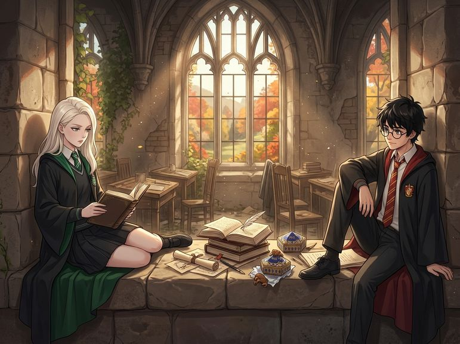

# Chương 05: Năm Nhất: Khung Cửa Sổ Bí Mật
**Tên gốc:** *First Year: The Window*  
**Tác giả:** [Sergio Xalambrí (`sergiodxa`)](https://www.wattpad.com/1661199172-dracaena-malfoy-and-the-boy-who-lived-first-year)  
**Phiên bản:** Bản Dịch Chi Tiết (Sát nguyên tác từng phân cảnh & hội thoại)

*Căn phòng học bỏ trống trên tầng ba với bệ cửa sổ bằng đá rộng — nơi trú ẩn bí mật của Dracaena và Harry.*

> "Tôi tìm thấy phòng này trước cậu bốn phút đấy, Potter."

Đến tuần thứ ba của tháng Chín, Dracaena Malfoy kết luận rằng nhược điểm lớn nhất của Hogwarts là có quá nhiều người.

Ở Thái ấp Malfoy, nếu cô muốn yên tĩnh, cô có cả một thư viện riêng, ba phòng khách nhỏ và khu vườn rộng mênh mông. Ở Hogwarts, phòng sinh hoạt chung Slytherin luôn có người ngồi tán gẫu, thư viện thì quá gần chỗ Hermione Granger hay lui tới, còn phòng ngủ thì Pansy có thể nói liên tục bốn mươi phút về một chiếc kẹp tóc.

Chiều thứ Ba hôm đó, sau tiết Thảo Dược học mệt nhoài, Dracaena rẽ vào một hành lang nhỏ trên tầng ba ít người qua lại, bước lên cầu thang đá hẹp và thử mở cánh cửa gỗ thứ ba.

Đó là một phòng học cũ đã bỏ không từ lâu. Bàn ghế gỗ xếp gọn về một góc, bụi phủ mờ trên tấm bảng đen, nhưng phía cuối phòng là một khung cửa sổ vòm cao vút với bệ đá rộng thênh thang. Ánh nắng chiều thu vàng rực chiếu xuyên qua lớp kính, hắt xuống mặt đá ấm áp và mở ra tầm nhìn tuyệt đẹp hướng thẳng ra mặt Hồ Đen cùng bìa Rừng Cấm.

Dracaena mỉm cười hài lòng. Cô bước tới, phủi nhẹ bệ đá phía bên trái — chỗ có nắng nhiều nhất và có cột đá phẳng phiu để tựa lưng — rồi ngồi xuống, bày sách vở và lọ mực ra.

Cô tận hưởng sự yên tĩnh tuyệt đối đó được đúng bốn phút.

Rồi cánh cửa gỗ kẽo kẹt mở ra.

Harry Potter bước vào, tay ôm cặp sách, đầu cúi xuống như đang cố trốn tránh một đám học sinh năm hai vừa đi ngang qua hành lang ngoài kia để săm soi vết sẹo của cậu.

Cậu đóng cửa lại, thở phào một hơi, rồi ngẩng lên.

Cả hai đông cứng tại chỗ.

"Malfoy," Harry lên tiếng trước, giọng đầy cảnh giác.

"Potter." Dracaena giữ nguyên tư thế trên bệ cửa sổ. "Phòng này có người dùng rồi."

"Cả căn phòng rộng thế này cơ mà."

"Và tôi đang dùng nó."

Harry nhìn quanh những chiếc bàn trống, rồi nhìn về phía bệ cửa sổ rộng mênh mông nơi cô chỉ mới chiếm chưa đầy một phần tư diện tích. "Bạn không sở hữu cả căn phòng này."

"Tôi tìm thấy nó trước."

"Trước bao lâu?"

"Bốn phút."

Harry chớp mắt. "Bốn phút thì không tính là quyền sở hữu hợp pháp được."

"Ở Slytherin thì có đấy. Đi tìm chỗ khác mà trốn người hâm mộ của cậu đi."

"Mình không trốn ai cả," Harry đỏ mặt, nhưng thay vì quay lưng bỏ đi như cô nghĩ, cậu lại bước thẳng tới đầu bên phải của bệ cửa sổ đá, đặt cặp sách xuống và trèo lên ngồi.

Dracaena nhìn cậu chằm chằm. "Cậu đang làm cái gì thế?"

"Làm bài tập Độc Dược," Harry đáp tỉnh bơ, lôi cuộn giấy da nhàu nhĩ ra khỏi cặp. "Nếu mình ngồi ở phòng sinh hoạt chung, Ron sẽ rủ chơi cờ phù thủy, còn ở thư viện thì mọi người cứ nhìn chằm chằm."

Dracaena định buông một câu mỉa mai sắc lẻm để đuổi cậu đi. Nhưng khi nhìn thấy gương mặt hơi mệt mỏi của cậu — không có cậu bạn nhà Weasley ồn ào bên cạnh, cũng không có đám đông vây quanh *Cậu Bé Sống Sót* — cô bỗng nhớ lại cậu bé ngơ ngác trên chiếc ghế đẩu ở tiệm Madam Malkin.

"Nếu cậu gây tiếng ồn, tôi sẽ ném cậu qua cửa sổ đấy," cô lạnh lùng tuyên bố, rồi quay lại với cuốn sách của mình.

"Đồng ý."

Suốt mười lăm phút tiếp theo, căn phòng chỉ có tiếng ngòi bút lông sột soạt trên giấy da. Rồi Harry thở dài một tiếng rõ to, gạch xóa mạnh tay lên tờ giấy.

"Sao cậu có thể thở dài ồn ào đến thế hả?" Dracaena đặt bút xuống.

"Thầy Snape yêu cầu viết mười hai phân giấy da về tác dụng của lá bạc hà trong thuốc giải độc cơ bản, nhưng trong sách chỉ có đúng một đoạn ngắn."

Dracaena đảo mắt, nghiêng người nhìn sang tờ giấy của cậu. "Đó là vì cậu đang tra ở chương nguyên liệu thô chứ không phải chương tương tác nhiệt độ. Nếu cậu đun lá bạc hà trước khi cho rễ cây vào, nó sẽ làm bay hơi độc tính thay vì trung hòa nó."

Harry ngẩng lên nhìn cô, đôi mắt xanh ánh lên vẻ ngạc nhiên. "Sao bạn biết?"

"Bởi vì tôi thực sự đọc sách trước khi mở vạc nấu, Potter." Cô kéo cuốn sách giáo khoa của cậu lại gần, lật nhanh đến trang cần tìm rồi đẩy trả lại. "Trang một trăm linh bốn. Đọc đi để khỏi làm nổ tung phòng học vào thứ Sáu tới."

Harry nhìn trang sách, rồi khẽ mỉm cười: "Cảm ơn nhé."

Dracaena quay mặt đi, giả vờ chăm chú vào bài luận Bùa Chú của mình. "Tôi chỉ không muốn ngồi cùng phòng với một cái vạc phát nổ thôi."

Họ ngồi đó cho đến khi ánh nắng trên bệ đá chuyển sang màu cam sẫm của buổi chiều tà. Không ai nhắc đến chuyến tàu tốc hành. Không ai nhắc đến Ron Weasley hay Quả cầu Nhớ. Khi chuẩn bị thu dọn sách vở, Harry lấy từ trong túi áo ra một hộp Ếch Sô-cô-la hơi bẹp, bóc lớp giấy gói và rút tấm thẻ ngũ giác bên trong ra xem.

"Lại là Agrippa," Harry lẩm bẩm.

Dracaena khựng lại. "Agrippa á? Tôi tìm tấm đó suốt hai năm nay mà toàn bốc trúng Morgana."

Harry nhìn tấm thẻ trên tay, rồi nhìn cô. Thay vì cất vào túi, cậu bước tới chiếc bàn giáo viên cũ kỹ ở góc phòng, kéo ngăn kéo ra và đặt tấm thẻ Agrippa vào bên trong.

"Để ở đây đi," Harry nói, giọng nhẹ tênh khi khoác cặp lên vai. "Ai tìm thấy phòng này trước vào ngày mai thì được quyền giữ nó."

Cánh cửa đóng lại sau lưng cậu. Dracaena nhìn theo chiếc ngăn kéo bàn một lúc lâu, rồi bất giác mỉm cười một mình giữa căn phòng ngập ánh hoàng hôn.
