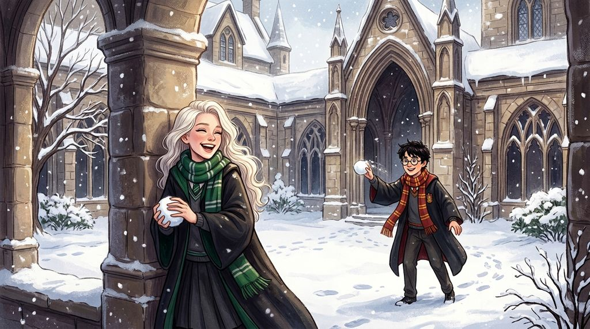

# Chương 08: Năm Nhất: Mùa Giáng Sinh
**Tên gốc:** *First Year: Christmas*  
**Tác giả:** [Sergio Xalambrí (`sergiodxa`)](https://www.wattpad.com/1661246563-dracaena-malfoy-and-the-boy-who-lived-first-year)  
**Phiên bản:** Bản Dịch Chi Tiết (Sát nguyên tác từng phân cảnh & hội thoại)

*Trận ném bóng tuyết hỗn loạn ngoài sân trường và những bức thư cú trao gửi dịp Giáng Sinh.*

> "Con công nhà cậu vẫn chẳng làm được tích sự gì cả. — Potter."

Tuyết đầu mùa rơi xuống vào tháng Mười Hai.

Dracaena tỉnh giấc khi Pansy kéo toạc tấm rèm nhung xanh quanh giường cô lúc bảy giờ sáng và lôi xềnh xệch cô từ phòng sinh hoạt chung dưới đáy hồ lên sảnh chính. Toàn bộ khuôn viên Hogwarts đã biến mất dưới lớp tuyết trắng xóa dày cộp.

Mặc dù ban đầu nhất quyết từ chối bước ra ngoài vì không muốn làm hỏng chiếc áo khoác lông dê cashmere đắt tiền, chỉ cần hai anh em sinh đôi Fred và George Weasley ném hai quả bóng tuyết đập vào khung cửa đá ngay sát vai cô, đôi mắt Dracaena lập tức nheo lại.

Hai mươi phút sau, chiếc áo khoác của cô đã hoàn toàn ướt sũng. Tuyết vương trên mái tóc bạch kim, lọt vào trong găng tay và ủng. Cô nấp sau bức tường đá thấp cùng Pansy, nhắm thẳng vào một cái đầu tóc đỏ của nhà Weasley rồi ném mạnh — nhưng lại ném trượt hoàn toàn và đập trúng ngay giữa ngực Harry Potter.

Trong một giây im lặng, Harry nhìn vệt tuyết nổ tung trên áo chùng của mình rồi ngẩng lên nhìn cô.

"Quả đó," Dracaena bình thản tuyên bố, "là nhắm vào Weasley."

Harry cúi xuống vo một nắm tuyết lớn. Dracaena lập tức hụp đầu xuống né, khiến quả bóng tuyết bay thẳng vào giữa mặt Pansy Parkinson. Tiếng hét của Pansy cùng tiếng cười không sao kìm nén nổi của Dracaena và Harry đã châm ngòi cho một cuộc đại chiến bóng tuyết kéo dài suốt nửa tiếng đồng hồ — nơi lòng trung thành với Nhà hay vẻ đoan trang quý tộc đều bị quẳng ra sau đầu, cho đến khi Hermione Granger xuất hiện ở cửa lớn nhắc tất cả sắp muộn giờ ăn sáng.

Hai ngày trước khi kỳ nghỉ lễ bắt đầu, trong phòng cửa sổ, Dracaena báo tin mẹ cô đã viết thư yêu cầu cô về nhà nghỉ Giáng Sinh. Cô chợt nhận ra giọng điệu khác lạ của Harry khi cậu bảo mình sẽ ở lại trường.

"Cậu thích ở lại trường hơn về nhà Dursley à?"

"Hiển nhiên rồi (*Obviously*)," Harry mỉm cười.

Khi Dracaena hào hứng kể về truyền thống Giáng Sinh ở Thái ấp Malfoy — tiệc tối đêm Giáng Sinh, mở quà trước bữa sáng, và nhiều quà đến mức cô chưa bao giờ đếm xuể — Harry bật cười trêu chọc: "Cuộc sống của bạn thật lố bịch. Nhà bạn nuôi mấy con chim cảnh chỉ có mỗi việc đi bộ làm dáng, và nhận nhiều quà đến mức không đếm nổi."

Thay vì ném đồ vào người cậu, Dracaena buột miệng đáp trả: "Cậu từng sống trong một cái tủ dưới gầm cầu thang. Tôi không nghĩ cậu đủ tư cách để xác định thế nào là một tuổi thơ bình thường đâu."

Câu nói vừa thốt ra đã rơi xuống nặng nề. Nụ cười của Harry biến mất ngay lập tức.

Dạ dày Dracaena thắt lại. Cô nhắm mắt một giây, tự rủa sự vô tâm của mình, rồi mở mắt nhìn thẳng vào cậu: "Potter. Tôi không nên nói câu đó."

Harry ngạc nhiên nhìn cô: "Bạn lại xin lỗi mình kìa."

"Cậu có muốn tôi rút lại lời xin lỗi không?"

"Không."

"Vậy thì đừng có làm vẻ mặt thích thú đó nữa."

Khi cô hỏi cậu muốn quà gì cho Giáng Sinh, Harry nhìn ra ngoài cửa sổ phủ tuyết và đáp nhỏ: "Mình không biết. Chẳng có ai từng hỏi mình câu đó cả." Một tấm ván sàn mục nữa lại lộ ra, và Dracaena khéo léo chuyển chủ đề sang những cây chổi đua để bầu không khí ấm áp trở lại.

Sáng thứ Bảy, giữa sảnh chính ngập tràn rương hòm và tiếng chim cú kêu, trước khi bước ra xe ngựa đi Hogsmeade, Dracaena chủ động rẽ sang chỗ Harry đang đứng tay không cạnh Ron và Hermione.

"Potter. Cố mà đừng để bị giết trong lúc tôi đi vắng đấy. Tôi từ chối quay lại trường và phát hiện Gryffindor đã thay thế cậu bằng một người có năng lực thực sự."

Harry bật cười: "Chúc Giáng Sinh vui vẻ nhé."

"Hiển nhiên rồi," cô đáp, rồi thở dài nói thêm: "Cậu cũng vậy."

Trở về Thái ấp Malfoy, Dracaena được mẹ Narcissa ôm chặt và được cha Lucius tặng sớm một món quà đặc biệt trong phòng khách: một đôi găng tay Quidditch chuyên nghiệp bằng da đen khâu chỉ bạc, khắc chữ cái **D.M.** ở cổ tay, được ông đặt làm riêng từ tháng Mười vì biết rõ cô con gái của mình kiểu gì cũng sẽ thi vào đội tuyển năm sau. Trong bữa tối kéo dài hai tiếng đồng hồ, khi Narcissa và Lucius hợp sức trêu chọc việc cô nhắc đến cái tên "Potter" quá thường xuyên trong các bức thư gửi về nhà, Dracaena đỏ mặt tuyên bố cả cha lẫn mẹ đều cần kiếm thêm sở thích mới.

Sáng ngày lễ Giáng Sinh, ngồi giữa phòng khách ngập giấy gói quà bên cạnh mô hình sân Quidditch thu nhỏ và chiếc dây chuyền bạc, tâm trí Dracaena vẫn không ngừng tự hỏi liệu Harry có nhận được món quà nào ở Hogwarts không. Đến ba giờ chiều, cô ngồi vào bàn viết một bức thư ngắn cho cậu dưới cái cớ thông báo thông tin về Quidditch:

*Potter,*
*Cha tôi xác nhận có đúng bảy trăm lỗi phạt được ghi nhận trong lịch sử Quidditch, vậy nên thật đáng tiếc là cậu đã đúng. Ông ấy cũng nói hầu hết các lỗi đó đã bị cấm từ quá lâu đến mức chẳng cầu thủ tỉnh táo nào thèm nhớ. Do đó, cậu vẫn là một kẻ không thể chịu nổi.*
*Malfoy.*

Khi Narcissa bước vào phòng và bắt gặp con gái đang giấu mảnh giấy da dưới cuốn sách, bà mỉm cười dịu dàng. Nghe con gái rụt rè hỏi: *"Cha có để tâm nếu con viết thư cho Harry Potter không?"*, Narcissa đặt tay lên mái tóc bạch kim của cô: "Cha con rất yêu con. Ông ấy kỳ vọng nhiều điều ở con vì cái tên của gia tộc. Và một ngày nào đó, con sẽ phải tự mình quyết định kỳ vọng nào thuộc về con, và kỳ vọng nào thuộc về ông ấy. Nhưng điều đó không có nghĩa là con phải giấu giếm mọi người bạn mà cha con có thể không tán thành. Hãy gửi bức thư đi, con yêu."

Ngày hai mươi tám tháng Mười Hai, chim cú mang thư hồi âm của Harry về ngay giữa bữa ăn sáng của gia đình Malfoy:

*Malfoy,*
*Anh Wood nói việc biết đủ bảy trăm lỗi phạt giúp mình trở thành cầu thủ giỏi hơn. Mình đã bảo anh ấy rằng bạn nói chẳng cầu thủ tỉnh táo nào thèm biết chúng, và anh ấy muốn hỏi xem bạn đang đầu quân cho đội chuyên nghiệp nào đấy.*
*Giáng Sinh ở đây rất tuyệt. Mình đã nhận được quà. Weasley— [gạch xóa] Quy tắc số ba. Có người tặng mình kẹo, có người tặng mình áo len đan tay, và mình còn nhận được một thứ từ một người mà mình hoàn toàn không ngờ tới. Mình không nói cho bạn biết là thứ gì đâu, bạn sẽ hỏi quá nhiều câu hỏi mất.*
*Đàn công nhà bạn vẫn chẳng làm được tích sự gì cả.*
*Potter.*

Dracaena bật cười thành tiếng, nói dối cha đó là thư của Pansy trước cái ho khẽ đầy ẩn ý của mẹ, rồi cẩn thận giữ lá thư trong túi áo. Ngay đêm đầu tiên trở lại Hogwarts vào tháng Giêng, cô đi thẳng lên phòng cửa sổ — nơi Harry đã ngồi sẵn ở phía bên trái và lập tức nhường chỗ cho cô. Dưới ánh hoàng hôn nhuộm vàng mặt hồ đóng băng, căn phòng cửa sổ lại thuộc về hai người họ.
