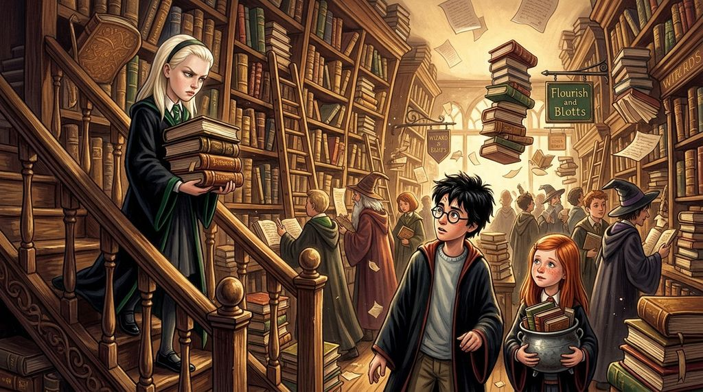

# Chương 14: Năm Hai: Hẻm Knockturn & Cuộc Đụng Độ Ở Tiệm Sách
**Tên gốc:** *Second Year: Knockturn Alley*  
**Tác giả:** [Sergio Xalambrí (`sergiodxa`)](https://www.wattpad.com/1661817258-dracaena-malfoy-and-the-boy-who-lived-second-year)  
**Phiên bản:** Bản Dịch Chi Tiết (Sát nguyên tác từng phân cảnh & hội thoại)

*Chuyến đi tới tiệm Borgin và Burkes ở Hẻm Knockturn và vụ ẩu đả hỗn loạn tại tiệm sách Phú Quý và Cơ Hàn.*

> "Bạn gái của cậu đang tìm cậu kìa, Potter."

Hẻm Knockturn có một mùi rất kỳ quặc — sự pha trộn giữa bụi bặm, đá ẩm, nguyên liệu độc dược cũ và một thứ gì đó cháy khét.

Dracaena đi sát bên cạnh cha mình, vừa vì đã hứa với mẹ Narcissa, vừa vì những món đồ trưng bày trong các khung cửa sổ xung quanh trông như có thể tự cử động bất cứ lúc nào. Chiếc cặp da nhỏ vẫn nằm chặt trong tay ông Lucius. Họ dừng lại trước cửa tiệm *Borgin và Burkes*.

Khi bước vào trong ánh sáng u tối của cửa tiệm, lão Borgin đon đả cúi chào hai cha con rồi dẫn họ về phía quầy hàng phía sau. Ông Lucius đặt chiếc cặp da lên quầy, mở khóa để lộ lớp vải đen và góc của một vật bằng bạc.

"Gần đây Bộ Pháp thuật trở nên nhiệt tình thái quá với các cuộc lục soát," giọng Lucius lạnh lùng khi nhắc tới cái tên Arthur Weasley. "Tôi muốn một số vật phẩm nhất định không có mặt tại Thái ấp nếu Bộ quyết định đến kiểm tra."

Trong lúc cha cô và lão Borgin thương lượng giá cả, Dracaena bước dịch ra bốn bước chân, tò mò ngắm nhìn chiếc đệm nhung đặt một bàn tay khô quắt đi kèm tấm biển **BÀN TAY VINH QUANG** (*Hand of Glory*). Trong một thoáng chốc, cô ngỡ như có một vạt vải vừa cử động phía sau chiếc tủ gỗ đen đồ sộ gần đó — hoàn toàn không hề biết rằng Harry Potter vừa đi lạc ống khói bột Floo và đang nấp ngay bên trong chiếc tủ ấy.

Rời khỏi Hẻm Knockturn u ám để bước ra Hẻm Xéo ngập tràn ánh nắng, Dracaena hỏi cha liệu những món đồ vừa bán có phải là thứ ông giấu giếm suốt mùa hè qua không. Ông Lucius trả lời *"Không"* không chút do dự — một sự thành thật khiến cô càng thêm bất an.

Gặp lại Pansy và tiến về phía tiệm sách *Phú Quý và Cơ Hàn*, cả nhóm phải đối mặt với một đám đông hỗn loạn đang xếp hàng chờ Gilderoy Lockhart ký tặng cuốn tự truyện *Tôi Phép Thuật*. Giữa tiếng ồn ào, ánh mắt Dracaena bắt gặp mái tóc đỏ rực của gia đình Weasley — và ngay cạnh họ là **Harry Potter**.

Cậu vẫn còn sống, bình an vô sự và đang mỉm cười trước câu pha trò của hai anh em sinh đôi. Cảm giác đầu tiên của Dracaena là sự nhẹ nhõm; cảm giác thứ hai là cơn giận dữ vì mình lại đi nhẹ nhõm; và cảm giác thứ ba là sự bực bội đã được cô nuôi dưỡng suốt sáu tuần không có lấy một lá thư.

Sau khi bị gã nhiếp ảnh gia và Lockhart lôi lên chụp ảnh tặng sách miễn phí trong bộ dạng khổ sở như muốn chết đi được, Harry thoát ra và đặt toàn bộ chồng sách tặng vào chiếc vạc cũ của cô em gái út nhà Weasley — Ginny. Gương mặt cô bé lập tức đỏ bừng từ cổ lên tận chân tóc. Một cảm giác nhói lên đầy khó chịu xuất hiện dưới xương sườn của Dracaena.

Khi Harry nhìn thấy Dracaena và bước lại gần chào cô, cậu lập tức nhận ra giọng điệu lạnh nhạt của cô: "Bạn đang bực mình với mình à? Mình đã làm gì sai sao?"

*Chẳng làm gì cả.* Đó chính là vấn đề.

Đúng lúc đó, cô bé Ginny Weasley ôm chồng sách bước tới, mặt vẫn đỏ lựng và nhìn Potter như thể cậu là người phát minh ra ánh sáng mặt trời. Miệng của Dracaena lập tức hoạt động nhanh hơn não bộ:

"Bạn gái của cậu đang tìm cậu kìa."

Sự im lặng bao trùm. Harry chớp mắt, còn mặt Ginny thì đỏ rực như sắp bốc cháy. Dracaena lập tức hối hận vì câu nói trẻ con của mình, nhưng khi nghe Harry vội vàng đáp: *"Em ấy không phải bạn gái mình"* — một sự nhẹ nhõm ấm áp, nhanh chóng và hoàn toàn không thể chấp nhận được bỗng lan tỏa khắp lồng ngực cô. Trước khi bị bà Weasley gọi đi, Harry nhìn cô và nói ngắn gọn: *"Gặp sau nhé? (Later?)"*

"Nếu cậu gặp may," Dracaena khẽ nhún vai, gương mặt ấm lên khi thấy cậu mỉm cười.

Thế nhưng, chỉ vài phút sau, ông Lucius bước tới bên cạnh cô, ánh mắt nhìn theo Harry và nhận xét cậu trông giống hệt James Potter nhưng đôi mắt lại giống mẹ cậu — Lily Evans, một phù thủy mà ngay cả Lucius cũng phải thừa nhận là *"tài năng xuất chúng"*. Đúng lúc ấy, ông Arthur Weasley tiến lại gần.

Không khí lập tức sắc lạnh như dao cứa. Ông Lucius buông lời mỉa mai những cuộc lục soát của Bộ và cầm cuốn sách giáo khoa cũ nát trong vạc của Ginny lên, chế giễu cảnh nghèo túng của gia đình Weasley. Trong khoảnh khắc đó, Harry không nhìn ông Lucius — cậu nhìn thẳng vào Dracaena, nhắc cô nhớ lại đúng cuộc cãi vã trên tàu tốc hành năm ngoái.

Rồi ông Arthur Weasley vung nắm đấm đấm thẳng vào mặt ông Lucius.

Tâm trí Dracaena trống rỗng. Không phải bằng phép thuật, mà bằng nắm đấm. Ông Lucius ngã ngửa vào kệ sách, hàng chục cuốn sách nặng trịch đổ ập xuống. *"Cha ơi!"* Dracaena lao lên phía trước giữa lúc cả tiệm sách hỗn loạn, ông Lucius vung gậy ba-toong đánh trả cho đến khi lão Hagrid lao vào tách hai người đàn ông ra.

Nhìn vết máu rỉ ra trên môi cha mình và ánh mắt lạnh băng của Harry phía bên kia, cơn giận của Dracaena bùng lên dữ dội. Ông Lucius nhặt cuốn sách cũ dưới chân lên, nhìn nó với vẻ khinh miệt rồi dí trả lại vào ngực Ginny: *"Này con bé kia, cầm lấy sách của mày."*

Tối hôm đó, khi trở về Thái ấp Malfoy sau màn băng bó vết thương đầy giận dữ của bà Narcissa tại quán Cái Vạc Lủng, Dracaena bắt gặp gia tinh Dobby ở sảnh chính với đôi tay vẫn quấn băng. Khi cô hỏi thẳng: *"Mùa hè này ngươi có vào thư phòng của cha ta không?"*, Dobby run bần bật và lắp bắp: *"Dobby không được phép nói!"* Bước vào thư phòng của cha ngay sau đó, Dracaena nhận thấy cuốn sổ tay màu đen cũ kỹ trên bàn đã hoàn toàn biến mất — cô hoàn toàn không hề biết rằng trong lúc hỗn loạn ở tiệm sách chiều nay, vật nhỏ màu đen ấy đã vĩnh viễn rời khỏi tay cha cô.
