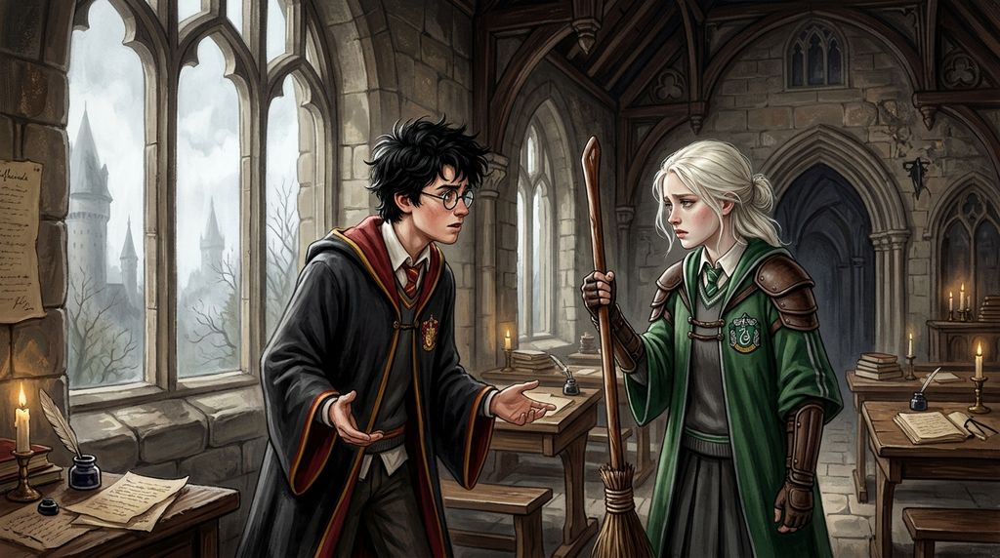

# Chương 16: Năm Hai: Một Từ Độc Ác
**Tên gốc:** *Second Year: The Word*  
**Tác giả:** [Sergio Xalambrí (`sergiodxa`)](https://www.wattpad.com/1661860376-dracaena-malfoy-and-the-boy-who-lived-second-year)  
**Phiên bản:** Bản Dịch Chi Tiết (Sát nguyên tác từng phân cảnh & hội thoại)

*Cuộc đụng độ trên sân tập Quidditch và vết rạn nứt sâu sắc trong phòng cửa sổ sau khi Dracaena thốt ra từ 'Máu Bùn'.*

> "Từ đó thật độc ác, Malfoy. — Harry Potter."

Buổi sáng thứ Bảy cuối tháng Chín đầy nắng nhưng mặt cỏ sân Quidditch vẫn còn ướt đẫm sương đêm.

Đội tuyển Slytherin vác trên vai bảy cây chổi Nimbus 2001 đen bóng khắc chữ vàng lấp lánh, tiến thẳng ra sân vận động với tờ giấy phép đặc biệt có chữ ký của Giáo sư Snape để huấn luyện cho Tầm thủ mới. Đúng lúc đó, đội tuyển Gryffindor của Oliver Wood cũng có mặt trên sân.

Một cuộc tranh cãi gay gắt về quyền sử dụng sân lập tức nổ ra giữa hai vị đội trưởng. Khi nhìn thấy Dracaena trong bộ đồng phục Quidditch màu xanh lục cầm cây Nimbus 2001 đứng cạnh Marcus Flint, Harry vô cùng ngạc nhiên:

"Malfoy? Bạn là Tầm thủ mới của Slytherin à?"

"Hiển nhiên rồi," Dracaena mỉm cười tự hào, vuốt nhẹ cán chổi mới. "Và nhìn xem cha tôi đã tặng gì cho cả đội này. Nimbus 2001. Nhanh hơn dòng Nimbus 2000 cũ kỹ của cậu nhiều đấy, Potter."

Đúng lúc ấy, Ron Weasley và Hermione Granger từ trên khán đài chạy vội xuống sân. Khi nghe Flint khoe khoang rằng dàn chổi mới sẽ quét sạch đám chổi cũ của Gryffindor khỏi bầu trời, Hermione Granger nhìn thẳng vào Dracaena và nói bằng giọng đanh thép:

"Ít nhất thì không một ai trong đội Gryffindor phải bỏ tiền ra để mua chỗ đứng trong đội tuyển. Họ được nhận vào đội bằng tài năng thực sự."

Nụ cười trên môi Dracaena tắt phụt.

Máu trong người cô như sôi lên. *Mua chỗ đứng.* Cô đã tập luyện suốt cả mùa hè dưới cái nắng chói chang và những cơn mưa rào. Cô đã bay nhanh hơn và bắt được trái Snitch trước mặt cả đội trước khi cha cô đặt mua bất kỳ cây chổi nào! Vậy mà trước mặt cả hai đội tuyển — trước mặt chính Harry Potter — Hermione Granger lại dám tuyên bố rằng cô chỉ có mặt ở đây nhờ tiền bạc của cha mình!

Sự tổn thương và cơn thịnh nộ làm mờ mắt Dracaena. Cô muốn làm cho Granger phải đau đớn. Cô muốn dùng một từ ngữ tồi tệ nhất, sắc bén nhất mà cô từng nghe những người lớn trong giới thuần huyết sử dụng để nhắc nhở Granger biết vị trí của cô ta ở đâu.

"Chẳng có ai hỏi ý kiến của mày đâu," giọng Dracaena lạnh băng, vang lên rõ mồn một giữa sân cỏ, "đồ Máu Bùn dơ bẩn (*filthy little Mudblood*)."

Ngay khoảnh khắc từ đó thoát ra khỏi môi cô, cả sân vận động như nổ tung.

Alicia Spinnet hét lên phẫn nộ. Fred và George Weasley lao tới định tóm cổ cô khiến Marcus Flint phải nhảy ra chắn phía trước. Ron Weasley rút cây đũa phép gãy dán băng keo ra khỏi túi, gầm lên *"Mày sẽ phải trả giá vì câu đó, Malfoy!"* rồi chĩa thẳng vào cô. Một tiếng nổ lớn vang lên từ đuôi đũa phép hỏng, hất văng Ron ngã ngửa ra cỏ và bắt đầu nôn ra những con sên khổng lồ nhớp nháp.

Đám cầu thủ Slytherin xung quanh cười ngặt nghẽo, vỗ vai Dracaena khen ngợi. Nhưng Dracaena không cười nổi.

Ánh mắt cô chạm phải ánh mắt của Harry Potter đang quỳ dưới cỏ đỡ lấy Ron. Đôi mắt xanh của Harry nhìn cô — không phải vẻ tức giận thông thường của một đối thủ, mà là sự sững sờ và ghê tởm lạnh người.

Hai ngày sau, Harry bước vào phòng cửa sổ. Cậu không mang theo sách vở. Cậu đóng cửa lại và đứng nhìn cô từ phía bên kia căn phòng.

"Ron đã giải thích cho mình biết từ đó có nghĩa là gì," Harry nói, giọng trầm và căng thẳng. "Máu dơ bẩn. Hạ đẳng."

Dracaena đứng dậy khỏi bệ cửa sổ, khoanh tay trước ngực để giấu đi sự run rẩy: "Cô ta đã sỉ nhục tôi trước! Cô ta nói tôi dùng tiền của cha để mua vị trí trong đội tuyển, ngay trước mặt tất cả mọi người! Tôi đã tự mình thi đậu vào đội!"

"Thế thì bạn có thể nói thẳng điều đó với cô ấy!" Harry bước tới một bước. "Tại sao bạn lại gọi cô ấy bằng cái từ đó? Hermione là phù thủy giỏi nhất khối chúng ta, vậy mà bạn lại cho rằng máu của cô ấy dơ bẩn chỉ vì cha mẹ cô ấy là người Muggle sao?"

"Bởi vì thế giới của chúng ta có những truyền thống và chuẩn mực riêng mà cậu không hiểu được, Potter!" Dracaena cố bấu víu vào những lập luận quen thuộc của gia tộc. "Gia đình, lịch sử và dòng máu có ý nghĩa của nó!"

Harry nhìn cô một lúc lâu. Không còn tiếng cười đùa, không còn sự bao dung của những buổi chiều học bài chung.

"Từ đó thật độc ác (*Cruel*)," Harry nói khẽ. "Và việc bạn cố bảo vệ nó cũng vậy."

Cậu quay lưng bước ra khỏi phòng, đóng cánh cửa gỗ lại sau lưng.

Dracaena đứng chết lặng bên khung cửa sổ suốt mười phút. Khi trở về phòng ngủ nữ sinh dưới đáy hồ, chỉ vừa nhìn thấy Pansy ngẩng lên hỏi *"Có chuyện gì thế?"*, lớp vỏ bọc kiêu hãnh của Dracaena hoàn toàn vỡ vụn. Lần đầu tiên kể từ khi đến Hogwarts, cô gục xuống giường và bật khóc nức nở trước mặt bạn mình — một nỗi đau đớn và tủi hổ mà cô thề rằng Harry Potter sẽ không bao giờ được phép biết tới cho đến ngày cô nhắm mắt.
