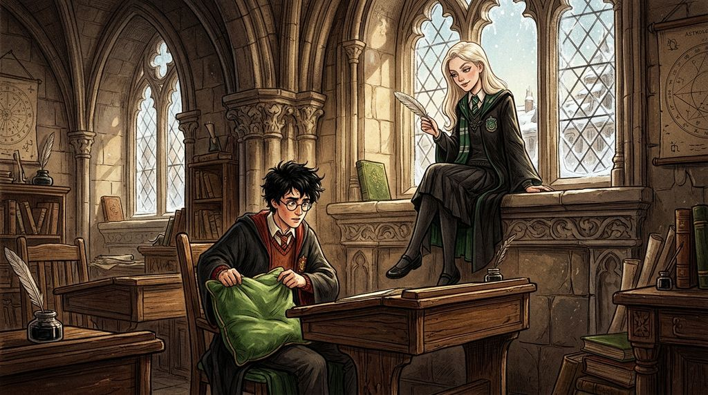

# Chương 20: Năm Hai: Câu Trả Lời Thứ Hai
**Tên gốc:** *Second Year: The Second Answer*  
**Tác giả:** [Sergio Xalambrí (`sergiodxa`)](https://www.wattpad.com/1662639073-dracaena-malfoy-and-the-boy-who-lived-second-year)  
**Phiên bản:** Bản Dịch Chi Tiết (Sát nguyên tác từng phân cảnh & hội thoại)

*Đêm Giáng Sinh kỳ lạ trong phòng sinh hoạt chung Slytherin và cuộc đối thoại hóa giải hiểu lầm giữa hai người.*

> "Lần này mình tin cậu hoàn toàn — không phải 'mình nghĩ là có', mà là 'mình biết'."

Kỳ nghỉ Giáng Sinh năm thứ hai, theo lời khuyên của cha mẹ để tránh việc đi lại giữa lúc trường học đang có nhiều biến động, Dracaena ở lại Hogwarts cùng Pansy, Crabbe và Goyle.

Lâu đài vào dịp lễ vắng vẻ đến kỳ lạ. Trong bữa tiệc Giáng Sinh tại Đại Sảnh Đường, chỉ có lác đác vài chục học sinh ngồi chung quanh những cây thông khổng lồ lấp lánh tuyết bạc. Harry, Ron và Hermione cũng ở lại trường. Thỉnh thoảng ánh mắt Dracaena và Harry chạm nhau qua những ngọn nến, nhưng khoảng cách từ câu hỏi hồi tháng Mười Một vẫn giữ họ ở hai đầu phòng ăn.

Tối hôm đó, sau khi rời bàn tiệc để trở về hầm ngục, Dracaena đang ngồi đọc sách bên lò sưởi trong phòng sinh hoạt chung Slytherin thì cánh cửa đá mở ra. Vincent Crabbe và Gregory Goyle bước vào.

Dracaena ngẩng lên nhìn hai gã bạn của mình và lập tức cau mày.

Họ vừa đi đâu suốt cả tiếng đồng hồ qua? Hơn nữa, điệu bộ của cả hai hôm nay trông vô cùng kỳ quặc: Crabbe thì cứ đi đứng cứng nhắc như thể không quen với chiều cao của chính mình, còn Goyle thì nhìn quanh phòng sinh hoạt chung Slytherin với ánh mắt vừa tò mò vừa cảnh giác — hoàn toàn giống hệt cái cách một người lạ lần đầu tiên bước chân vào hầm ngục dưới đáy hồ! Cô hoàn toàn không thể ngờ rằng Crabbe và Goyle thật đang ngủ mê mệt trong tủ chứa chổi trên lầu vì ăn phải bánh ngọt tẩm thuốc ngủ, còn hai người đang ngồi trước mặt cô chính là Ron Weasley và Harry Potter vừa uống **Thuốc Đa Dịch** (*Polyjuice Potion*) do Hermione pha chế để lẻn vào dò hỏi cô.

"Hai cậu đi đâu nãy giờ thế?" Dracaena hỏi, gập cuốn sách lại. "Ăn no đến mức lạc đường về phòng sinh hoạt chung à?"

"Ờ... mình bị đau bụng một chút," Goyle — thực chất là Harry — trả lời, giọng nói ồm ồm nhưng cách ngắt câu lại quá đỗi trôi chảy so với một Goyle ngày thường hiếm khi nói trọn vẹn một câu quá năm từ.

Dracaena nheo mắt nhìn "Goyle", nhưng rồi tặc lưỡi bỏ qua và cầm tờ báo *Nhật Báo Tiên Tri* trên bàn lên, phàn nàn về sự bất tài của Bộ Pháp thuật cũng như cách cụ Dumbledore xử lý vụ Phòng Chứa Bí Mật.

"Thế... bạn có biết ai là người mở Phòng Chứa Bí Mật không, Malfoy?" "Goyle" ngập ngừng hỏi, đôi mắt đục ngầu của Goyle lúc này lại mang một vẻ chăm chú rất lạ.

Dracaena bật cười khẩy, ném tờ báo xuống ghế: "Sao dạo này ai cũng hỏi câu ngu ngốc đó thế nhỉ? Ngay cả cậu cũng bị lây bệnh mất não của đám Gryffindor rồi à, Goyle? Tôi đã nói hàng chục lần rồi: tôi không phải là Người Kế Vị, và tôi cũng chẳng biết kẻ nào đang làm chuyện đó! Lần cuối cùng Phòng Chứa Bí Mật mở ra là từ năm mươi năm trước, trước cả khi cha tôi ra đời."

Cô đứng dậy, bước lại gần cửa sổ nhìn ra làn nước đen thẫm của mặt hồ, giọng hạ thấp xuống: "Cha tôi chỉ dặn tôi phải tránh xa rắc rối và để cho Hội đồng Quản trị xử lý lão Dumbledore. Bộ Pháp thuật của lão Arthur Weasley vừa mới lục soát Thái ấp nhà tôi tuần trước nhưng tất nhiên là chẳng tìm thấy gì ở phòng khách cả. Cha tôi nói nếu tình hình ở trường cứ tiếp diễn thế này mà không tìm ra thủ phạm, có khi trường sẽ phải đóng cửa mất."

Cô quay lại, thấy cả "Crabbe" và "Goyle" đang nhìn nhau với vẻ mặt vô cùng sửng sốt, rồi đột nhiên cả hai cùng ôm đầu đứng bật dậy, lắp bắp bảo mình lại bị đau bụng và lao vội ra khỏi phòng sinh hoạt chung như bị ma đuổi.

"Hai cái tên đó hôm nay ăn trúng cái gì không biết," Dracaena lắc đầu nói với Pansy khi cô bạn từ phòng ngủ bước ra.

Ba ngày sau đêm Giáng Sinh kỳ quặc đó, khi Dracaena đang ngồi một mình trên bệ cửa sổ trên tầng ba, cánh cửa phòng mở ra.

Harry Potter bước vào — lần này là với gương mặt thật và đôi mắt xanh quen thuộc của chính cậu.

"Potter," cô lạnh nhạt chào mà không rời mắt khỏi trang sách. "Tôi sắp dùng xong phòng rồi, cậu có thể đợi ngoài hành lang năm phút."

"Mình không đến để đợi bạn đi khỏi," Harry đóng cửa lại và bước thẳng về phía cô. Cậu dừng lại cách bệ cửa sổ vài bước chân, vẻ mặt vừa có lỗi vừa nhẹ nhõm một cách kỳ lạ. "Về câu hỏi mà mình đã hỏi bạn hồi tháng Mười Một..."

Dracaena ngừng đọc, ngẩng đầu lên nhìn cậu.

"Bạn không phải là Người Kế Vị của Slytherin," Harry nói rõ ràng từng chữ. "Và bạn cũng không biết ai đã mở Phòng Chứa. Lần trước khi bạn hỏi mình có tin bạn không, mình đã trả lời là *'Mình nghĩ là có'*. Đó là một câu trả lời tồi tệ. Lần này là câu trả lời thứ hai của mình: **Mình biết bạn không làm chuyện đó.** Mình hoàn toàn tin bạn."

Trái tim Dracaena khẽ rung lên. Cô không biết tại sao chỉ sau kỳ nghỉ Giáng Sinh, mọi nghi ngờ trong mắt Harry lại biến mất hoàn toàn như vậy, nhưng sự chân thành tuyệt đối trong giọng nói của cậu đã làm tan chảy lớp băng giá suốt năm tuần qua.

Tuy nhiên, một tiểu thư nhà Malfoy thì không thể tha thứ dễ dàng mà không có điều kiện.

"Vậy là cậu muốn xin phép được quay lại căn phòng này?" cô nhướng mày.

"Nếu bạn đồng ý."

Dracaena chỉ tay vào chiếc bàn học bằng gỗ cũ kỹ, ọp ẹp ở góc phòng: "Cậu có thể ở lại. Nhưng cậu phải ngồi ở cái bàn đó. Còn toàn bộ bệ cửa sổ này là của tôi."

Harry nhìn chiếc ghế gỗ kêu cót két rồi bật cười: "Đồng ý." 
