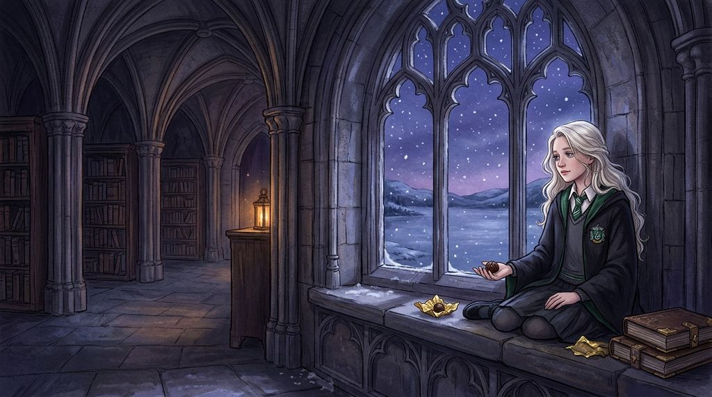

# Chương 21: Năm Hai: Viên Sô-cô-la Ngày Lễ Tình Nhân
**Tên gốc:** *Second Year: Valentine*  
**Tác giả:** [Sergio Xalambrí (`sergiodxa`)](https://www.wattpad.com/1662639152-dracaena-malfoy-and-the-boy-who-lived-second-year)  
**Phiên bản:** Bản Dịch Chi Tiết (Sát nguyên tác từng phân cảnh & hội thoại)

*Chiều Lễ Tình Nhân 14/2 — khi Dracaena ngồi đợi trên bệ cửa sổ suốt năm mươi phút cùng viên sô-cô-la thứ ba.*

> "Đến khi cô rời đi, không còn viên sô-cô-la nào, không mảnh giấy nhắn, không món quà nào để Potter tìm thấy."

Potter quay lại phòng cửa sổ vào tuần đầu tiên của tháng Giêng. Rồi hai ngày sau đó. Rồi ngay ngày hôm sau nữa.

Cậu ngồi ở chiếc bàn gỗ. Dracaena ngồi trên bệ cửa sổ. Sự sắp xếp này hoàn toàn làm cô hài lòng vì ba lý do: thứ nhất, Potter hiểu rằng việc được phép quay lại phòng không có nghĩa là mọi chuyện lập tức trở về như cũ; thứ hai, Dracaena có nguyên tắc của riêng mình; và thứ ba, chiếc ghế gỗ đó cực kỳ khó chịu.

Đến buổi chiều thứ tư, sau khi vặn vẹo làm chiếc ghế kêu cót két suốt hai mươi lần, Harry hỏi: "Chuyện này là cố ý phải không? Bạn bắt mình ngồi ở cái ghế mục nát từ trước khi bố mẹ mình ra đời này."

"Cậu đã xin phép được ở lại, tôi đã cho phép cậu dùng cái bàn, và giờ cậu đang phàn nàn về lòng hiếu khách tuyệt vời của tôi đấy à?"

Chiều hôm sau, Harry lén giấu một chiếc đệm gối dưới áo chùng mang tới đặt lên ghế và ngồi xuống với vẻ mặt đắc thắng: "Đã giải quyết xong vấn đề." Dracaena chỉ nhịn được đúng ba phút trước khi bật cười thành tiếng — thật khó để duy trì một hình phạt thích đáng khi kẻ bị phạt nhất quyết không chịu tỏ ra khổ sở.

Đến giữa tháng Giêng, chiếc đệm biến mất và Harry dần quay trở lại ngồi ở đầu bên kia của bệ cửa sổ đá. Mỗi lần sau đó, khoảng cách giữa họ lại thu hẹp thêm một chút mà không ai lên tiếng nhận xét.

Một buổi sáng, Dracaena nhìn thấy Harry và Ron đi từ cầu thang bệnh xá xuống — cô nhận ra cậu đã bỏ buổi học ở phòng cửa sổ hôm trước để vào thăm Hermione Granger (người đã nằm viện suốt từ lễ Giáng Sinh). Cùng thời gian đó, cô liên tục nhận thấy Ginny Weasley cứ lén nhìn Harry trong các bữa ăn rồi đỏ mặt cúi gằm xuống mỗi khi cậu quay sang. Chiều hôm đó tại phòng cửa sổ, khi thấy Harry lóng ngóng phủi mãi không sạch những bông tuyết đang tan trên tóc, Dracaena bực mình vươn tay gạt nhẹ lớp tuyết khỏi mái tóc đen của cậu. Harry đứng sững lại; bàn tay Dracaena cũng khựng lại trước khi cô vội vã rụt về và chống chế: *"Cậu đang làm rớt nước ra bệ đá đấy."*

Đầu tháng Hai, Hermione Granger xuất viện. Nhìn cách Harry đứng bật dậy mừng rỡ đón cô bạn ở bàn ăn sáng, xách hộ hai cuốn sách sau giờ Biến Hình, và chụm đầu cùng đọc chung một cuộn giấy da trong thư viện đến mức đến phòng cửa sổ muộn, Dracaena cảm thấy một sự bực dọc sắc nhọn cứa nhẹ dưới lồng ngực — đến mức cô quết bơ mạnh làm xước cả đĩa và lấy nhầm sách trong thư viện.

Ngày Lễ Tình Nhân 14 tháng 2 ập đến trong một biển màu hồng chói lọi do Gilderoy Lockhart bày ra. Những chú lùn đeo cánh vàng cầm đàn hạc đi khắp trường để hát thiệp tình yêu.

Trong chiếc túi giấy nhỏ đặt cạnh sách của Dracaena có **ba viên sô-cô-la truffle** mà mẹ cô đã gửi từ đầu tuần. Cô ăn một viên sau bữa trưa, ăn viên thứ hai lúc đọc sách, và khi ngón tay chạm phải viên thứ ba trong túi, cô nhìn sang bàn Gryffindor thấy Harry đang cãi nhau gì đó với Ron nên quyết định để nguyên viên sô-cô-la lại trong túi.

Khi họ vừa bước ra khỏi phòng ăn trưa, tiếng la hét vang lên ở cầu thang. Một chú lùn đã tóm được Harry Potter ngay giữa đám đông. Trong vòng vây có cả Ron, Hermione, Pansy, Dracaena và Ginny Weasley. Trước cả khi chú lùn cất tiếng hát bài thơ tình khủng khiếp về *"đôi mắt xanh như cóc ngâm tươi"*, Dracaena đã thấy mặt Ginny đỏ rực — đúng cái sắc đỏ mà cô đã âm thầm quan sát suốt nhiều tuần qua.

Khi màn tra tấn âm nhạc kết thúc, Dracaena khoanh tay trước ngực:

"Bạn gái của cậu có gu thơ ca tuyệt vời đấy, Potter."

Harry quay phắt sang nhìn cô, mặt vẫn còn đỏ bừng: "Em ấy không phải bạn gái mình!"

Câu trả lời bật ra ngay tức khắc. Và ngay lập tức, một thứ gì đó bên trong lồng ngực Dracaena bỗng nhiên giãn ra hoàn toàn. Mọi sự bực dọc âm ỉ từ bữa điểm tâm, từ hành lang, từ tiệm sách Phú Quý và Cơ Hàn mấy tháng trước — tất cả tan biến sạch sẽ, nhường chỗ cho một cảm giác nhẹ nhõm ấm áp và mạnh mẽ đến mức nụ cười nở trên môi cô trước cả khi cô kịp ngăn lại. Cô hoàn toàn không để ý rằng Pansy đang lặng lẽ quan sát biểu cảm trên gương mặt ửng hồng của mình.

Chiều hôm đó, Dracaena đến phòng cửa sổ trước lúc mặt trời lặn. Cô bày bài luận Bùa Chú, hai cuốn sách, ba cây bút lông — và cuối cùng, lấy viên sô-cô-la thứ ba ra đặt lên mặt đá giữa đống sách của mình và chỗ ngồi trống quen thuộc của Harry. Cô tự nhủ nếu Potter đến, cô sẽ ném nó cho cậu một cách hờ hững và bảo rằng mẹ mình gửi quá nhiều.

Mười phút trôi qua. Hai mươi phút. Ba mươi phút.

Bốn mươi phút trôi qua, ánh sáng tháng Hai ngoài khung cửa sổ chuyển dần từ màu xám sang xanh thẫm. Cánh cửa gỗ vẫn đóng im lìm. Harry không đến — có lẽ cậu đang ở cùng Weasley, hoặc đang ở thư viện cùng Granger. Ngòi bút lông trong tay Dracaena ấn mạnh đến mức đâm thủng góc tờ giấy da.

Năm mươi phút. Cô thu dọn sách vở vào cặp. Viên sô-cô-la vẫn nằm lẻ loi trên bệ đá.

Cô cầm nó lên. Cô có thể cất nó lại vào cặp để ngày mai đưa cho Potter. Nhưng ngay lập tức, cô khựng lại: *Không.* Bởi vì nếu làm thế, có nghĩa là cô đã cố tình giữ viên sô-cô-la này suốt cả một ngày trời để dành riêng cho cậu.

Bàn tay Dracaena siết chặt lớp giấy gói. Viên sô-cô-la đã sống sót qua bữa điểm tâm, bữa trưa, tiết Thảo Dược, bữa tối, sống sót qua bài thơ Valentine của Ginny Weasley và gần một tiếng đồng hồ cô ngồi nhìn cánh cửa đóng kín. Cô bóc lớp giấy bạc ra và tự mình ăn nốt viên sô-cô-la đã hơi mềm đi vì hơi ấm bàn tay. Cô hầu như không cảm nhận được vị ngọt của nó.

Khi Dracaena đứng dậy rời khỏi căn phòng, trên bệ cửa sổ không còn viên sô-cô-la nào, không mảnh giấy nhắn, không món quà nào. Harry Potter sẽ không bao giờ biết cậu đã bỏ lỡ điều gì.
