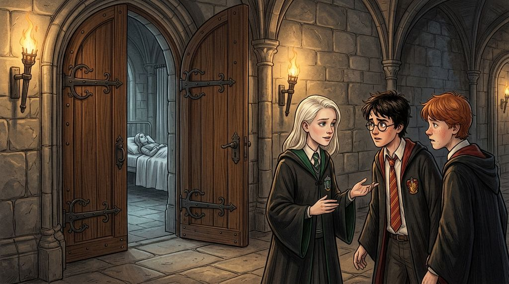

# Chương 23: Năm Hai: Những Chiếc Ghế Trống
**Tên gốc:** *Second Year: The Empty Seats*  
**Tác giả:** [Sergio Xalambrí (`sergiodxa`)](https://www.wattpad.com/1662639264-dracaena-malfoy-and-the-boy-who-lived-second-year)  
**Phiên bản:** Bản Dịch Chi Tiết (Sát nguyên tác từng phân cảnh & hội thoại)

*Chiếc ghế trống của Hermione trong lớp Biến Hình, cuộc tranh cãi về cụ Dumbledore và thông điệp kinh hoàng trên tường.*

> "BỘ XƯƠNG CỦA NÓ SẼ NẰM LẠI TRONG PHÒNG CHỨA MÃI MÃI."

Tháng Năm bắt đầu bằng kỳ thi — hay chính xác hơn là bắt đầu bằng chiếc thời khóa biểu ôn thi tô màu chia theo tỷ lệ phần trăm mà Hermione Granger lập cho Harry.

Thế nhưng, chỉ hai ngày sau buổi chiều hai người còn ngồi đùa nhau về chiếc thời khóa biểu ấy trên bệ cửa sổ, Hermione Granger đã không xuất hiện ở bữa điểm tâm. Đến giờ ăn trưa, chỗ ngồi của cô bé vẫn trống, và cả Harry lẫn Ron cũng biến mất.

Pansy là người nghe thấy tin dữ đầu tiên và báo lại cho Dracaena ngay giữa sảnh chính: hai nữ sinh vừa được tìm thấy bị hóa đá ngay gần thư viện — huynh trưởng nhà Ravenclaw Penelope Clearwater, và **Hermione Granger**.

Trong giờ Biến Hình chiều hôm đó, Dracaena mới thực sự thấm thía nỗi kinh hoàng của sự việc. Những vụ tấn công trước đó xảy ra với các học sinh ở bàn ăn khác, nhưng lần này là một chiếc ghế trống nằm cách cô chỉ vài dãy bàn. Không còn cánh tay nào phóng vút lên không trung trước khi Giáo sư McGonagall đọc xong câu hỏi. Không còn ai trả lời trước Dracaena.

Dracaena nhìn chằm chằm vào chiếc ghế trống, và ký ức về sân Quidditch lầy lội bùn đất dội về trong tâm trí cô: gương mặt của Granger, và từ ngữ độc ác đã thoát ra khỏi miệng Dracaena chỉ vì cô biết chính xác từ nào sẽ gây tổn thương nhất — *Máu Bùn*. Cô từng muốn thắng Granger, muốn làm cô bé tức giận và bẽ mặt, nhưng cô nhìn xuống tờ giấy da trước mặt mình: *Không phải như thế này. Không bao giờ là như thế này.*

Sau giờ học, Dracaena tìm thấy Harry và Ron đang đứng thất thần bên ngoài cửa bệnh xá. Lần đầu tiên, cô không còn bận tâm xem họ có được phép nói chuyện với nhau ở nơi công cộng hay không mà bước thẳng tới gần cậu:

"Cô ấy thế nào rồi?"

"Vẫn vậy," gương mặt Harry căng cứng.

"Cây Mandrake sắp trưởng thành rồi, Giáo sư Sprout đã nói thế," Dracaena khẽ nói. "Cô ấy sẽ tỉnh lại thôi."

"Cô ấy phải tỉnh lại," giọng Harry vỡ đi ở từ cuối cùng khiến lồng ngực Dracaena nhói đau.

Sáng hôm sau, cả trường thức dậy với hai tin chấn động mới: lão Hagrid đã bị giải đi ngục Azkaban, và Giáo sư Dumbledore đã bị Hội đồng Quản trị đình chỉ chức vụ Hiệu trưởng — với quyết định đình chỉ do chính ông Lucius Malfoy đích thân mang tới trường đêm qua.

Khi nhận được lá thư của cha thông báo rằng Hội đồng Quản trị đã quyết định để cụ Dumbledore tạm rời vị trí vì không giải quyết được các vụ tấn công, một cảm giác nhẹ nhõm thoáng qua trong lòng Dracaena: sau bảy tháng trời với sáu nạn nhân bị hóa đá mà không có câu trả lời, cuối cùng người lớn cũng đã hành động. Nhưng khi cô ngẩng lên nhìn sang bàn Gryffindor, Harry đang nhìn chằm chằm vào cô mà không có lấy một nụ cười.

Chiều hôm sau, Harry bước vào phòng cửa sổ mà không cần chào hỏi:

"Cha bạn đã tống cổ thầy Dumbledore ra khỏi trường! Ông ấy đã đe dọa các ủy viên khác! Hermione vừa bị tấn công hôm qua, và bạn nghĩ việc đuổi người duy nhất có thể ngăn chặn chuyện này sẽ giúp ích cho cô ấy sao?"

Một thứ gì đó trong Dracaena đứt phựt: "Đừng có đem Granger ra nói với tôi như thế! Tôi biết chuyện gì đã xảy ra với cô ấy! Nhưng cụ Dumbledore đã làm được gì nào? Bà Norris bị tấn công hồi tháng Mười, Creevey tháng Mười Một, Finch-Fletchley tháng Mười Hai, và giờ là Granger! Phải có bao nhiêu người bị hóa đá nữa thì người ta mới được phép nói rằng Hiệu trưởng đã thất bại?"

"Cha bạn căm ghét thầy ấy! Và lúc nào bạn cũng bênh vực cha bạn như thể ông ấy không bao giờ làm điều gì sai trái!"

"Cậu không biết gì về cha tôi cả!"

"Thế bạn nghĩ cha bạn kể cho bạn nghe mọi thứ sao?"

Câu hỏi của Harry giáng mạnh hơn mức bình thường rất nhiều. Hình ảnh thư phòng của cha, những ngăn kéo khóa kín và cuốn sổ tay màu đen cũ kỹ biến mất thoáng hiện lên trong đầu Dracaena, nhưng cô lập tức đè nén nó xuống.

"Hôm qua mình đến đây là vì sáng nay lúc nhận được thư của cha bạn, trông bạn có vẻ hài lòng," Harry nhìn cô với ánh mắt đầy thất vọng, rồi nhặt cặp sách bước ra cửa: "Lúc nào bạn cũng nghĩ cha bạn đúng."

"Còn cậu thì lúc nào cũng nghĩ ông ấy sai!"

Cánh cửa đóng sầm lại. Đôi bàn tay Dracaena run rẩy bên bệ cửa sổ.

Gần hai tuần sau, khi thấy Harry và Ron xuất hiện ở bữa điểm tâm với áo chùng lấm lem bùn đất và vết xước trên cằm sau chuyến đi liều mạng vào Rừng Cấm ban đêm, Dracaena chặn Harry lại ở cầu thang sau giờ Bùa Chú: "Cậu đã đi vào Rừng Cấm trong lúc Hagrid ở Azkaban và Dumbledore không có ở trường! Cậu có thể đã mất mạng đấy! Dù cậu đang làm gì thì hãy dừng lại ngay!"

"Mình không dừng được," Harry nhìn xuống sàn đá, giọng khàn đặc vì mệt mỏi. "Hermione không thể tự làm được. Cả Colin, Justin và Penelope cũng thế. Phải có ai đó tìm ra sự thật."

"Nếu cậu mà bị hóa đá luôn thì tôi sẽ không vào thăm cậu đâu đấy," cơn giận của Dracaena tan biến, cô dịu giọng nói. "Tôi sẽ chỉ gửi một tấm thiệp thôi."

Những ngày sau đó, mối quan hệ giữa họ giống như một hiệp ước đình chiến thận trọng — không nhắc đến Dumbledore, cũng không nhắc đến Lucius Malfoy.

Cho đến một buổi trưa cuối tháng Năm.

Dracaena nhìn thấy Harry và Ron quay lại sảnh đường với một biểu cảm hoàn toàn khác lạ trên gương mặt Harry — không phải sợ hãi, mà là sự **chắc chắn** tuyệt đối như thể cậu vừa ghép xong mảnh ghép cuối cùng. Khi cô gọi *"Potter!"*, cậu chỉ dừng lại nửa giây và nói một từ duy nhất:

"Để sau nhé (*Later*)."

Nhưng chữ *"Sau"* đó đã không bao giờ tới.

Ngay đầu giờ chiều, toàn bộ học sinh bị lệnh quay về phòng sinh hoạt chung khẩn cấp. Trên bức tường đá hành lang hiện lên dòng chữ máu mới:

**BỘ XƯƠNG CỦA NÓ SẼ NẰM LẠI TRONG PHÒNG CHỨA MÃI MÃI.**

Con quái vật không chỉ hóa đá nạn nhân nữa — nó đã bắt **Ginny Weasley** xuống Phòng Chứa Bí Mật. Mọi sự bực dọc trẻ con mà Dracaena từng cảm thấy mỗi khi Ginny nhìn Harry hay gửi thiệp Valentine lập tức biến mất sạch sẽ; cô chỉ cầu mong cô bé tóc đỏ ấy được sống sót trở ra.

Và rồi một ý nghĩ kinh hoàng ập đến: *Potter.*

Cả Harry và Ron đều không có mặt trong đám đông. Dracaena lao ngược dòng học sinh, chạy lên cầu thang hẹp dẫn tới phòng cửa sổ bằng hai bậc một. Cô đẩy tung cánh cửa gỗ.

Căn phòng hoàn toàn trống rỗng. Cây bút lông cũ của Harry vẫn nằm dưới bệ cửa sổ, cuốn sách cậu để quên mấy hôm trước vẫn nằm trên kệ — nhưng Harry Potter đã biến mất cùng với con quái vật của Phòng Chứa Bí Mật.
