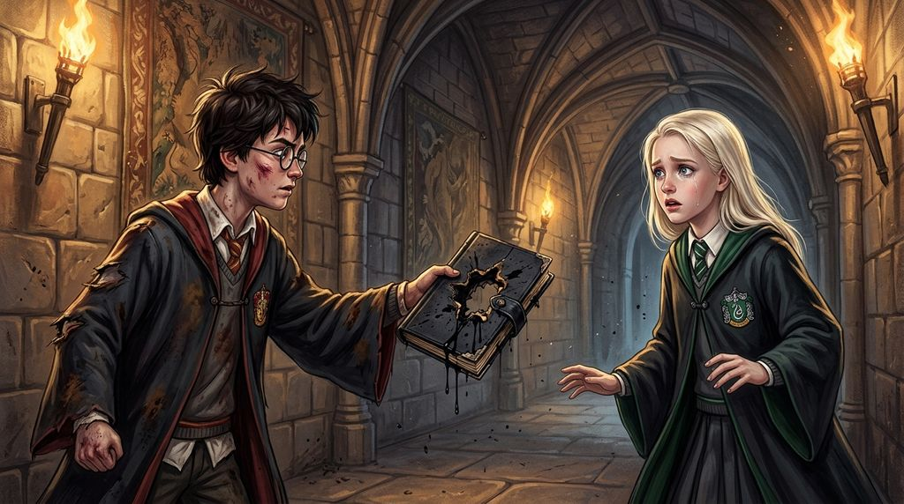

# Chương 24: Năm Hai: Lời Cáo Buộc & Sự Tan Vỡ
**Tên gốc:** *Second Year: The Accusation*  
**Tác giả:** [Sergio Xalambrí (`sergiodxa`)](https://www.wattpad.com/1662639300-dracaena-malfoy-and-the-boy-who-lived-second-year)  
**Phiên bản:** Bản Dịch Chi Tiết (Sát nguyên tác từng phân cảnh & hội thoại)

*Cuộc đối chất đau đớn trên hành lang về cuốn nhật ký đen và ánh nhìn lặng lẽ cuối cùng tại nhà ga Ngã Tư Vua.*

> "— Chúng con không còn là bạn nữa, mẹ ạ. — Cô từng dành gần hai năm khẳng định mình không thích Harry Potter, rồi dành cả mùa xuân để nhận ra mình có thích cậu. Giờ đây, lần đầu tiên, Dracaena ước gì ngay từ đầu mình đã đúng."

Dracaena ghét nhất là phải chờ đợi.

Cô ghét chờ chim cú. Cô ghét chờ kết quả thi. Cô ghét chờ Pansy quyết định xem hai bộ áo chùng giống hệt nhau thì bộ nào đẹp hơn. Nhưng lần chờ đợi này còn tồi tệ hơn tất cả.

Phòng sinh hoạt chung Slytherin đã bị khóa kín theo lệnh giới nghiêm. Ginny Weasley đã bị đưa xuống Phòng Chứa Bí Mật. Potter đã biến mất cùng với Weasley. Căn phòng xôn xao hàng chục giả thuyết hỗn loạn, còn Dracaena ngồi trên ghế bành với cuốn sách mở trên đùi — cô đã nhìn chằm chằm vào cùng một trang sách suốt hai mươi ba phút, cứ vài phút lại ngước nhìn ra cánh cửa đá một lần.

Pansy ngồi đối diện cô, cuối cùng cũng gấp sách lại: "Cậu ổn chứ?"

"Ổn," Dracaena đáp tự động. Nhưng rồi cô nhìn ra cửa: "Lúc ăn trưa, Potter đã biết chuyện gì đó. Cậu ấy chỉ nói mỗi chữ *'Để sau'* rồi biến mất cùng Weasley."

Pansy nhìn những ngón tay đang bấu chặt mép sách của bạn mình, không hề trêu chọc một lời: "Khi nào họ cho chúng ta ra ngoài, hãy đi tìm cậu ta đi. Nếu không cậu sẽ dành cả buổi tối chỉ để nhìn chằm chằm vào cánh cửa đó mất."

Họ nghe tin Ginny còn sống trước khi nghe bất cứ tin tức gì về Harry.

Cánh cửa phòng sinh hoạt chung bật mở mạnh đến mức đập vào tường đá. Một huynh trưởng khóa trên bước vào thông báo: "Con bé nhà Weasley còn sống! Họ tìm thấy nó rồi!"

Cả căn phòng vỡ òa, nhưng Dracaena đã đứng bật dậy, giọng vang lớn hơn mức cô dự định trước mặt bao người:

"Còn Potter thì sao? Cậu ấy có ở cùng cô bé không?"

"À, có. Potter cũng còn sống."

Một thứ gì đó bên trong Dracaena trùng hẳn xuống. Đầu gối cô bỗng nhiên bủn rủn đến mức phải vịn chặt vào lưng ghế bành, hơi thở tràn vào phổi quá nhanh. *Potter còn sống.*

Cô vội vã khoác áo chùng chạy ra hành lang ngay khi lệnh giới nghiêm được dỡ bỏ, nhưng không thể vào bệnh xá hay văn phòng Giáo sư McGonagall nơi gia đình Weasley và cụ Dumbledore (người vừa được Hội đồng Quản trị mời quay trở lại làm Hiệu trưởng) đang có mặt. Mãi đến tối muộn, khi bữa tiệc ăn mừng tự phát diễn ra tưng bừng trong Đại Sảnh Đường và thông báo hủy kỳ thi cuối năm được đưa ra, cô mới nhìn thấy Harry bằng xương bằng thịt ở bàn tiệc Gryffindor.

Áo chùng của cậu đã được thay mới, nhưng trông cậu kiệt sức với một vết cắt mới trên cánh tay. Khi ánh mắt họ chạm nhau qua khoảng cách giữa hai dãy bàn, Harry nở một nụ cười nhỏ, mệt mỏi nhưng bình an.

Lát sau, tiếng reo hò lại vang dội khi **Hermione Granger** bước vào Đại Sảnh Đường — hơi xanh xao nhưng hoàn toàn khỏe mạnh nhờ thuốc giải Mandrake, và bắt đầu nói liên hồi ngay cả trước khi kịp ngồi xuống ghế. Một gánh nặng khổng lồ trong lồng ngực Dracaena lập tức được tháo bỏ: *Không phải như thế này.* Giờ đây Granger đã đi lại, nói chuyện và chắc chắn đang sửa lưng một ai đó. Lần đầu tiên nhìn thấy ba người họ ôm nhau cười nói, Dracaena không còn thấy chút bực dọc nào — chỉ có sự nhẹ nhõm chân thành.

Cô đã định đứng dậy bước sang bàn Gryffindor như lời Pansy khuyên, nhưng nhìn gia đình Weasley, Ron, Hermione và lão Hagrid (người vừa được trả tự do từ Azkaban) đang vây kín lấy Harry, cô chợt nhận ra mình không có bất kỳ lý do công khai nào để bước tới đó. Cô ngồi xuống, tự nhủ: *Ngày mai. Tại phòng cửa sổ. Ở đó, mình biết chỗ đứng của mình ở đâu.*

Thế nhưng, chiều hôm sau Harry không đến phòng cửa sổ.

Ngày thứ hai cậu cũng không đến.

Đến ngày thứ ba, Dracaena bước lên phòng mà không mang theo sách vở — dấu hiệu cho thấy cô đã ngừng giả vờ. Sau mười lăm phút nhìn cánh cửa đóng kín, nhớ lại buổi chiều Lễ Tình Nhân với viên sô-cô-la cô đơn, cô quyết định không ngồi chờ thêm nữa.

Sau tiết Phòng chống Nghệ thuật Hắc ám chiều hôm đó, Dracaena bước thẳng ra chắn trước mặt Harry và Ron giữa hành lang.

"Potter."

Harry dừng bước, bảo Ron cứ đi trước. Khi hành lang đã vắng người, Harry điều chỉnh lại quai cặp, biết rõ lý do cô tìm mình.

"Cậu đã không đến phòng," Dracaena lên tiếng.

"Mình biết," Harry nhìn ra cửa sổ.

"Vậy là cậu đang cố tình tránh mặt tôi."

"Ừ."

Dracaena khoanh tay: "Tại sao?"

Harry im lặng mất vài giây, rồi nhìn thẳng vào mắt cô:

"Cha bạn đã gây ra tất cả chuyện này. Cha bạn đã lén bỏ một thứ vào vạc sách của Ginny Weasley ở tiệm Phú Quý và Cơ Hàn. Chính thứ đó đã mở Phòng Chứa Bí Mật."

Hành lang xung quanh như biến mất.

Trong một giây kinh hoàng, tâm trí Dracaena quay ngược về Thái ấp Malfoy: thư phòng của cha, chiếc tủ gỗ khóa kín, cuốn sổ tay màu đen cũ kỹ sờn rách nằm trên bàn làm việc rồi đột ngột biến mất, và cảnh cha cô nhặt cuốn sách của Ginny dưới sàn tiệm sách sau vụ ẩu đả với ông Arthur Weasley rồi dí trả lại cho cô bé: *Này con bé kia, cầm lấy sách của mày.*

Dạ dày Dracaena rơi xuống vực thẳm. *Không. Chỉ là sự trùng hợp.*

"Không," cô lắc đầu. "Cậu sai rồi. Làm sao cậu biết được chuyện đó?"

Harry khựng lại, không thể giải thích toàn bộ sự thật về con gia tinh Dobby và chiếc tất. Chính sự ngập ngừng đó đã cho Dracaena điểm tựa để bấu víu:

"Đúng như tôi nghĩ! Cậu lại buộc tội cha tôi, từ chối giải thích lời buộc tội đó lấy từ đâu ra, và đòi tôi phải tin cậu! Tại sao cậu cứ cố biến cha tôi thành một con quái vật như thế? Ông ấy là cha của tôi!"

"Mình biết bạn yêu thương ông ấy," giọng Harry trầm xuống, "nhưng điều đó không làm cho việc ông ấy đã làm biến mất được. Ginny đã suýt chết vì một vật Hắc ám mà ông ấy bỏ vào đồ đạc của một cô bé mười một tuổi!"

"Ông ấy không làm chuyện đó!"

"Sao bạn biết chắc là ông ấy không làm?"

Dracaena nhìn cậu sắc lạnh. Hình ảnh cuốn sổ đen lại lóe lên trong đầu cô. Cô im lặng. Và Harry đã hiểu sự im lặng đó theo cách của cậu.

"Bạn sẽ luôn bảo vệ ông ấy bất kể ông ấy làm chuyện gì," Harry nói, gương mặt đanh lại.

Dracaena cảm thấy như vừa bị tát thẳng vào mặt. Đôi mắt cô nóng rát vì giận dữ và tổn thương:

"Còn cậu sẽ tin bất cứ điều gì về ông ấy miễn là nó biến một người nhà Malfoy thành kẻ phản diện!"

Harry khẽ giật mình: "Bạn biết điều đó không đúng mà. Bạn biết mình mà (*You know me*)."

Bốn từ đó làm cả hai khựng lại. Tháng Mười Một. Cùng một hành lang ký ức mở ra giữa hai người. Khi Harry hỏi cô có phải là Người Kế Vị không, cô đã nói: *"Cậu biết tôi mà."* Giờ đây, chính cậu đang dùng câu nói đó để cầu xin sự tin tưởng từ cô.

Dracaena nuốt nghẹn:

"Tôi từng nghĩ là tôi biết (*I thought I did*)."

Ngay khoảnh khắc những từ đó rời khỏi môi, cô đã ước gì mình có thể rút chúng lại. Nhưng đã quá muộn.

Harry quay mặt đi trước: "Được thôi (*Right*)."

Một chữ duy nhất đó gây đau đớn hơn bất kỳ tiếng la hét nào.

"Mình cứ tưởng ít nhất bạn sẽ chịu lắng nghe," Harry nói nhỏ.

"Tôi không tin cậu."

Harry nhìn cô một lúc lâu, rồi khẽ gật đầu — không phải sự đồng tình, mà là sự chấp nhận buông xuôi: "Được rồi."

Cậu bước lướt qua cô.

"Potter," Dracaena quay đầu gọi giật lại. Trong một giây, cô không biết mình định nói gì: *Đừng đi. Cậu sai rồi. Ngày mai hãy đến nhé. Tôi xin lỗi. Cuốn sổ đen—* Nhưng chẳng có lời nào thoát ra được. Cô chỉ nâng nhẹ cằm lên. Và Harry bước đi.

Những tuần cuối năm học trôi qua trong bầu không khí lễ hội rộn ràng của toàn trường khi tất cả các nạn nhân hóa đá đều hồi phục và Phòng Chứa Bí Mật đã khép lại, nhưng đối với Dracaena, mọi thứ đã vỡ vụn. Cô không quay lại phòng cửa sổ nữa. Đêm cuối cùng đóng gói hành lý, tìm thấy tấm thẻ Ếch Sô-cô-la dưới đáy cặp, cô định ném nó vào sọt rác nhưng rồi lại nhặt lên, giấu sâu vào ngăn kéo bàn ngủ ở ký túc xá trước ánh mắt lặng lẽ cảm thông của Pansy.

Khi tàu tốc hành Hogwarts cập bến nhà ga Ngã Tư Vua, Dracaena bước xuống sân ga và lao vào vòng tay ấm áp của mẹ Narcissa cùng cái vỗ vai của cha Lucius.

Lúc ba người chuẩn bị bước qua rào chắn để trở về thế giới của họ, bà Narcissa nhìn quanh đám đông học sinh và nhẹ nhàng hỏi:

"Con đã chào tạm biệt Harry chưa?"

Bước chân của Dracaena dừng hẳn lại. Cổ họng cô thắt nghẹn:

"Potter ạ."

Biểu cảm của Narcissa khẽ thay đổi — không phải ngạc nhiên, mà là sự thấu hiểu. "Potter," bà dịu dàng sửa lại theo ý con gái.

Dracaena bất giác nhìn về phía đám đông đằng xa. Harry đang đứng cạnh gia đình Weasley và Hermione, mỉm cười lắng nghe điều gì đó mà Ron đang hào hứng kể. Trông cậu rất hạnh phúc.

Dracaena quay mặt đi:

"Chúng con không còn là bạn nữa, mẹ ạ."

Narcissa đứng lặng đi. Không một nụ cười trêu chọc, không một lời nhận xét thông minh nào về những bức thư. Chỉ có một tiếng *"Ồ"* thật khẽ chứa đựng biết bao sự dịu dàng, rồi bà vươn tay nắm lấy bàn tay lạnh ngắt của con gái.

Ngay trước khi bước qua rào chắn sân ga, Dracaena ngoái đầu nhìn lại một lần cuối.

Giữa biển người ồn ào ngăn cách hai thế giới, Harry cũng đang nhìn thẳng về phía cô. Trong một giây ngắn ngủi, cả nhà ga Ngã Tư Vua dường như lặng đi. Không ai vẫy tay. Không ai mỉm cười. Harry là người quay mặt đi trước.

Dracaena bước theo cha mẹ xuyên qua rào chắn. Cô đã dành gần hai năm trời khăng khăng rằng mình không thích Harry Potter, rồi dành cả mùa xuân vừa qua để nhận ra rằng mình có thích cậu. Giờ đây, lần đầu tiên trong đời, Dracaena ước gì ngay từ đầu mình đã đúng.
