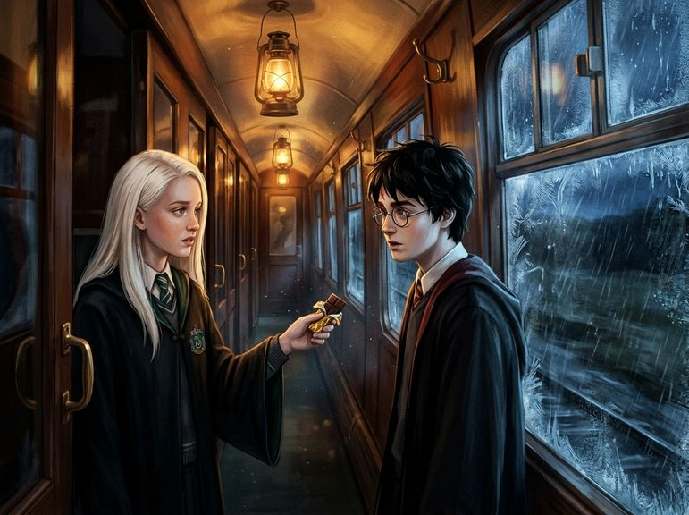

# Chương 26: Năm Ba: Cái Lạnh Trên Tàu Tốc Hành
**Tên gốc:** *Third Year: The Cold on the Train*  
**Tác giả:** [Sergio Xalambrí (`sergiodxa`)](https://www.wattpad.com/story/416871248-dracaena-malfoy-and-the-boy-who-lived)  
**Phiên bản:** Bản Dịch Chi Tiết (Sát nguyên tác từng phân cảnh & hội thoại)

*Trên hành lang tàu tốc hành Hogwarts phủ đầy sương giá, Dracaena lặng lẽ đưa thanh sô-cô-la bọc giấy vàng cho Harry sau khi Giám ngục rời đi.*

> "Ăn đi, Potter. Trông cậu giống hệt như một cái xác trôi sông, và tôi không muốn bị đổ tội nếu cậu ngất thêm lần nữa ngay trước mặt tôi."

### Cơn mưa ngày mồng một tháng Chín
Sân ga chín phần tư vào sáng ngày mồng một tháng Chín ngập trong làn khói trắng đặc quánh của đầu máy hơi nước đỏ thẫm và tiếng mưa đầu thu lộp bộp trên mái vòm kính.

Dracaena đứng cạnh cha mẹ mình gần toa tàu giữa. Cô đã cao lên đáng kể sau mùa hè năm mười ba tuổi; mái tóc vàng bạch kim dài mượt được buộc gọn gàng phía sau bằng một dải ruy băng lụa màu xanh lục thẫm, và chiếc áo chùng học sinh mới may vừa vặn tôn lên dáng vẻ kiêu kỳ đặc trưng của một tiểu thư nhà Malfoy.

Cách đó không xa, gia đình Weasley vừa xuất hiện cùng Harry Potter và Hermione Granger dưới sự hộ tống của hai nhân viên Bộ Pháp thuật. Dù cố tình quay mặt về phía Pansy Parkinson đang líu lo kể chuyện kỳ nghỉ ở Pháp, Dracaena vẫn thoáng thấy Harry qua khóe mắt. Cậu cũng đã cao hơn vài phân, mái tóc đen vẫn rối bù một cách tuyệt vọng như mọi năm, nhưng gương mặt cậu có vẻ trầm tư và căng thẳng hơn hẳn.

Cậu không nhìn về phía cô. Hoặc có lẽ cậu đã nhìn khi cô vừa quay đi — cô không dám chắc, và lòng kiêu hãnh không cho phép cô ngoái lại kiểm tra lần thứ hai.

Khi đoàn tàu tốc hành Hogwarts rời khỏi London và lao đi giữa những cánh đồng mờ mịt mưa giăng của miền bắc, không khí trong khoang tàu của nhà Slytherin vẫn ồn ào như thường lệ.

*"Cha mình bảo bọn Giám ngục Azkaban đã được điều tới đứng gác ở tất cả các lối vào làng Hogsmeade rồi,"* Blaise Zabini vừa nói vừa xoay cây đũa phép trên tay. *"Nghe nói chúng chỉ cần nhìn thấy Sirius Black là sẽ thực hiện Nụ Hôn Giám Ngục ngay lập tức, chẳng cần xét xử gì hết."*

*"Đáng đời hắn thôi,"* Pansy rùng mình kéo cao cổ áo len. *"Nhưng mà nghĩ đến chuyện phải học suốt cả năm cạnh lũ Giám ngục cũng thấy rợn người. Mình nghe nói chỉ cần đứng gần chúng quá năm phút là sẽ quên sạch mọi chuyện vui vẻ trên đời."*

Dracaena không tham gia vào cuộc trò chuyện. Cô tựa đầu vào thành ghế đệm, mắt nhìn những giọt nước mưa chảy dài ngoằn ngoèo trên mặt kính cửa sổ. Trời chiều tối sầm lại nhanh một cách bất thường dù đồng hồ mới chỉ hơn bốn giờ.

### Khi bóng tối bước lên tàu
Đột nhiên, đoàn tàu tốc hành Hogwarts giật mạnh một cái rồi giảm tốc độ. Những chiếc rương trên giá hành lý va vào nhau lạch cạch, và chỉ vài giây sau, con tàu dừng hẳn lại giữa vùng hoang địa tối đen như mực.

*"Sao lại dừng ở đây?"* Goyle ngơ ngác hỏi, tay vẫn cầm dở chiếc bánh vạc. *"Trời mới tối mà, làm sao đã tới Hogsmeade được?"*

Chưa ai kịp trả lời thì toàn bộ những ngọn đèn trên trần toa tàu đồng loạt phụt tắt.

Một cái lạnh không giống với bất kỳ cơn gió mùa đông nào bất ngờ ập tới. Lớp kính cửa sổ bên cạnh thái dương Dracaena phủ đầy một lớp sương giá trắng đục chỉ trong chớp mắt, phát ra những tiếng răng rắc rất khẽ. Hơi thở của Pansy và Blaise hóa thành những làn khói trắng mờ trong bóng tối.

Ngoài hành lang, một bóng đen cao lớn chạm sát trần toa, khoác tấm áo choàng rách rưới mục nát lướt chậm rãi qua khung cửa kính mờ của khoang tàu.

Hơi thở của Dracaena nghẹn cứng trong lồng ngực.

Bóng đen ấy không mở cửa khoang của họ, nhưng ngay khoảnh khắc nó dừng lại nửa giây ngoài hành lang cùng tiếng hít thở khò khè, lạnh lẽo như tiếng gió rít qua nghĩa địa, một làn sương mù xám xịt dường như tràn ngập tâm trí cô. Mọi màu sắc, mọi hơi ấm biến mất. Trong đầu cô chỉ còn lại tiếng bước chân lạnh lùng của cha cô trên nền đá cẩm thạch, tiếng rít kinh hoàng của con vật uống máu kỳ lân trong Rừng Cấm năm thứ nhất, và giọng nói lạnh ngắt của chính cô trên sân ga: *"Chúng con không còn là bạn nữa..."* — đi kèm với cảm giác chắc chắn rằng cô sẽ mãi mãi cô độc trong tòa dinh thự lạnh lẽo ấy cho đến hết đời.

Rồi bóng đen trôi đi về phía cuối toa. Hai phút sau, một luồng ánh sáng trắng bạc lóe lên từ một khoang tàu phía xa, và cái lạnh khủng khiếp ấy rút dần đi. Đèn trên trần toa sáng trở lại.

Chưa đầy năm phút sau, Millicent Bulstrode từ toa phía trước hớt hải chạy về, mắt mở to đầy kích động:

*"Các cậu biết chuyện gì vừa xảy ra không? Một tên Giám ngục đã mở cửa khoang của Potter! Nghe nói Potter vừa nhìn thấy nó đã ngất xỉu lăn đùng ra sàn, người co giật cứng đờ! Phải nhờ một ông giáo sư mới ngồi cùng khoang tung bùa đuổi tên Giám ngục đi thì hắn mới tỉnh lại đấy!"*

Cả khoang tàu Slytherin lập tức nổ ra một tràng cười khoái trá. Crabbe và Goyle đập tay vào đùi cười hô hố, còn Pansy lập tức quay sang nhìn Dracaena, chờ đợi câu bình luận cay độc quen thuộc của cô tiểu thư nhà Malfoy.

Trái tim Dracaena vẫn đang đập thình thịch trong lồng ngực vì dư chấn của cái lạnh vừa rồi — và vì tin Harry vừa ngất xỉu. Nhưng dưới bốn cặp mắt đang nhìn chằm chằm vào mình, bản năng tự vệ của mười ba năm giáo dưỡng tại Thái ấp Malfoy lập tức điều khiển gương mặt cô.

*"Ngất xỉu thật sao?"* Dracaena nhếch môi, giọng ngân dài đầy vẻ khinh khỉnh hoàn hảo. *"Thật đáng thương cho Cậu Bé Sống Sót. Chắc là phải nhờ ai đó bế cậu ta từ trên tàu xuống xe ngựa mất thôi."*

Cả khoang lại cười rộ lên. Dracaena quay mặt ra phía cửa sổ, bàn tay giấu dưới vạt áo chùng siết chặt lấy gói sô-cô-la trong túi đến mức lớp giấy bạc kêu sột soạt.

### Thanh sô-cô-la bên khung cửa sổ đóng băng
Hai mươi phút trước khi đoàn tàu đến ga Hogsmeade, khi Pansy và Daphne đang bận rộn chỉnh lại cà vạt xanh bạc trước gương, Dracaena đứng dậy mở cửa khoang:

*"Mình lên toa Huynh trưởng hỏi xem bao giờ tàu mới tới nơi đây. Đừng có chờ mình."*

Cô bước nhanh dọc theo hành lang hẹp đang lắc lư theo nhịp bánh sắt. Cô không đi về phía toa Huynh trưởng ở đầu tàu, mà rẽ sang toa giữa — nơi cô biết bộ ba Gryffindor thường ngồi.

Cô không định gõ cửa khoang của họ. Cô chỉ muốn nhìn qua lớp kính xem cậu có thực sự ổn không rồi sẽ quay về ngay. Thế nhưng, khi vừa bước qua cửa nối giữa hai toa tàu, bước chân Dracaena đột ngột khựng lại.

Harry Potter đang đứng một mình ngay bên khung cửa sổ hành lang, hai tay chống lên thanh vịn bằng đồng. Cậu đã mặc sẵn áo chùng đồng phục đen của Hogwarts, nhưng gương mặt cậu dưới ánh đèn dầu vàng vọt treo trên trần toa vẫn tái nhợt, đôi kính tròn hơi mờ đi vì hơi nước và những lọn tóc đen trước trán ướt đẫm mồ hôi lạnh. Cậu đã bước ra khỏi khoang tàu ngột ngạt để hít thở một mình, tránh ánh mắt lo lắng quá mức của Ron và Hermione.

Nghe tiếng cửa thông toa khép lại, Harry giật mình quay phắt sang.

Khi nhận ra mái tóc vàng bạch kim và chiếc phù hiệu rắn bạc trên ngực áo Dracaena, đôi vai cậu lập tức căng cứng. Ánh mắt xanh biếc sau tròng kính tối lại, vừa phòng thủ vừa mỏi mệt:

*"Nếu cậu định tới đây để hỏi xem mình đã ngất như thế nào để về kể cho đám bạn của cậu nghe, Malfoy, thì cứ tiết kiệm lời đi,"* Harry nói, giọng trầm và khàn. *"Cậu có thể đợi đến bữa tiệc tối nay ở Đại Sảnh Đường rồi diễn lại luôn một thể."*

Dracaena đứng cách cậu ba bước chân. Ngoài cửa kính, mưa vẫn quất từng hồi vào lớp băng giá chưa tan hết. Cô nhìn gương mặt xanh xao của cậu, nhìn vết sẹo hình tia chớp dưới lọn tóc ướt, và đột nhiên mọi lời đối đáp sắc sảo mà cô định nói đều tan biến hết.

Cô tiến lại gần thêm hai bước, rút bàn tay phải từ trong túi áo chùng ra và chìa về phía cậu.

Trên lòng bàn tay trắng trẻo của cô là một thanh sô-cô-la đen thượng hạng của tiệm Công Tước Mật được bọc trong lớp giấy vàng lấp lánh, đã được bẻ sẵn một góc.

Harry sững người, nhìn chằm chằm vào thanh sô-cô-la rồi lại ngước lên nhìn cô như thể không tin vào mắt mình.

*"Cái... cái gì đây?"* cậu lắp bắp.

*"Sô-cô-la đen bảy mươi phần trăm ca cao,"* Dracaena đáp, giọng hạ thấp xuống vừa đủ để tiếng bánh tàu át đi đối với những khoang xung quanh. *"Giáo sư Lupin của cậu có thể đã cho cậu ăn loại sô-cô-la rẻ tiền nào đó rồi, nhưng mẹ tôi bảo sau khi tiếp xúc với Giám ngục thì phải dùng loại ca cao nguyên chất của Công Tước Mật mới đẩy hết hàn khí ra khỏi mạch máu được."*

*"Tại sao cậu lại đưa cho mình?"* Harry hỏi khẽ, đôi mắt xanh nhìn thẳng vào mắt cô. *"Cuối năm ngoái, trên hành lang... mình đã nghĩ rằng chúng ta..."*

*"Cầm lấy đi, Potter, tay tôi mỏi rồi đấy,"* Dracaena ngắt lời, gò má hơi ửng hồng dưới ánh đèn dầu. *"Trông cậu giống hệt như một cái xác trôi sông, và tôi hoàn toàn không muốn bị giáo sư McGonagall đổ tội nếu cậu ngất thêm lần nữa ngay trước mặt tôi trên hành lang này."*

Harry nhìn cô thêm một giây nữa, rồi từ từ đưa tay ra đón lấy thanh sô-cô-la. Những ngón tay vẫn còn lạnh buốt của cậu vô tình chạm vào đầu ngón tay ấm áp của Dracaena. Cả hai đều khẽ giật nhẹ, nhưng không ai rụt tay lại ngay lập tức.

*"Khi tên Giám ngục đó bước vào..."* Harry bất giác nói nhỏ, mắt nhìn xuống lớp giấy vàng trên tay, *"...mình đã nghe thấy tiếng một người phụ nữ hét lên. Mình nghĩ đó là tiếng mẹ mình trước khi bà mất."*

Trái tim Dracaena thắt lại. Cô nhìn đỉnh đầu rối bù của cậu thiếu niên đang đứng trước mặt mình — người đã mất cha mẹ từ thuở nằm nôi, người đang bị một tên sát nhân vượt ngục săn đuổi, nhưng vẫn phải gồng mình tỏ ra cứng cỏi trước cả thế giới.

*"Đó là cách lũ Giám ngục hoạt động, Harry,"* cô thì thầm — lần đầu tiên sau nhiều tháng gọi lại tên cậu khi không có ai xung quanh. *"Chúng ép cậu phải sống lại khoảnh khắc tồi tệ nhất trong đời mình. Đừng để chúng thắng."*

Tiếng còi tàu hú dài phía trước báo hiệu đoàn tàu sắp tiến vào ga Hogsmeade, và tiếng chốt cửa một khoang tàu phía xa vang lên lách cách.

Dracaena lập tức lùi lại một bước, gương mặt lấy lại vẻ kiêu kỳ lạnh lùng chỉ trong tích tắc.

*"Ăn hết thanh đó trước khi xuống xe ngựa đi, Potter,"* cô nói nhanh rồi xoay người bước về phía toa Slytherin, để lại Harry đứng ngẩn ngơ bên khung cửa sổ hành lang cùng viên sô-cô-la ấm áp trong lòng bàn tay.
