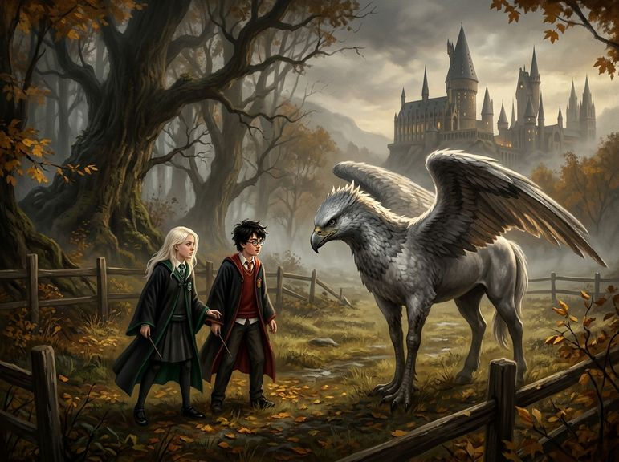

# Chương 27: Năm Ba: Lông Vũ Và Lòng Kiêu Hãnh
**Tên gốc:** *Third Year: Feathers and Pride*  
**Tác giả:** [Sergio Xalambrí (`sergiodxa`)](https://www.wattpad.com/story/416871248-dracaena-malfoy-and-the-boy-who-lived)  
**Phiên bản:** Bản Dịch Chi Tiết (Sát nguyên tác từng phân cảnh & hội thoại)

*Tiết học Chăm sóc Sinh vật Huyền bí đầu tiên của Hagrid tại bãi cỏ bìa Rừng Cấm cùng chú Bằng mã Buckbeak.*

> "Nếu Potter có thể khiến một con quái vật nửa đại bàng nửa ngựa cúi đầu, thì một Malfoy càng không có lý do gì phải lùi bước."

### Căn phòng bỏ trống và quyển sách biết cắn người
Suốt ba ngày đầu tiên của học kỳ mới, Dracaena đã hai lần đi ngang qua hành lang phía đông trên tầng ba sau giờ ăn tối.

Cả hai lần, bước chân cô đều chậm lại trước cánh cửa gỗ sồi quen thuộc của căn phòng học bỏ trống. Thế nhưng bàn tay cô chỉ chạm hờ lên nắm đấm bằng đồng lạnh ngắt rồi lại rút về. Khoảnh khắc ngắn ngủi trên hành lang tàu tốc hành Hogwarts đã chứng minh rằng cô không hề ghét cậu — nhưng giữa việc đưa một thanh sô-cô-la khi cậu suýt ngất và việc quay trở lại ngồi bên nhau như chưa từng có lời buộc tội cuối năm thứ hai vẫn là một khoảng cách quá lớn đối với lòng tự trọng của Dracaena Malfoy.

Và có vẻ như Harry Potter cũng đang bận rộn với những rắc rối mới của riêng mình.

Sáng thứ Năm, trong tiết Tiên Tri đầu tiên trên căn gác tròn ngột ngạt mùi hương trầm của giáo sư Sybill Trelawney, cả lớp đã được một phen náo loạn khi bà giáo nhìn vào bã trà trong tách của Harry rồi hét lên kinh hoàng rằng cậu đang mang dấu hiệu của **Hung Tinh (The Grim)** — con chó ma khổng lồ báo hiệu cái chết.

Ngồi ở chiếc bàn tròn bọc vải nhung đỏ phía bên kia phòng cùng Pansy Parkinson, Dracaena khoanh tay trước ngực, giả vờ đảo mắt ngán ngẩm trước màn kịch bi thương của bà giáo dạy Tiên Tri. Thế nhưng khi thấy đôi bàn tay của Harry khẽ run lên lúc đặt chiếc tách sứ xuống đĩa, cô lại nhớ tới bức ảnh của Sirius Black trên tờ *Nhật Báo Tiên Tri* và lời cảnh báo của mẹ mình trong phòng trà.

Sự bồn chồn không lời giải đáp ấy theo chân cô suốt bữa ăn trưa và kéo dài tới tận chiều thứ Năm, khi học sinh năm ba của hai nhà Gryffindor và Slytherin cùng kéo nhau xuống bãi cỏ ven Rừng Cấm để học tiết **Chăm sóc Sinh vật Huyền bí** đầu tiên do Rubeus Hagrid đứng lớp.

*"Lão gác rừng đó mà cũng đòi làm giáo sư cơ đấy,"* Pansy vừa đi vừa bĩu môi, ôm chặt cuốn *Quái Thú Mở Miệng (The Monster Book of Monsters)* đã phải buộc chặt bằng một sợi dây lưng da. *"Mình cá là cha cậu sẽ cười ngất khi nghe chuyện này cho xem, Dracaena."*

*"Nếu cuốn sách này mà cắn đứt ngón tay mình thêm lần nữa thì cha mình sẽ không chỉ cười đâu,"* Dracaena đáp cộc lốc, mắt vẫn hướng về phía hàng rào gỗ bên rìa Rừng Cấm.

Hagrid đang đứng đợi họ với vẻ háo hức hiện rõ trên gương mặt râu ria xồm xoàm. Sau màn hướng dẫn mở cuốn sách quái vật bằng cách vuốt dọc gáy sách — điều mà Dracaena phải miễn cưỡng thừa nhận trong bụng là khá thông minh — Hagrid biến mất vào rừng rồi dẫn ra một đàn sinh vật kỳ lạ nhất mà cô từng thấy.

Chúng có thân hình, hai chân sau và đuôi của những con ngựa khỏe mạnh sáng bóng, nhưng nửa thân trước lại là đôi cánh rộng mênh mông, cái đầu phủ lông vũ và chiếc mỏ thép sắc nhọn của loài đại bàng khổng lồ, cùng đôi mắt màu cam sáng quắc đầy kiêu hãnh.

*"Bằng mã (Hippogriff)!"* Hagrid vui vẻ giới thiệu, vẫy tay chỉ vào những con vật đang dậm móng xuống lớp lá khô mùa thu. *"Đẹp tuyệt vời phải không nào? Điều đầu tiên các trò phải nhớ về Bằng mã là chúng cực kỳ kiêu hãnh. Chúng rất dễ nổi giận nếu bị xúc phạm. Đừng bao giờ xúc phạm một con Bằng mã, bởi đó có thể là điều cuối cùng các trò làm trong đời đấy!"*

Hagrid giải thích quy tắc tiếp cận: phải tiến lại gần, giữ giao tiếp bằng mắt không được chớp, cúi chào thật lịch sự rồi chờ xem con Bằng mã có cúi chào lại hay không.

*"Nào, vậy ai muốn thử tiến lên chào hỏi chú Buckbeak này đầu tiên?"* Hagrid cởi sợi dây xích của con Bằng mã màu xám bạc to lớn nhất đàn và nhìn quanh lớp học.

Không một ai nhúc nhích. Cả đám học sinh Slytherin lẫn Gryffindor đều lùi lại phía sau hàng rào gỗ. Dracaena cũng theo phản xạ lùi lại nửa bước — cho đến khi một giọng nói quen thuộc vang lên:

*"Em sẽ thử ạ."*

Đó là Harry Potter.

### Đôi cánh xám bạc và cơn tự ái nông nổi
Trái tim Dracaena nhảy lên tận cổ họng khi thấy Harry trèo qua hàng rào gỗ, bước chậm rãi về phía con Bằng mã xám bạc đang nghểnh chiếc đầu đại bàng nhìn cậu chằm chằm bằng đôi mắt màu cam sắc lạnh.

*"Đừng chớp mắt, Harry!"* Hagrid nhắc khẽ. *"Tốt lắm... giờ thì cúi chào đi!"*

Dracaena đứng ở hàng đầu của nhóm Slytherin, quên cả việc phải giữ gương mặt dửng dưng. Những ngón tay cô bám chặt vào thanh gỗ ngang của hàng rào. Con Bằng mã chưa chịu cúi đầu ngay; nó vỗ nhẹ đôi cánh khổng lồ và phát ra một tiếng kêu sắc lẻm khiến Hermione Granger đứng cách đó vài mét phải nín thở. Dracaena đã đặt sẵn bàn tay phải vào túi áo chùng, nắm chặt cán đũa phép gỗ táo gai của mình — sẵn sàng tung bùa chú ngay lập tức nếu con thú dám lao vào cậu.

Thế nhưng, đột nhiên chú Bằng mã Buckbeak khuỵu hai chân trước đầy vảy xuống và cúi thấp chiếc đầu đại bàng một cách vô cùng trang trọng.

Cả lớp thở phào nhẹ nhõm. Hagrid vỗ tay vang dội, rồi trước sự kinh ngạc của tất cả mọi người, ông nhấc bổng Harry đặt lên lưng Buckbeak. Chỉ bằng một cú đập cánh mạnh mẽ, con Bằng mã đã bay vút lên bầu trời mùa thu xám bạc, lướt vòng quanh những ngọn tháp cổ kính của lâu đài Hogwarts trước khi đáp nhẹ nhàng xuống bãi cỏ.

Tiếng vỗ tay reo hò của nhà Gryffindor vang dậy cả bìa rừng. Ron và Hermione chạy ùa tới quanh Harry, gương mặt cậu ửng hồng và đôi mắt sáng rực sau tròng kính.

Cảm giác lo lắng thắt ruột trong lòng Dracaena lập tức biến mất, nhường chỗ cho một cơn tự ái nóng bừng rất trẻ con.

Suốt bốn ngày qua, cậu đã không thèm tìm đến căn phòng cửa sổ để nói chuyện với cô sau khi nhận thanh sô-cô-la trên tàu. Giờ đây cậu lại đứng giữa vòng vây tán thưởng của nhà Gryffindor, trông hoàn toàn rạng rỡ như thể sự vắng mặt của cô chẳng có ý nghĩa gì với cậu cả. Và nếu Harry Potter có thể khiến một con Bằng mã kiêu hãnh cúi đầu, thì Dracaena Malfoy — người đã đọc thuộc lòng chương viết về Bằng mã trong thư viện gia đình từ năm chín tuổi — càng không có lý do gì để đứng nép sau hàng rào như một kẻ nhát gan.

Khi Hagrid cởi dây xích cho những con Bằng mã khác và đám học sinh bắt đầu chia nhóm thực hành, Dracaena gạt tay Pansy ra, sải bước tiến thẳng tới trước mặt chính con Buckbeak vừa chở Harry bay lượn.

*"Tránh ra nào,"* cô hất cằm, cố tình nói đủ to để Harry đứng cách đó vài bước phải quay lại nhìn. *"Để xem con thú cưng của lão gác rừng có thực sự ghê gớm như người ta làm quá lên không."*

*"Malfoy, cẩn thận đấy!"* Harry lập tức bước tới một bước, lông mày nhíu chặt.

Ánh mắt lo lắng của Harry đáng lẽ phải làm cô dịu lại, nhưng trước mặt Crabbe, Goyle và đám bạn cùng nhà, nó chỉ càng kích động lòng hiếu thắng của Dracaena. Cô nhìn thẳng vào mắt Buckbeak và cúi chào. Con Bằng mã nhìn cô một lát rồi cũng ngoan ngoãn khuỵu chân cúi chào lại.

Dracaena mỉm cười đắc thắng, bước tới vỗ nhẹ lên chiếc mỏ sáng bóng của nó rồi quay sang nhìn Harry:

*"Thấy chưa, Potter? Cậu làm như thể cưỡi được con thú này là kỳ tích vĩ đại lắm không bằng. Thực ra nó cũng chỉ là một con quái vật lông lá xấu xí và ngu ngốc thôi mà—"*

Cô chưa kịp nói hết câu.

Một tia chớp màu xám bạc lóe lên trước mắt cô. Đôi cánh khổng lồ của Buckbeak bung rộng ra cùng một tiếng rít chói tai, và bộ móng vuốt sắc như dao thép ở chân trước của nó bổ thẳng xuống.

### Máu trên tay áo và bức thư từ Thái ấp
Một cơn đau buốt nhói xé toạc cánh tay phải của Dracaena từ khuỷu tay xuống tận cổ tay.

Cô ngã bật ngửa xuống lớp lá khô ẩm ướt. Màu đỏ tươi của máu lập tức thấm đẫm ống tay áo sơ mi trắng và chảy tràn ra lớp vải đen của áo chùng Slytherin.

*"Malfoy!"*

Giọng hét hoảng hốt của Harry vang lên cùng lúc với tiếng gầm của Hagrid. Trong tầm mắt nhòe đi vì đau và choáng váng, Dracaena thấy Harry đã lao tới quỳ sụp xuống ngay bên cạnh cô trước cả bất kỳ học sinh Slytherin nào, bàn tay cậu định chạm vào cánh tay đẫm máu của cô trong khi Hagrid đang vật lộn kéo sợi dây xích giữ chặt con Buckbeak đang lồng lộn.

Nhưng ngay lúc ấy, Pansy Parkinson và đám học sinh Slytherin đã ùa tới vây kín xung quanh, đẩy Harry lùi lại phía sau.

Đau đớn, xấu hổ vì vừa bị quật ngã ngay sau lời khoe khoang của chính mình, lại thêm sự hoảng loạn khi nhìn thấy máu chảy ướt đẫm tay áo, Dracaena nhắm chặt mắt lại và rên lên:

*"Đau quá... nó cắt đứt tay mình rồi, Pansy! Mình sắp chết mất!"*

Hagrid tái mặt bế thốc cô lên khỏi mặt đất và chạy như bay về phía tòa lâu đài để tới Bệnh xá, theo sau là cả đoàn học sinh Slytherin đang nhao nhao đòi đuổi việc ông giáo mới ngay lập tức.

Thực chất, tại Bệnh xá, bà Pomfrey chỉ mất chưa đầy hai phút để dùng thần chú và thuốc đắp làm liền hoàn toàn vết rách trên cánh tay của Dracaena, chỉ để lại một đường sẹo hồng nhạt. Thế nhưng, vì không biết phải đối mặt với sự mất mặt trước cả hai nhà ra sao — và vì vẫn còn giận dỗi khi thấy Harry đứng bên cạnh Hagrid để bênh vực ông giáo — Dracaena đã giữ nguyên chiếc đai treo tay bằng vải lụa đen suốt mấy ngày liền, để mặc cho Pansy cắt thịt bít tết hộ mình trong Đại Sảnh Đường.

Cô nghĩ rằng đó chỉ là một màn kịch trẻ con vô hại để trêu tức Potter và giữ thể diện trước đám bạn nhà Slytherin.

Cho đến sáng thứ Hai tuần kế tiếp.

Khi đàn cú bay tràn vào Đại Sảnh Đường, con cú đại bàng của gia đình Malfoy đã thả xuống trước mặt cô một phong thư đóng dấu sáp xanh lục của cha cô. Dracaena bóc phong bì ra đọc, và nụ cười kiêu kỳ trên môi cô lập tức đông cứng lại.

*Gửi Dracaena,*
*Mẹ con đã cho cha biết về vụ tấn công kinh khủng mà con phải chịu đựng trong tiết học của tên gác rừng ngu xuẩn đó. Con hãy yên tâm: cha đã chính thức gửi đơn khiếu nại lên Bộ trưởng Fudge và Ủy ban Thanh lý Sinh vật Nguy hiểm. Một phiên điều trần sẽ sớm được mở ra, và con quái vật đã làm bị thương một người nhà Malfoy sẽ phải nhận bản án tử hình xứng đáng.*
*Cha của con — Lucius Malfoy.*

Tờ giấy da dê rơi xuống bên cạnh đĩa bánh mì nướng. Dracaena nhìn xuống chiếc đai băng tay giả tạo của mình, cảm giác lạnh buốt chạy dọc sống lưng. Cô không hề muốn giết con Bằng mã đó. Cô chỉ muốn Harry Potter chú ý đến mình — nhưng một lần nữa, cái tên Malfoy và sự tàn nhẫn của cha cô lại vừa biến sự nông nổi của cô thành một lưỡi rìu treo lơ lửng trên đầu một sinh mạng vô tội.
