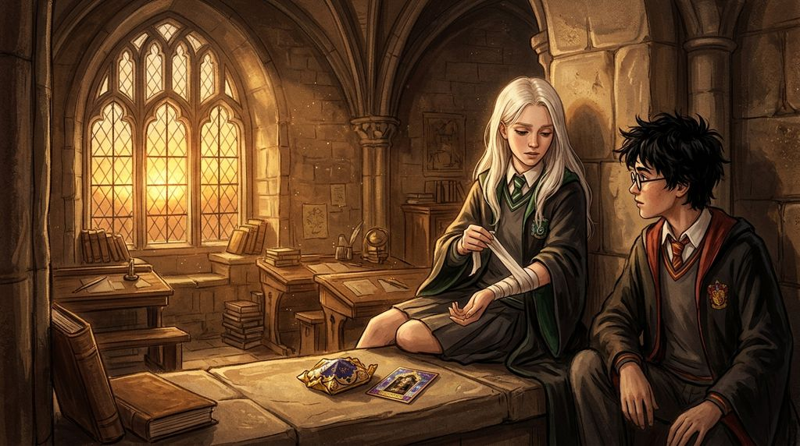

# Chương 29: Năm Ba: Cánh Cửa Chưa Khóa
**Tên gốc:** *Third Year: The Locked Door*  
**Tác giả:** [Sergio Xalambrí (`sergiodxa`)](https://www.wattpad.com/story/416871248-dracaena-malfoy-and-the-boy-who-lived)  
**Phiên bản:** Bản Dịch Chi Tiết (Sát nguyên tác từng phân cảnh & hội thoại)

*Trong căn phòng cửa sổ tầng ba, Harry và Dracaena tháo gỡ vết thương lòng từ cuối năm thứ hai và vụ việc của Buckbeak.*

> "Cậu thực sự nghĩ rằng mình sẽ ngồi đây ăn Ếch Sô-cô-la với cậu suốt cả mùa xuân nếu mình biết cuốn sổ đó sẽ giết chết bạn của cậu sao, Harry?"

### Chiếc đai băng tay được tháo bỏ
Ánh hoàng hôn tháng Chín chiếu qua ô cửa kính hình vòm trên tầng ba, phủ một lớp ánh sáng màu đồng ấm áp lên phiến đá lạnh giữa Harry và Dracaena.

Dù cả hai đã quay trở lại đúng chỗ ngồi của mình sau hơn bốn tháng xa cách, bầu không khí trong căn phòng học bỏ trống vẫn chưa thể trở lại sự tự nhiên như những buổi chiều mùa xuân năm ngoái. Giữa họ vẫn còn quá nhiều điều chưa nói hết: câu hỏi của Harry bên ngoài phòng giáo sư McGonagall hồi tháng Năm, sự im lặng suốt cả mùa hè, và mới đây nhất là vụ việc ở bãi cỏ bìa Rừng Cấm.

Ánh mắt Harry dừng lại ở chiếc đai lụa màu đen vẫn đang đỡ lấy cánh tay phải của Dracaena.

*"Cánh tay của cậu vẫn chưa khỏi thật sao?"* Harry hỏi, giọng cậu cố giữ vẻ bình tĩnh nhưng không giấu được chút gai góc. *"Mình nghe Ron và Hermione bảo bà Pomfrey có thể nối lại cả xương gãy chỉ trong một đêm. Vậy mà cậu vẫn đeo băng suốt hai tuần nay, và hôm qua lão Hagrid vừa nhận được giấy triệu tập của Ủy ban Thanh lý Sinh vật Nguy hiểm vì cha cậu kiện ông ấy."*

Dracaena không nổi giận ngay như mọi khi mỗi lần Harry nhắc đến Ron và Hermione. Cô nhìn cậu một lát, rồi bằng những ngón tay thon dài của bàn tay trái, cô chậm rãi tháo nút thắt của chiếc đai lụa đen trên cổ mình, kéo nó ra khỏi cánh tay phải và đặt gọn xuống phiến đá bên cạnh hộp Ếch Sô-cô-la.

Sau đó, cô xắn ống tay áo chùng và tay áo sơ mi trắng lên tới khuỷu tay, chìa cẳng tay phải ra dưới ánh nắng chiều.

Trên làn da trắng ngần của cô chỉ còn lại một đường sẹo mảnh màu hồng nhạt dài chừng một gang tay, đã lành lặn hoàn toàn.

Harry chớp mắt, hơi sững người: *"Nó... lành hẳn rồi mà? Tại sao ở ngoài hành lang và trong tiết Độc dược sáng nay cậu vẫn bắt Goyle băm rễ cây Cúc Dại hộ cậu?"*

*"Bởi vì Goyle băm rễ cây Cúc Dại đều tay hơn cậu tưởng nhiều, và bởi vì tôi không muốn Pansy cùng đám học sinh Slytherin hỏi tại sao tôi lại chịu để yên sau khi bị một con thú quật ngã trước mặt cả hai nhà,"* Dracaena trả lời thẳng thắn, kéo ống tay áo sơ mi xuống và cài lại khuy măng-séc.

*"Nhưng vì cậu làm thế nên cha cậu mới có cớ để đòi xử tử Buckbeak!"* Harry cao giọng, rướn người về phía trước. *"Hagrid đã khóc suốt tối hôm qua trong chòi của bác ấy đấy, cậu có biết không? Bác ấy chỉ muốn tiết học đầu tiên của mình thật ấn tượng thôi!"*

*"Và cậu nghĩ tôi là người đã viết thư bảo cha tôi đòi chém đầu con Bằng mã đó sao, Potter?"*

Giọng Dracaena vang lên sắc lạnh, đôi mắt xám bạc ánh lên tia lửa giận quen thuộc nhưng lần này lại pha lẫn một nỗi tổn thương sâu sắc.

*"Tôi đã bước lên trước mặt con thú đó vì một lý do hết sức ngu ngốc,"* cô nói tiếp, hai bàn tay nắm chặt trên vạt váy đồng phục. *"Suốt bốn ngày đầu năm học, cậu không thèm nhìn về phía tôi lấy một lần. Rồi cậu bước ra giữa bãi cỏ, cưỡi con Bằng mã đó bay lượn trên bầu trời trước tiếng reo hò của cả nhà Gryffindor như thể mùa xuân năm ngoái và căn phòng này chưa từng tồn tại. Tôi đã tự ái. Tôi muốn chứng minh trước mặt cậu rằng bất cứ thứ gì Harry Potter làm được thì Dracaena Malfoy cũng làm được. Và khi con Bằng mã cào rách tay tôi, bà Pomfrey đã bắt buộc phải ghi vào sổ y tế của trường để thông báo cho phụ huynh theo quy định. Tôi không hề xin cha tôi đệ đơn kiện lão Hagrid!"*

Harry im bặt, cơn nóng nảy trên gương mặt cậu lập tức chùng xuống khi nghe cô thú nhận lý do thật sự khiến cô tiến lại gần Buckbeak hôm ấy.

### Câu hỏi từ tháng Năm năm ngoái
Dracaena hít một hơi thật sâu, quay sang nhìn thẳng vào đôi mắt xanh biếc sau tròng kính tròn của Harry. Giọng cô trầm xuống, gần như run rẩy:

*"Tại sao lúc nào cậu cũng mặc định rằng mọi việc cha mình làm đều có sự đồng lõa của mình hả, Harry?"*

Harry khựng lại khi nghe cô gọi tên thật của mình.

*"Chiều hôm đó, khi cậu bước ra từ phòng làm việc của cô McGonagall với thanh kiếm dính máu và cuốn sổ đen bị đâm thủng trên tay,"* Dracaena nói khẽ, từng chữ như rút ra từ lồng ngực, *"cậu đã nhìn mình như nhìn một kẻ thù và hỏi: *'Cậu có biết không?'*. Cậu thực sự nghĩ rằng mình sẽ ngồi trên bệ cửa sổ này suốt cả học kỳ mùa xuân, chia sẻ từng con Ếch Sô-cô-la với cậu và lắng nghe cậu lo lắng cho Granger, nếu mình biết cuốn sổ trong thư phòng của cha mình chính là thứ đang biến bạn cậu thành đá và giết chết em gái của Weasley sao?"*

Căn phòng chìm vào sự tĩnh lặng tuyệt đối. Một chiếc lá phong vàng úa ngoài cửa sổ lìa cành, chao nghiêng trước lớp kính.

Harry cúi đầu nhìn xuống đôi giày thể thao cũ kỹ của mình. Phải mất một lúc lâu cậu mới ngẩng lên. Không còn vẻ phòng thủ, cũng không còn cái nhíu mày gay gắt.

*"Mình đã biết là cậu không biết,"* Harry nói thật khẽ.

Dracaena mở to mắt nhìn cậu: *"Cái gì cơ?"*

*"Ngay khoảnh khắc mình hỏi câu đó và nhìn thấy sắc mặt của cậu trên hành lang hôm ấy, mình đã biết là cậu hoàn toàn không biết cha cậu dùng cuốn sổ đó để làm gì,"* Harry thú nhận, giọng cậu trầm và nặng nề. *"Nhưng dưới Phòng Chứa Bí Mật, mình vừa suýt chết vì nọc độc của con Tử Xà Basilisk. Mình vừa nhìn thấy linh hồn mười sáu tuổi của Voldemort bước ra từ cuốn nhật ký mà cha cậu đã lén bỏ vào vạc của một cô bé mười một tuổi. Lúc bước ra hành lang và nhìn thấy cha cậu, rồi nhìn thấy cậu đứng đó với cùng màu tóc và cùng đôi mắt xám ấy... mình đã hoảng sợ, Dracaena."*

Đó là lần đầu tiên sau nhiều tháng Harry gọi tên cô.

*"Mình sợ rằng dù ở trong căn phòng này chúng ta có nói chuyện với nhau bao nhiêu đi nữa,"* Harry tiếp lời, ánh mắt xanh nhìn thẳng vào cô đầy chân thành, *"thì một ngày nào đó, khi cha cậu ra lệnh, cậu vẫn sẽ chọn đứng về phía ông ấy. Và khi cậu quay lưng bước đi hôm đó, mình đã quá kiêu ngạo và quá bối rối để chạy theo xin lỗi cậu."*

Cơn giận dữ và tủi thân đè nặng trong lòng Dracaena suốt bốn tháng hè bỗng chốc tan chảy như lớp sương giá dưới ánh mặt trời.

Cô nhìn cậu thiếu niên đang ngồi đối diện mình. Cô hiểu nỗi sợ của cậu, bởi chính cô cũng đã vừa trải qua nỗi sợ tương tự trước chiếc tủ chứa Ông Kẹ của giáo sư Lupin chỉ một giờ trước đó.

*"Mình mang họ của ông ấy, Harry, và mình không thể thay đổi dòng máu đang chảy trong người mình,"* Dracaena nói chậm rãi, giọng cô bình tĩnh nhưng rõ ràng đến từng âm tiết. *"Ở ngoài hành lang kia, trước mặt Crabbe, Goyle và những kẻ sẽ viết thư báo cáo từng lời mình nói về Thái ấp Malfoy, mình vẫn phải đóng vai đứa con gái mà cha mình kỳ vọng. Nhưng mỗi khi mình bước qua cánh cửa gỗ kia để vào căn phòng này... không có ai ra lệnh cho mình cả. Mình ở đây là vì mình tự chọn ở đây."*

Harry nhìn cô, đôi mắt xanh sau tròng kính sáng lên một niềm nhẹ nhõm ấm áp.

*"Mình xin lỗi vì câu hỏi ngày hôm đó, Dracaena,"* cậu nói giản dị, rồi đẩy hộp Ếch Sô-cô-la chưa bóc trên phiến đá về phía cô. *"Và cảm ơn cậu vì thanh sô-cô-la trên tàu tốc hành."*

Dracaena khẽ hất cằm, dù một nụ cười rất thật đã nở trên môi cô:

*"Cậu vẫn còn nợ tôi một thanh của tiệm Công Tước Mật đấy, Potter. Giờ thì mở hộp kẹo của cậu ra xem nào — nếu lại là thẻ cụ Dumbledore thì tôi sẽ ném nó qua cửa sổ thật đấy."*
