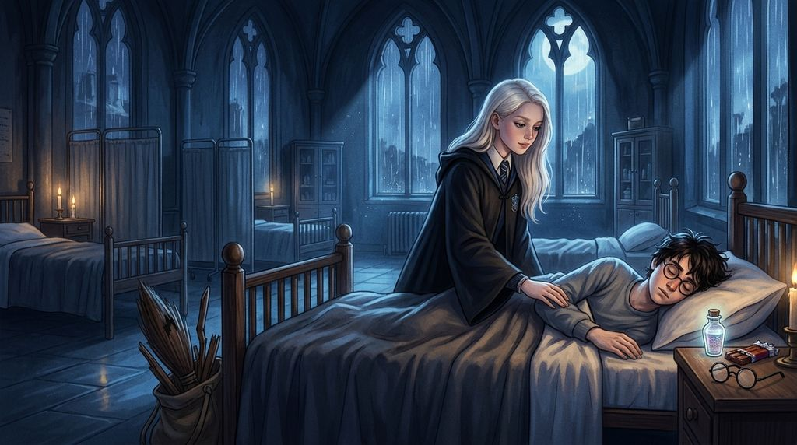

# Chương 30: Năm Ba: Ba Mươi Mét Trong Mưa Bão
**Tên gốc:** *Third Year: A Hundred Feet in the Rain*  
**Tác giả:** [Sergio Xalambrí (`sergiodxa`)](https://www.wattpad.com/story/416871248-dracaena-malfoy-and-the-boy-who-lived)  
**Phiên bản:** Bản Dịch Chi Tiết (Sát nguyên tác từng phân cảnh & hội thoại)

*Trận Quidditch giữa cơn bão tháng Mười Một khi hàng trăm Giám ngục tràn vào sân và Harry rơi tự do từ độ cao ba mươi mét.*

> "Lần tới nếu cậu còn dám buông tay khỏi cán chổi ở độ cao ba mươi mét nữa, Potter, chính tay tôi sẽ nguyền rủa cậu trước khi cậu kịp chạm đất."

### Cơn bão tháng Mười Một và cái cớ hoàn hảo
Tháng Mười khép lại với những cơn mưa dầm dề và những ngọn gió lạnh buốt thổi từ đỉnh núi xuống thung lũng Hogwarts.

Vào đêm lễ Halloween, trong khi cả trường đang dự tiệc thì bức chân dung Bà Béo ở lối vào tháp Gryffindor bị rạch nát tả tơi. Tin tức Sirius Black đã đột nhập vào tận bên trong lâu đài khiến toàn bộ học sinh rơi vào trạng thái hoang mang tột độ. Trong Đại Sảnh Đường đêm hôm ấy, khi toàn bộ học sinh của bốn nhà phải ngủ chung trong những chiếc túi ngủ trải trên sàn đá dưới sự canh gác của các giáo sư, Dracaena đã nằm ở khu vực của nhà Slytherin, thức gần như trắng đêm để lắng nghe tiếng bước chân tuần tra của giáo sư Dumbledore và nhìn về phía dãy túi ngủ màu đỏ vàng cách đó vài chục bước chân.

Một tuần sau sự cố ấy, trận đấu Quidditch mở màn mùa giải giữa Gryffindor và Slytherin được ấn định vào thứ Bảy đầu tiên của tháng Mười Một.

Thế nhưng, ngay từ tối thứ Năm, một cơn bão dữ dội chưa từng thấy đã kéo tới. Khi Marcus Flint triệu tập đội tuyển Slytherin trong phòng sinh hoạt chung dưới đáy hồ để bàn chiến thuật, hắn nhìn mưa quất ầm ầm vào cửa kính rồi nhếch mép cười ranh mãnh:

*"Thời tiết thế này mà bay thì chẳng khác nào đánh bạc. Malfoy, ngày mai cô cứ bảo với giáo sư McGonagall và lão Hooch là cánh tay bị con Bằng mã cắn của cô bị nhiễm lạnh nên tái phát đau nhức, không cầm chổi được. Chúng ta sẽ nhường suất thi đấu ngày mai trong mưa bão cho bọn Hufflepuff đấu với Gryffindor!"*

Dracaena không hề phản đối. Thực chất, cô đồng ý ngay lập tức không phải vì sợ mưa bão, mà vì một lý do hoàn toàn khác: cô biết với bầu trời đầy sấm sét và sự hiện diện của lũ Giám ngục quanh trường, nếu cô và Harry cùng lao lên không trung để tranh trái Snitch vào ngày mai, cô sẽ không thể nào tập trung thi đấu khi cứ phải canh chừng xem cậu có bị Giám ngục tấn công hay không.

### Cú rơi từ độ cao ba mươi mét
Sáng thứ Bảy, bầu trời tối sầm như ban đêm. Gió gào thét dữ dội trên sân vận động Quidditch đến mức những tấm biểu ngữ của hai nhà Gryffindor và Hufflepuff bị giật rách tả tơi.

Dracaena ngồi ở hàng ghế cao của khán đài nhà Slytherin, trùm kín chiếc mũ áo choàng đã được yểm bùa Chống Thấm Nước (*Impervius*). Bên cạnh cô, Pansy và Daphne đang co ro dưới một chiếc ô phép thuật, liên tục than phiền không hiểu sao mình lại phải đội mưa đi xem một trận đấu không có nhà Slytherin.

Nhưng đôi mắt xám của Dracaena không rời khỏi bầu trời lấy một giây.

Giữa màn mưa trắng xóa như thác đổ và những tia chớp rạch ngang tầng mây đen kịt, bóng áo đỏ của Harry Potter và bóng áo vàng của Tầm thủ Cedric Diggory bên nhà Hufflepuff lao vút lên cao như hai mũi tên đuổi theo một chấm vàng lấp lánh.

Đột nhiên, tiếng gió bão gào rú quanh khán đài im bặt một cách kỳ lạ.

Dracaena cảm thấy hơi thở của mình đông đặc lại. Một làn sương mù lạnh buốt đến thấu xương tràn qua các bậc ghế gỗ. Cô cúi nhìn xuống mặt sân cỏ phía dưới và chết lặng: ít nhất một trăm tên Giám ngục Azkaban với những chiếc áo choàng đen mục nát đang lướt thành từng đàn tiến vào sân vận động, ngước những chiếc mũ trùm đầu trống rỗng lên phía bầu trời.

*"Nhìn kìa!"* Daphne hét lên kinh hãi, chỉ tay lên đám mây phía trên. *"Potter... Potter sao thế kia?!"*

Giữa làn mưa xối xả ở độ cao hơn ba mươi mét, cây chổi Nimbus 2000 của Harry đang trôi dạt không người lái, còn cơ thể nhỏ nhắn trong bộ áo chùng đỏ của cậu đã buông thõng hoàn toàn, rơi thẳng đứng xuống mặt đất với tốc độ kinh hoàng.

*"Không—!"*

Tiếng hét bật ra khỏi cổ họng Dracaena bị tiếng sấm rền vang nuốt chửng. Cô bật dậy khỏi ghế, bàn tay rút phắt cây đũa phép ra khỏi túi áo chùng dù cô thừa biết ở khoảng cách quá xa này, bùa chú của một học sinh năm ba không thể nào chạm tới cậu. Trái tim cô như bị một bàn tay băng giá bóp nghẹt — đúng y như hình ảnh kinh hoàng mà cô từng sợ sẽ bước ra từ chiếc tủ Ông Kẹ của giáo sư Lupin.

Chỉ vài giây trước khi cơ thể Harry chạm xuống mặt sân bùn lầy, giáo sư Albus Dumbledore đã chạy lao ra giữa sân, vung cây đũa phép lên. Một luồng ánh sáng bạc phóng ra; tốc độ rơi của Harry chậm hẳn lại như một chiếc lá rồi hạ nhẹ nhàng xuống thảm cỏ, ngay trước khi cụ Dumbledore triệu hồi một luồng sáng bạc khổng lồ đánh bật toàn bộ bầy Giám ngục ra khỏi cổng sân vận động.

### Bóng người trong Bệnh xá lúc nửa đêm
Suốt cả buổi chiều và buổi tối hôm đó, trong phòng sinh hoạt chung Slytherin, đám học sinh năm trên không ngừng bàn tán xôn xao về việc Harry Potter lại ngất xỉu vì Giám ngục và việc cây chổi Nimbus 2000 của cậu bị gió thổi bay trúng Cây Liễu Roi rồi bị đập nát thành hàng trăm mảnh vụn.

Dracaena ngồi im lặng trước lò sưởi, cuốn sách *Số Học Huyền Bí* mở sẵn trên đùi nhưng suốt hai tiếng đồng hồ cô không lật nổi một trang.

Đúng mười một giờ mười lăm phút đêm, khi phòng sinh hoạt chung đã vắng tanh, Dracaena khoác chiếc áo choàng đen bên ngoài bộ đồ ngủ, cầm theo đũa phép và một chiếc túi lụa nhỏ rồi lặng lẽ lách qua bức tường đá tiến ra hành lang hầm ngục.

Cô thuộc lòng lộ trình tuần tra của lão Filch và con mèo Bà Norris từ năm thứ nhất sau đêm bị phạt cấm túc vì con rồng Norbert. Lướt êm như một cái bóng dọc theo cầu thang đá lên tầng một, cô dừng lại trước cánh cửa phụ phía đông của Bệnh xá, khẽ chạm đầu đũa phép vào ổ khóa:

*"Alohomora."*

Cánh cửa mở ra không một tiếng động. Bên trong Bệnh xá chỉ có ánh đèn ngủ lờ mờ ở cuối hành lang nơi phòng trực của bà Pomfrey đã khép cửa. Trên dãy giường trắng muốt được chiếu sáng bởi ánh trăng bàng bạc sau cơn bão, chỉ có duy nhất một chiếc giường ở góc khuất có người nằm.

Ron và Hermione đã bị bà Pomfrey đuổi về tháp Gryffindor từ lúc chín giờ tối. Nhưng Harry vẫn chưa ngủ.

Cậu đang nằm nghiêng, mắt mở to nhìn chằm chằm vào chiếc túi vải đặt trên ghế cạnh giường — nơi chứa đống mảnh gỗ vụn và những cành cây gãy nát của chiếc Nimbus 2000.

Khi nghe thấy tiếng bước chân rất nhẹ dừng lại bên tấm bình phong trắng và mùi hương bạc hà thanh mát quen thuộc thoang thoảng trong không khí mùi thuốc sát trùng, Harry giật mình quay phắt đầu lại.

Dưới ánh trăng nhợt nhạt chiếu qua khung cửa sổ cao, Dracaena Malfoy đang đứng ngay sát mép giường cậu. Mái tóc vàng bạch kim xõa dài trên vai chiếc áo choàng đen, đôi bàn tay cô vẫn còn lạnh toát vì gió lùa ngoài hành lang, và đôi mắt xám bạc của cô đang nhìn cậu với một hỗn hợp giữa giận dữ và nỗi sợ hãi chưa kịp lắng xuống.

*"Dracaena?"* Harry thì thầm, vội vàng chống khuỷu tay định ngồi dậy. *"Sao cậu lại lên đây giờ này? Nếu bà Pomfrey hay lão Filch bắt gặp—"*

*"Nằm yên xuống đó đi, đồ ngốc!"*

Dracaena bước tới ấn nhẹ lên vai cậu để buộc cậu nằm xuống gối. Giọng cô thì thầm thật khẽ nhưng run lên vì xúc động bị kìm nén suốt cả buổi chiều:

*"Cậu bị mất trí rồi sao, Harry? Đó là độ cao hơn ba mươi mét đấy! Mình đã đứng trên khán đài và nhìn thấy cậu buông tay khỏi cán chổi rơi thẳng xuống đất! Lần tới nếu cậu còn dám ngất xỉu ở độ cao ba mươi mét nữa, chính tay mình sẽ nguyền rủa cậu trước khi cậu kịp chạm mặt cỏ, cậu nghe rõ chưa?"*

Harry nằm yên trên gối, ngước nhìn gương mặt đang cúi gần của cô. Dưới ánh trăng, cậu nhận ra hàng mi dài của cô hơi ướt và những ngón tay đang đặt trên vai áo bệnh nhân của cậu vẫn còn đang run rẩy thật khẽ.

Cơn đau đầu âm ỉ và cảm giác trống rỗng lạnh lẽo sau cuộc tấn công của bầy Giám ngục bỗng chốc dịu đi. Harry khẽ mỉm cười, đưa bàn tay phải của mình lên chạm nhẹ vào mu bàn tay lạnh ngắt của cô.

*"Mình đâu có cố ý ngất xỉu,"* Harry thì thầm. *"Nếu cụ Dumbledore không ở đó thì chắc giờ này cậu đã chẳng còn ai để mắng ở phòng cửa sổ nữa rồi."*

*"Đừng có đùa kiểu đó,"* Dracaena khẽ rùng mình, nhưng cô không rút tay ra khỏi bàn tay ấm áp của cậu. Ánh mắt cô lướt sang chiếc túi vải đựng những mảnh gỗ gãy vụn của cây chổi Nimbus 2000 trên ghế, và giọng cô lập tức chùng xuống: *"Đó... đó là cây chổi của cậu thật sao?"*

*"Ừ,"* Harry thở dài, nụ cười tắt dần. *"Gió thổi nó bay thẳng vào Cây Liễu Roi. Bà Pomfrey bảo không có bùa chú nào sửa lại được nữa."*

Với bất kỳ ai khác, đó có thể chỉ là một món đồ thể thao bị hỏng. Nhưng Dracaena cũng là một Tầm thủ; cô hiểu cảm giác gắn bó với cây chổi đã cùng mình bay lên bầu trời lần đầu tiên năm mười một tuổi.

*"Tôi xin lỗi về cây chổi của cậu, Harry,"* cô nói thật lòng, không một chút mỉa mai. Rồi cô dùng tay trái lấy từ trong túi áo choàng ra một lọ thủy tinh nhỏ chứa dung dịch màu hổ phách lấp lánh cùng một thanh sô-cô-la bọc giấy bạc, đặt xuống dưới mép gối của cậu. *"Đây là thuốc Bổ Huyết Hồi Khí loại thượng hạng mà mẹ gửi dự phòng cho mình, uống dễ chịu hơn thứ thuốc đắng nghét của bà Pomfrey nhiều. Uống đi rồi ngủ một giấc cho tử tế."*

Đúng lúc đó, phía sau cánh cửa phòng trực của bà Pomfrey vang lên tiếng ghế dịch chuyển.

Dracaena lập tức rút tay lại, kéo mũ trùm áo choàng lên che khuất mái tóc vàng bạch kim.

*"Hẹn gặp lại ở phòng cửa sổ khi cậu xuất viện,"* cô thì thầm thật nhanh rồi lướt êm ra phía cửa phụ, để lại trên gối của Harry hơi ấm dịu dàng và mùi hương bạc hà xóa tan mọi bóng tối của lũ Giám ngục.
