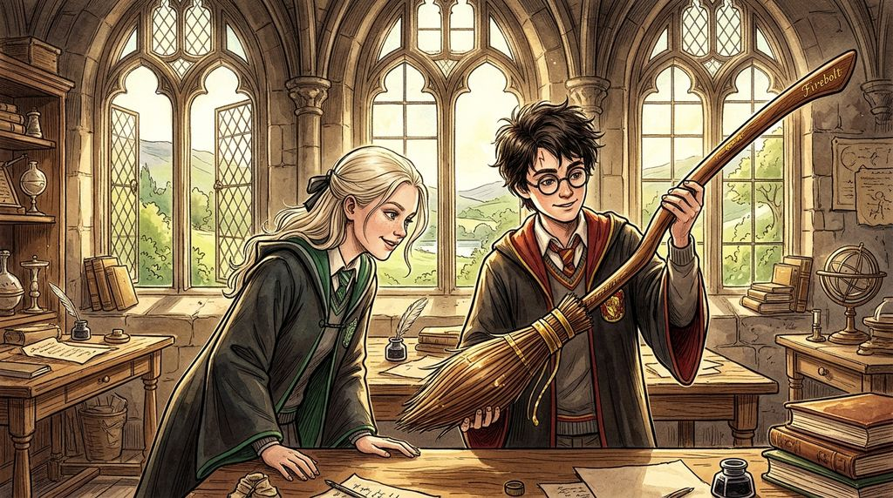

# Chương 32: Năm Ba: Bùa Hộ Mệnh Và Ký Ức Hạnh Phúc
**Tên gốc:** *Third Year: Expecto Patronum*  
**Tác giả:** [Sergio Xalambrí (`sergiodxa`)](https://www.wattpad.com/story/416871248-dracaena-malfoy-and-the-boy-who-lived)  
**Phiên bản:** Bản Dịch Chi Tiết (Sát nguyên tác từng phân cảnh & hội thoại)

*Mùa xuân năm thứ ba: Cây chổi Tia Chớp (Firebolt) và câu chuyện về những ký ức hạnh phúc dùng để gọi Bùa Hộ Mệnh.*

> "Nếu mình phải chọn một ký ức đủ ấm để chống lại Giám ngục, Potter... thì thật đáng ghét là có cậu ở trong đó."

### Cây chổi Tia Chớp và những buổi tối thứ Năm
Khi học kỳ mùa xuân bắt đầu vào tháng Giêng năm 1994, đề tài bàn tán sôi nổi nhất trên mọi bàn ăn ở Đại Sảnh Đường — đặc biệt là giữa các tuyển thủ Quidditch — chính là cây chổi **Tia Chớp (Firebolt)** mà Harry Potter nhận được vào sáng ngày lễ Giáng Sinh.

Dĩ nhiên, vào thời điểm Dracaena trở lại trường từ Thái ấp Malfoy, cây chổi đó đã bị giáo sư McGonagall tịch thu để cô và giáo sư Flitwick tháo rời từng bộ phận ra kiểm tra xem có lời nguyền Hắc ám nào của Sirius Black ẩn giấu bên trong hay không. Phải mất hơn một tháng rưỡi, vào một buổi chiều giữa tháng Hai đầy gió, khi Dracaena bước vào căn phòng cửa sổ trên tầng ba, cô mới được tận mắt chiêm ngưỡng nó.

Harry đang ngồi trên bệ cửa sổ với nụ cười rạng rỡ nhất kể từ đầu năm học, và đặt ngang trên hai đầu gối cậu là cây chổi đua hoàn hảo nhất thế giới.

Bước chân Dracaena dừng sững lại giữa phòng.

Với tư cách là Tầm thủ của đội tuyển Slytherin — người đang sở hữu một chiếc Nimbus 2001 vốn đã là niềm mơ ước của hầu hết học sinh trong trường — đôi mắt xám của Dracaena lập tức sáng rực lên khi nhìn thấy cán chổi bằng gỗ tần bì được đánh bóng mượt như lụa, những chữ cái mạ vàng khắc số hiệu xuất xưởng tinh xảo, và bộ đuôi chổi bằng cành bạch dương được tỉa gọn gàng đến từng milimét.

*"Cô McGonagall... trả lại nó cho cậu rồi sao?"* Dracaena bước nhanh tới bên bệ cửa sổ, quên cả việc giữ vẻ mặt lạnh lùng thường lệ.

*"Vừa mới trả tối qua!"* Harry hào hứng nói, nâng cây chổi lên chìa về phía cô. *"Không có lấy một lời nguyền nào cả. Cậu cầm thử mà xem, Dracaena — nó nhẹ hơn chiếc Nimbus 2000 cũ của mình gấp đôi, và chỉ cần chạm nhẹ ngón tay là nó đã tự nâng lên đúng tầm nắm tay rồi!"*

Dracaena do dự một giây rồi đưa hai tay đỡ lấy chiếc Tia Chớp. Ngay khoảnh khắc các ngón tay cô chạm vào lớp gỗ tần bì ấm áp, cô có thể cảm nhận được luồng ma pháp cân bằng tuyệt đối chạy dọc theo thân chổi — một kiệt tác khí động học thực sự.

*"Merlin ơi..."* cô khẽ thốt lên, đầu ngón tay lướt nhẹ qua phần giá để chân bằng kim loại sáng bóng trước khi trả lại cho Harry với một tiếng thở dài đầy tiếc nuối. *"Nếu Marcus Flint mà nhìn thấy thứ này ở cự ly gần, chắc anh ta sẽ khóc thét mất. Cậu biết rõ điều này có nghĩa là trong trận Chung kết vào tháng Năm tới, tôi sẽ không có lý do gì để nương tay với cậu đâu đấy, Potter."*

*"Cứ việc thử xem sao, Malfoy,"* Harry bật cười sảng khoái.

Sau khi đặt cây chổi dựa cẩn thận vào góc tường đá, Harry lấy từ trong cặp ra hai chiếc bánh vạc còn ấm mà cậu mang từ bữa trà chiều lên, đưa một chiếc cho cô rồi bắt đầu kể về những buổi học tối thứ Năm của cậu với giáo sư Lupin.

*"Thầy ấy đã mượn được một Ông Kẹ khác từ khu rừng để mình tập luyện,"* Harry vừa nói vừa xoay nhẹ cây đũa phép gỗ nhựa ruồi trên tay. *"Mỗi khi mình đứng trước mặt nó, nó lại biến thành một tên Giám ngục. Thầy Lupin đang dạy mình cách gọi **Bùa Hộ Mệnh — Expecto Patronum**."*

Dracaena ngừng nhai bánh, đôi mắt mở to nhìn cậu đầy kinh ngạc:

*"Bùa Hộ Mệnh? Nhưng phép thuật đó đâu có nằm trong chương trình thi Pháp sư Thường đẳng (O.W.L.)! Ngay cả nhiều phù thủy trưởng thành trong Bộ Pháp thuật mà cha mình quen biết cũng không thể triệu hồi nổi một Thần Hộ Mệnh có hình dạng rõ ràng!"*

*"Mình biết, và thực ra mình vẫn chưa làm tốt lắm,"* Harry thừa nhận, khẽ nhún vai. *"Mỗi lần mình hô câu thần chú, đầu đũa phép mới chỉ phun ra được một làn sương bạc như đám mây nhỏ thôi. Thầy Lupin bảo để tạo ra được một tấm khiên thực sự chống lại Giám ngục, mình phải tập trung toàn bộ tâm trí vào một ký ức hạnh phúc duy nhất — một ký ức đủ mạnh và đủ thật để giữ cho mình không bị chìm vào bóng tối."*

### Ký ức nào là thật?
Câu nói của Harry khiến Dracaena đột nhiên trầm mặc.

Cô quay mặt nhìn ra ngoài khung cửa sổ, nơi những đám mây màu tím sẫm của buổi chiều tháng Hai đang trôi qua đỉnh tháp Thiên Văn.

*"Cậu đã chọn ký ức nào?"* cô hỏi khẽ.

*"Lúc đầu mình chọn khoảnh khắc lần đầu tiên mình được cưỡi chổi bay ở năm thứ nhất,"* Harry đáp. *"Nhưng thầy Lupin bảo đó chỉ là niềm vui phấn khích chứ chưa đủ sâu sắc. Thế là mình chuyển sang nghĩ về ngày bác Hagrid đến căn chòi trên biển báo cho mình biết mình là phù thủy và đưa mình rời khỏi nhà Dursley. Còn cậu thì sao, Dracaena? Nếu cậu phải học Bùa Hộ Mệnh, cậu sẽ chọn ký ức nào?"*

Dracaena im lặng rất lâu.

Trong đầu cô lần lượt hiện lên những ký ức mà bất kỳ ai ngoài kia cũng nghĩ là niềm tự hào của tiểu thư độc nhất nhà Malfoy: bữa tiệc sinh nhật tám tuổi với những ngọn nến lơ lửng trong đại sảnh đường Thái ấp; ngày cha cô mua cho cô chiếc chổi đua trẻ em đắt tiền nhất nước Anh; hay giây phút Chiếc Nón Phân Loại vừa chạm vào tóc cô đã hô vang *"SLYTHERIN!"* trong tiếng vỗ tay của cả dãy bàn xanh bạc.

Thế nhưng, khi cô thử đặt những ký ức ấy đối diện với cái lạnh buốt xương mà cô đã cảm nhận được khi tên Giám ngục lướt qua hành lang tàu tốc hành hồi tháng Chín, cô nhận ra tất cả những kỷ niệm hào nhoáng đó đều mỏng manh như giấy lụa. Bởi đằng sau mỗi món quà và mỗi tràng pháo tay ở Thái ấp Malfoy luôn là ánh mắt dò xét của cha cô: *Con phải đứng nhất. Con không được làm xấu mặt dòng họ. Con phải chứng tỏ mình xứng đáng.*

Những ký ức thực sự khiến ngực cô ấm lên mà không kèm theo bất kỳ nỗi sợ hãi hay điều kiện nào lại hoàn toàn khác hẳn: đó là buổi sáng mùa hè cùng mẹ cô cắt tỉa những khóm hoa hồng trắng trong khu vườn nhỏ phía nam khi cha cô đi vắng; là tiếng cười bật ra không kịp che miệng trong tiệm may của Madam Malkin; và là những buổi chiều ngồi co chân trên chính bệ cửa sổ bằng đá lạnh lẽo này, tranh cãi về những tấm thẻ Ếch Sô-cô-la với một cậu bé có mái tóc đen không bao giờ chịu nằm yên.

*"Mình không biết nữa,"* Dracaena đáp khẽ, gò má hơi ửng hồng dưới ánh chiều tà nên cô cố tình không quay lại nhìn Harry. *"Có lẽ là một buổi chiều mùa xuân nào đó ở khu vườn phía nam cùng mẹ mình... hoặc một buổi chiều yên tĩnh nào đó ở Hogwarts mà không ai bắt mình phải đóng vai người thừa kế nhà Malfoy."*

Cô ngừng lại một nhịp, rồi nói thêm thật nhỏ, gần như chỉ đủ để gió ngoài cửa sổ nghe thấy:

*"Và nếu mình buộc phải chọn một ký ức ở ngôi trường này để gọi Bùa Hộ Mệnh, Potter... thì thật đáng ghét là có mặt cậu ở trong đó."*

Harry ngẩn người nhìn sườn mặt thanh tú của cô. Một luồng hơi ấm dịu dàng lan tỏa khắp lồng ngực cậu — ấm áp và rõ ràng hơn bất kỳ câu thần chú nào.

### Màn kịch của Marcus Flint và ánh sáng bạc trên sân cỏ
Một tuần sau đó, trận đấu quan trọng giữa Gryffindor và Ravenclaw diễn ra dưới ánh nắng rực rỡ.

Dracaena ngồi trên khán đài nhìn Harry bay lượn trên chiếc Tia Chớp với tốc độ ngoạn mục đối đầu với Tầm thủ Cho Chang của nhà Ravenclaw. Thế nhưng, ngay khi Harry vừa lao xuống sát mặt đất để đuổi theo trái Snitch, từ bên dưới khán đài, ba bóng đen cao lêu nghêu trùm kín áo choàng đen từ đầu đến chân giống hệt lũ Giám ngục Azkaban bất ngờ nhô lên chỉ tay thẳng vào Harry.

Trái tim Dracaena thót lại vì giận dữ — cô nhận ra ngay lập tức đó là trò bẩn thỉu mà Marcus Flint đã bàn tính với Crabbe và Goyle trong phòng thay đồ tối hôm qua mà không cho cô biết!

Nhưng Harry không hề chao đảo.

Không cần suy nghĩ lấy nửa giây, cậu rút phắt đũa phép ra ngay khi đang lao đi với vận tốc hơn trăm dặm một giờ, hướng thẳng xuống ba kẻ giả mạo và hô vang:

*"Expecto Patronum!"*

Một luồng ánh sáng trắng bạc khổng lồ bùng nổ từ đầu đũa phép của cậu, lao thẳng xuống quật ngã cả Marcus Flint, Crabbe, Goyle và Theodore Nott đang ngồi trên vai nhau trong lớp áo choàng đen, trước khi Harry vươn tay tóm gọn trái Snitch vàng chỉ vài giây sau đó.

Dưới mặt sân, giáo sư McGonagall giận dữ lao tới chỉ thẳng vào mặt đám Flint và trừ liền năm mươi điểm của nhà Slytherin. Trong khi Pansy và đám học sinh xung quanh rên rỉ tức tối, Dracaena lại kéo cao cổ áo choàng để giấu đi nụ cười rạng rỡ trên môi — cô chưa bao giờ cảm thấy việc nhà Slytherin bị trừ năm mươi điểm lại xứng đáng đến thế.
