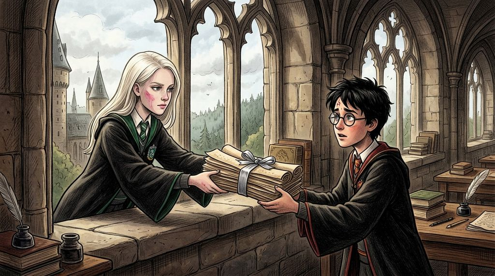

# Chương 33: Năm Ba: Hồ Sơ Kháng Cáo Cho Buckbeak
**Tên gốc:** *Third Year: The Appeal*  
**Tác giả:** [Sergio Xalambrí (`sergiodxa`)](https://www.wattpad.com/story/416871248-dracaena-malfoy-and-the-boy-who-lived)  
**Phiên bản:** Bản Dịch Chi Tiết (Sát nguyên tác từng phân cảnh & hội thoại)

*Cuộc chạm trán căng thẳng với Hermione Granger và tập tài liệu luật pháp bí mật Dracaena trao cho Harry để cứu Buckbeak.*

> "Đừng nói cho Granger biết ai đã đưa cho cậu tập án lệ này. Cô ấy vừa tát mình một cái đau điếng hôm qua, và lòng tự trọng của mình không cho phép mình nhận lời cảm ơn từ cô ấy đâu."

### Lời nói dối trên sườn đồi và cái tát của Hermione Granger
Tháng Tư đến mang theo những cơn gió xuân ẩm ướt thổi qua khu đất quanh lâu đài Hogwarts, nhưng đối với cả bộ ba nhà Gryffindor lẫn Dracaena Malfoy, bầu không khí ngày một ngạt thở khi ngày xét xử kháng cáo của chú Bằng mã Buckbeak tại London được ấn định vào cuối tháng.

Hai ngày trước đó, một con cú đại bàng từ Thái ấp Malfoy đã mang tới cho Dracaena một bức thư ngắn gọn nhưng lạnh lùng của cha cô: ông thông báo rằng ông đã đích thân làm việc với các thành viên trong Ủy ban Thanh lý Sinh vật Nguy hiểm, đồng thời nhắc nhở cô rằng Crabbe và Goyle cũng sẽ được cha của chúng hỏi thăm về tình hình ở trường.

Dracaena hiểu ngay ẩn ý đằng sau bức thư ấy. Lucius Malfoy đã bắt đầu nhận thấy con gái mình không còn hào hứng nhắc đến vụ kiện trong các bức thư gửi về nhà nữa, và ông đang dùng hai gã bạn to xác cùng nhà để giám sát thái độ của cô.

Chiều thứ Ba, khi tiết Chăm sóc Sinh vật Huyền bí vừa kết thúc dưới chân đồi, Hagrid trông tiều tụy đến mức ông gần như quên mất bài giảng về loài Giun Đất Khổng Lồ. Khi cả lớp đang đi ngược lên sườn cỏ để trở về lâu đài, Crabbe và Goyle kè sát ngay hai bên vai Dracaena.

*"Cha tôi bảo lão Hagrid chắc chắn sẽ thua kiện thôi,"* Goyle cười khục khặc, giọng cố tình nói thật to khi thấy Harry, Ron và Hermione đang đi ngay phía trước cách đó vài bước. *"Nghe nói lão già đó tối nào cũng ngồi khóc trong căn chòi gỗ. Đúng là thảm hại, phải không Malfoy?"*

Ở phía trước, đôi vai của Harry và Ron lập tức căng cứng. Hermione Granger nắm chặt quai chiếc cặp sách nặng trĩu — suốt nhiều tuần qua, cô bé đã phải học gấp đôi số môn học nhờ chiếc Xoay Thời Gian, đồng thời thức đến hai giờ sáng mỗi đêm trong thư viện để viết hồ sơ bào chữa cho Buckbeak.

Dracaena nhìn thấy ánh mắt dò xét của cả Crabbe lẫn Theodore Nott đang đi ngay sau lưng mình. Nếu cô im lặng hoặc bênh vực Hagrid ngay lúc này, tối nay một con cú sẽ bay thẳng về Thái ấp Malfoy, và mọi nỗ lực âm thầm mà cô đang chuẩn bị trong ngăn kéo bàn học để giúp Harry sẽ đổ sông đổ biển.

*"Cứ để lão ta khóc cho thỏa thích,"* Dracaena cất giọng lạnh băng, hất cằm nhìn về phía căn chòi gỗ dưới chân đồi. *"Ai bảo lão ta dám đưa một con thú nguy hiểm vào lớp học ngay từ ngày đầu tiên cơ chứ? Sớm muộn gì Bộ Pháp thuật cũng sẽ xử lý xong chuyện này thôi."*

Cô vừa dứt lời thì một bóng người lao vút tới nhanh như cắt.

Đó không phải là Harry, cũng không phải là Ron.

Hermione Granger đã quay phắt lại, sải bước băng qua khoảng cỏ ngắn giữa hai nhóm với đôi mắt rực lửa giận dữ đến tột cùng. Trước khi Dracaena kịp lùi lại, bàn tay phải của Hermione đã vung lên và giáng một cái tát trời giáng thẳng vào má trái của cô.

*CHÁT!*

Âm thanh sắc gọn vang lên giữa sườn đồi lộng gió khiến cả Crabbe, Goyle, Ron lẫn Harry đều chết sững tại chỗ.

Đầu Dracaena ngoặt sang một bên, mái tóc vàng bạch kim bung khỏi dải ruy băng xõa xuống che nửa gương mặt. Một cơn đau rát bỏng lan khắp gò má trái của cô.

*"Đừng có mà dám gọi bác Hagrid là thảm hại, đồ độc ác ti tiện!"* Hermione hét lên, giọng run bắn vì kiệt sức và phẫn nộ, tay rút phắt cây đũa phép ra chĩa thẳng vào ngực Dracaena.

*"Hermione!"* Ron lắp bắp, vội vàng giữ tay bạn lại, trong khi Harry bước nhanh lên đứng chắn giữa hai người, ánh mắt cậu sững sờ nhìn vết đỏ ửng đang hiện rõ trên làn da trắng ngần của Dracaena.

Crabbe và Goyle định thò tay vào túi rút đũa phép, nhưng Dracaena đã lập tức giơ tay trái lên ngăn chúng lại.

Cô không rút đũa phép. Cô từ từ quay mặt lại, đưa mu bàn tay chạm nhẹ lên gò má đang nóng rát của mình. Ánh mắt xám bạc của cô lướt qua gương mặt đang thở gấp của Hermione, rồi dừng lại một phần mười giây nơi đôi mắt xanh đầy bối rối và lo lắng của Harry.

*"Đi thôi,"* Dracaena nói khẽ nhưng sắc lạnh với Crabbe và Goyle, rồi quay lưng bước nhanh lên những bậc tam cấp đá dẫn vào tiền sảnh tòa lâu đài mà không ngoái lại một lần nào.

### Tập hồ sơ đóng dấu gia huy nhà Malfoy
Chiều thứ Năm — bốn mươi tám tiếng sau vụ va chạm trên sườn đồi — Harry bước dọc hành lang tầng ba với trái tim nặng trĩu.

Cậu gần như chắc chắn rằng căn phòng học bỏ trống hôm nay sẽ không có ai. Không một tiểu thư nhà Malfoy nào có thể chấp nhận việc bị tát thẳng vào mặt trước sự chứng kiến của cả đám học sinh mà không cắt đứt mọi quan hệ với nhóm người đó. Suốt hai ngày qua, trong các bữa ăn ở Đại Sảnh Đường, Dracaena luôn ngồi quay lưng về phía dãy bàn Gryffindor.

Thế nhưng, khi Harry mở cánh cửa gỗ sồi bước vào, cô đã ngồi đợi sẵn trên bệ cửa sổ đá.

Ánh nắng chiều tháng Tư chiếu rõ lên gương mặt cô: trên gò má trái vẫn còn một vệt hồng rất nhạt chưa tan hết. Nhưng điều khiến Harry ngạc nhiên nhất là đặt trên phiến đá trước mặt cô không phải là hộp Ếch Sô-cô-la, mà là một tập giấy da dê dày cộp gồm hơn hai mươi trang viết tay kín đặc bằng mực xanh đen, được buộc gọn bằng một sợi dây lụa màu bạc.

*"Dracaena..."* Harry bước lại gần, giọng cậu đầy áy náy. *"Về chuyện hôm thứ Ba vừa rồi... Hermione dạo này bị căng thẳng quá mức vì lịch học và vụ kiện của bác Hagrid. Mình xin lỗi vì—"*

*"Nếu cậu định xin lỗi thay cho Granger thì khỏi cần đâu, Potter,"* Dracaena ngắt lời, nhưng trong giọng nói của cô không hề có sự giận dữ mà cậu lo sợ. Cô khẽ chạm đầu ngón tay lên má trái của mình, nở một nụ cười nửa miệng hơi chua chát: *"Nói cho công bằng thì cú đấm... à không, cái tát của cô ấy khá mạnh đấy. Và xét cho cùng thì mọi chuyện rắc rối của con Bằng mã năm nay cũng bắt đầu từ sự nông nổi của mình hồi tháng Chín, nên coi như mình trả nợ cho xong."*

Harry thở phào nhẹ nhõm, ngồi xuống phía bên trái bệ cửa sổ rồi nhìn tập giấy da dê trước mặt: *"Vậy đây là cái gì?"*

Dracaena hạ giọng xuống thật khẽ, đẩy tập tài liệu sang phía cậu:

*"Hôm thứ Ba trên sườn đồi, mình buộc phải nói những lời đó vì Crabbe và Nott đang đứng ngay sát lưng mình. Cha mình đã dặn chúng để mắt xem mình có biểu hiện gì lạ về vụ kiện của lão Hagrid hay không."*

Cô mở trang đầu tiên của tập giấy da dê ra, chỉ tay vào những dòng chữ ghi chép các điều khoản pháp thuật cổ:

*"Trong kỳ nghỉ lễ Phục Sinh vừa rồi, khi cha mình gửi các bản sao tài liệu pháp lý của Ủy ban Thanh lý Sinh vật Nguy hiểm về cho luật sư của gia đình kiểm tra, mình đã thức hai đêm để chép lại toàn bộ các án lệ từ năm 1792 đến năm 1875 trong thư viện của Thái ấp. Cha mình đã dùng ảnh hưởng và tiền bạc để gây sức ép với gần hết các ủy viên trong Ủy ban rồi, Harry. Nhưng nếu các cậu nhìn vào **Án lệ năm 1843 tại hạt Devon** ở trang số bảy này — điều khoản quy định rằng nếu học sinh tự ý tiến lại gần và buông lời khiêu khích sinh vật hạng Ba sau khi giáo viên đã nêu rõ cảnh báo an toàn, thì sinh vật đó được quyền tự vệ theo bản năng tự nhiên."*

Harry cầm lấy tập giấy da dê, đôi mắt cậu mở to khi đọc những dòng chữ viết tay nắn nót, rõ ràng của Dracaena — từng điều luật, từng số hiệu hồ sơ và cả những lập luận mà luật sư của cha cô dự định dùng để tấn công Hagrid đều được cô ghi chú cách phản biện ở bên lề.

*"Dracaena... cậu đã tự tay chép hết chỗ này để giúp bọn mình cứu Buckbeak sao?"* Harry ngước lên nhìn cô, giọng cậu nghẹn lại vì xúc động. *"Nếu cha cậu mà phát hiện ra nét chữ của cậu hoặc biết nguồn tài liệu này từ đâu ra..."*

*"Vì thế nên cậu phải chép lại toàn bộ nội dung này ra một cuộn giấy khác bằng nét chữ của cậu hoặc của Granger ngay tối nay, rồi đốt bản gốc này trong lò sưởi đi,"* Dracaena dặn dò nghiêm nghị.

Rồi cô hơi quay mặt đi, đôi tai khẽ đỏ lên dưới lớp tóc vàng bạch kim:

*"Và còn một điều kiện nữa, Potter: cậu tuyệt đối không được nói cho Granger hay Weasley biết ai đã đưa tập án lệ này cho cậu. Cậu cứ bảo là cậu tìm thấy nó trong khu vực sách cũ của thư viện trường. Mình vừa bị cô bạn thông thái của cậu tát cho một cái nổ đom đóm mắt hôm thứ Ba xong, lòng tự trọng của một Malfoy không cho phép mình nhận lời cảm ơn hay sự thương hại của cô ấy đâu."*

Harry nhìn cô gái đang ngồi đối diện mình — người vừa chịu đựng cái tát oan ức trước mặt bao nhiêu người để giữ vỏ bọc, rồi lại âm thầm trao cho cậu thứ vũ khí duy nhất có thể chống lại chính người cha quyền lực của cô.

*"Cảm ơn cậu, Dracaena,"* Harry nói thật khẽ nhưng sâu sắc đến mức khiến cô phải quay lại nhìn cậu. *"Mình biết cô ấy không biết chuyện này, nhưng đối với mình... cậu dũng cảm chẳng kém bất kỳ ai ở nhà Gryffindor cả."*
