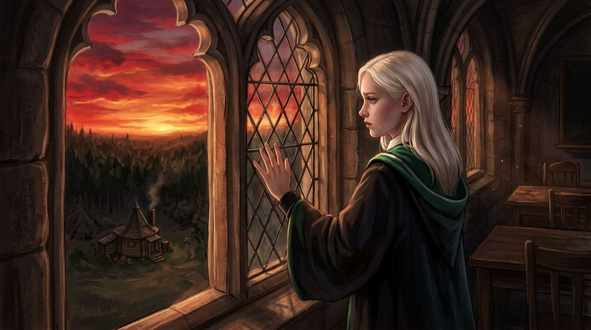

# Chương 34: Năm Ba: Lưỡi Rìu Lúc Hoàng Hôn
**Tên gốc:** *Third Year: The Executioner's Axe*  
**Tác giả:** [Sergio Xalambrí (`sergiodxa`)](https://www.wattpad.com/story/416871248-dracaena-malfoy-and-the-boy-who-lived)  
**Phiên bản:** Bản Dịch Chi Tiết (Sát nguyên tác từng phân cảnh & hội thoại)

*Chiều hoàng hôn ngày cuối kỳ thi khi Dracaena đứng bên khung cửa sổ nhìn xuống bìa Rừng Cấm và đêm định mệnh tại Lều Hét.*

> "Lưỡi rìu đã bổ xuống lúc hoàng hôn, nhưng không có sinh mạng vô tội nào phải chết trong đêm hôm ấy."

### Trận Chung kết Quidditch và nụ cười trên mặt cỏ
Ngày thứ Bảy giữa tháng Năm, cả trường Hogwarts như nổ tung trong sắc đỏ vàng và xanh lục bạc của trận Chung kết Cúp Quidditch giữa Gryffindor và Slytherin.

Chưa bao giờ một trận đấu lại mang tính chất quyết định đến thế: đội Slytherin đang dẫn đầu giải đấu đúng hai trăm điểm, nghĩa là Harry Potter buộc phải bắt được trái Snitch chỉ sau khi Gryffindor đã ghi bàn dẫn trước ít nhất sáu mươi điểm thì mới giành được Cúp.

Trên bầu trời xanh ngắt lộng gió, Dracaena Malfoy đã có một trận đấu xuất sắc nhất trong sự nghiệp Tầm thủ của mình. Không màng đến những pha phạm lỗi thô bạo mà Marcus Flint và đám Tấn thủ nhà Slytherin liên tục gây ra trên sân, Dracaena chỉ tập trung vào cuộc đua tốc độ thuần túy giữa chiếc Nimbus 2001 của cô và chiếc Tia Chớp của Harry.

Khi điểm số trên bảng điện tử chạm mốc Gryffindor dẫn trước tám mươi điểm, trái Snitch vàng đột ngột xuất hiện ngay gần chân cột gôn phía nam.

Dracaena lập tức ép sát người xuống cán chổi, lao vút xuống như một mũi tên bạc. Gió rít bên tai cô, và ngay sát bên vai trái của cô là bóng áo đỏ của Harry. Chiếc Tia Chớp lướt đi với gia tốc phi thường; ở những mét cuối cùng trước khi chạm mặt cỏ, Harry vươn dài cánh tay phải vượt lên trước mũi tay Dracaena chỉ chưa đầy một gang tay và tóm gọn quả bóng vàng có cánh.

Tiếng còi kết thúc trận đấu vang lên chói lói, bị nhấn chìm hoàn toàn trong tiếng gầm reo hò chấn động cả mặt đất của hàng trăm khán giả nhà Gryffindor, Ravenclaw và Hufflepuff.

Khi cả hai cùng đáp xuống thảm cỏ trước khi đám đông tràn xuống sân để công kênh Harry lên vai, Dracaena bước xuống khỏi chiếc Nimbus 2001, hơi thở vẫn còn gấp gáp nhưng đôi mắt xám sáng lấp lánh. Trong một khoảnh khắc ngắn ngủi khi Harry quay lại nhìn cô cùng trái Snitch nắm chặt trong tay và nụ cười rạng rỡ nhất trên gương mặt đẫm mồ hôi, Dracaena đã khẽ nghiêng đầu gật nhẹ một cái — cái gật đầu tôn trọng của một đối thủ xứng tầm và là lời chúc mừng thầm lặng dành cho người bạn của mình.

### Hoàng hôn đẫm máu bên khung cửa sổ tầng ba
Niềm vui của chiếc Cúp Quidditch không kéo dài được lâu khi tuần lễ thi cuối năm bắt đầu vào đầu tháng Sáu, và cùng lúc đó, một tin tức tồi tệ ập xuống: Ủy ban Thanh lý Sinh vật Nguy hiểm sẽ trực tiếp đến Hogwarts vào đúng chiều thứ Năm — ngày thi môn cuối cùng — để xét xử lần cuối và mang theo đao phủ thi hành án ngay tại chỗ đối với Buckbeak.

Trưa thứ Năm, sau khi kết thúc bài thi môn Tiên Tri và Chăm sóc Sinh vật Huyền bí, một bức thư ngắn được chuyển tới cho Harry từ Hagrid: *Thua kiện rồi. Họ sẽ thi hành án lúc mặt trời lặn. Đừng xuống đây.*

Mọi nỗ lực tra cứu án lệ của Hermione và tập tài liệu mà Dracaena bí mật cung cấp đều đã bị gạt phăng bởi sức ép chính trị và vàng bạc mà Lucius Malfoy dồn lên các ủy viên già nua của Bộ Pháp thuật.

Bốn giờ rưỡi chiều hôm đó, trong khi Pansy, Crabbe và Goyle rủ nhau ra đầu cầu thang đá để ngóng nhìn đoàn quan chức Bộ Pháp thuật cùng tên đao phủ Walden Macnair mang chiếc rìu lớn đi xuống căn chòi của Hagrid, Dracaena lại tách khỏi đám đông và chạy một mạch lên tầng ba.

Cô khóa chặt cánh cửa căn phòng học bỏ trống từ bên trong, bước tới đứng sát bên khung cửa sổ đá nhìn xuống khu đất trải dài về phía bìa Rừng Cấm.

Từ độ cao của tầng ba, cô có thể nhìn thấy mái căn chòi gỗ của Hagrid và mảnh vườn bí ngô nằm dưới ánh mặt trời chiều đang từ từ lặn xuống phía sau rặng núi xa, nhuộm cả bầu trời và mặt Hồ Đen thành một màu đỏ thẫm như máu.

Cô không thấy Harry ở đây — và cô biết chắc rằng bất chấp lời dặn của Hagrid, cậu cùng Ron và Hermione đã khoác Áo Khoác Tàng Hình xuống căn chòi đó để ở bên cạnh ông giáo vào giờ phút cuối cùng.

Bàn tay Dracaena bám chặt vào bệ cửa sổ đá lạnh buốt.

Cảm giác tội lỗi chưa bao giờ đè nặng lên lồng ngực cô đến thế. Cô nhớ lại buổi chiều tháng Chín đầy nắng khi Buckbeak đã ngoan ngoãn khuỵu chân cúi chào cô, nhớ lại đôi cánh màu xám bạc tuyệt đẹp của nó khi chở Harry bay lượn trên bầu trời tòa lâu đài. Chỉ vì một câu nói kiêu ngạo ngu ngốc của cô, và chỉ vì lòng thù hận nhỏ nhen của cha cô đối với cụ Dumbledore và lão Hagrid, một sinh vật kiêu hãnh và vô tội sắp phải lìa đời dưới lưỡi rìu của một cựu Tử Thần Thực Tử như Macnair.

Mặt trời chạm xuống đường chân trời. Những bóng cây dài ngoằng đổ rạp trên mặt cỏ.

Từ phía rặng cây gần chòi của Hagrid, một đàn quạ đen đột ngột vỗ cánh bay vụt lên bầu trời tĩnh mịch, và ngay sau đó, một tiếng *PHẬP* nặng nề, khô khốc của lưỡi rìu bổ xuống gỗ vang vọng từ phía xa lên tận khung cửa sổ tầng ba.

Dracaena nhắm chặt mắt lại, trán tựa vào khung cửa đá lạnh toát. Một giọt nước mắt nóng hổi lăn dài qua gò má cô rồi rơi vỡ tan trên phiến đá.

### Đêm báo động tại lâu đài Hogwarts
Thế nhưng, khi cô mở mắt ra nhìn xuống khu đất mờ tối dưới ánh hoàng hôn vài phút sau đó, những chuyện kỳ lạ liên tiếp xảy ra.

Từ phía sườn đồi gần gốc Cây Liễu Roi khổng lồ, cô thoáng thấy ba bóng người nhỏ nhắn chạy đuổi theo một con vật gì đó, rồi một con chó đen to lớn như một con gấu bất ngờ lao ra từ bóng tối, ngoạm lấy chân của Ron Weasley và kéo cậu ta tụt thẳng xuống cái hốc dưới gốc Cây Liễu đang quật cành điên cuồng.

Ngay sau đó, Harry và Hermione cũng lao mình xuống dưới gốc cây biến mất. Và một tiếng sau, giáo sư Lupin rồi cả giáo sư Severus Snape cũng lần lượt chạy băng qua bãi cỏ trong bóng tối để tiến về phía Cây Liễu Roi!

Đúng tám giờ tối, toàn bộ học sinh trong trường bị lệnh triệu tập khẩn cấp về phòng sinh hoạt chung của từng nhà. Cánh cửa đá của hầm ngục Slytherin bị khóa chặt.

Đến mười một giờ đêm, những tin tức chấn động và khó tin nhất bắt đầu được các huynh trưởng truyền tai nhau trong phòng sinh hoạt chung:

Thứ nhất, con Bằng mã Buckbeak **không hề bị chém đầu** — tên đao phủ Macnair chỉ bổ lưỡi rìu vào quả bí ngô trong cơn tức giận điên cuồng vì con Bằng mã đã biến mất khỏi sợi dây buộc chỉ vài giây trước khi đoàn Ủy ban bước ra vườn!

Thứ hai, Sirius Black đã xuất hiện ngay trong khuôn viên trường, đối đầu với Harry Potter, Ron Weasley, Hermione Granger và giáo sư Snape; sau đó cả một đàn hàng trăm Giám ngục Azkaban đã tấn công họ bên bờ Hồ Đen trước khi bị một luồng ánh sáng bạc khổng lồ đánh đuổi.

Và thứ ba — tin tức làm cả phòng sinh hoạt chung Slytherin chấn động nhất vào lúc nửa đêm khi giáo sư Snape hầm hầm bước vào kiểm tra quân số với gương mặt tái mét vì thịnh nộ — Sirius Black đã bị bắt giam trên văn phòng tầng bảy của giáo sư Flitwick, nhưng chỉ mười phút trước khi Giám ngục kịp thực hiện Nụ Hôn, hắn đã một lần nữa bốc hơi khỏi căn phòng khóa kín mà không để lại bất kỳ dấu vết nào!

Trong phòng ngủ nữ sinh dưới đáy hồ đêm hôm đó, Dracaena nằm mở mắt nhìn lên vòm trần xanh thẫm phản chiếu ánh nước hồ. Trái tim cô đập rộn ràng: Buckbeak vẫn còn sống, và Harry Potter đã một lần nữa vượt qua đêm đen bình an vô sự.
