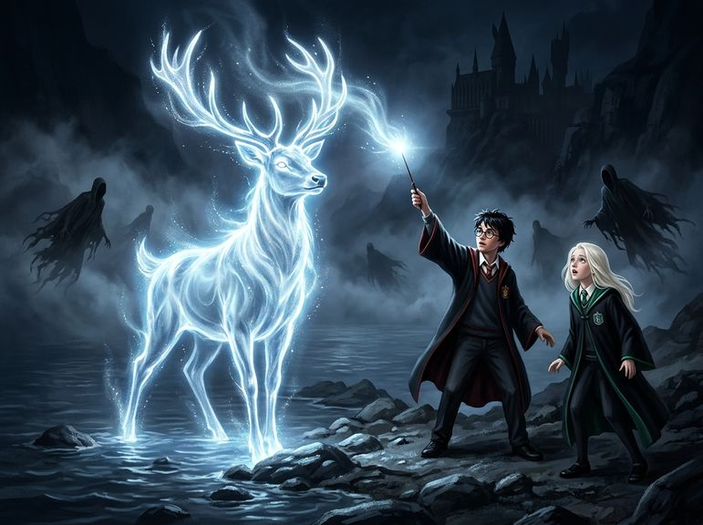

# Chương 35: Năm Ba: Hươu Bạc Bên Hồ Đen
**Tên gốc:** *Third Year: The Stag by the Lake*  
**Tác giả:** [Sergio Xalambrí (`sergiodxa`)](https://www.wattpad.com/story/416871248-dracaena-malfoy-and-the-boy-who-lived)  
**Phiên bản:** Bản Dịch Chi Tiết (Sát nguyên tác từng phân cảnh & hội thoại)

*Thần Hộ Mệnh hình Hươu Bạc rực rỡ bên bờ Hồ Đen đẩy lùi hàng trăm Giám ngục Azkaban trong đêm định mệnh.*

> "Ông ấy vô tội, Dracaena. Người anh họ của mẹ cậu đã chịu oan suốt mười hai năm trong ngục Azkaban vì một tội ác mà ông ấy chưa từng phạm phải."

### Tấm thẻ Ếch Sô-cô-la trong kẽ đá
Phải mất trọn một ngày thứ Sáu trong Bệnh xá, Harry và Hermione mới được bà Pomfrey cho phép ra ngoài vào sáng thứ Bảy cuối tuần — trong khi Ron vẫn phải nằm lại thêm một ngày để chăm sóc cái chân bị gãy đã được bó bột.

Ngay trong bữa điểm tâm sáng thứ Bảy tại Đại Sảnh Đường, bầu không khí ở dãy bàn Slytherin vô cùng kỳ quặc. Giáo sư Severus Snape — người vẫn còn tức giận đến mức bàn tay cầm nĩa run lên vì vuột mất Huân chương Merlin Đệ Nhất Đẳng sau khi Sirius Black trốn thoát — đã "vô tình" nói lớn trước mặt đám học sinh Slytherin rằng giáo sư Remus Lupin thực chất là một **người sói**, và rằng đêm thứ Năm vừa rồi ông đã quên uống thuốc Bả Sói nên đã biến hình ngay trong khuôn viên trường.

Chỉ hai tiếng sau, tin giáo sư Lupin tự nguyện nộp đơn từ chức và đang thu dọn hành lý đã lan khắp lâu đài.

Đầu giờ chiều hôm đó, khi Dracaena đi dọc hành lang tầng ba, cô nhìn thấy góc nhọn màu vàng tím của một tấm thẻ Ếch Sô-cô-la được kẹp khéo léo vào khe đá thứ tư bên trái bức tượng phù thủy lưng gù — mật hiệu hẹn gặp khẩn cấp mà chỉ có cô và Harry biết.

Khi cô mở cửa bước vào căn phòng học bỏ trống, ánh nắng tháng Sáu rực rỡ đang tràn ngập khắp căn phòng.

Harry đang đứng bên bệ cửa sổ. Trông cậu hơi mệt mỏi sau đêm kinh hoàng hôm thứ Năm, trên trán và gò má vẫn còn vài vết xước nhỏ do cành Cây Liễu Roi quẹt phải, nhưng đôi mắt xanh biếc sau tròng kính lại sáng trong và bình tĩnh đến lạ thường.

*"Harry!"* Dracaena khép nhanh cánh cửa, rút đũa phép niệm một bùa *Muffliato* nhẹ lên khe cửa như cô đã học từ các học sinh năm năm, rồi bước vội tới trước mặt cậu. Cô nhìn khắp người cậu một lượt để chắc chắn rằng cậu không bị thương nặng ở đâu: *"Đêm thứ Năm vừa rồi rốt cuộc đã xảy ra chuyện gì vậy? Cả trường đồn ầm lên rằng Sirius Black đã bắt cóc Weasley xuống dưới gốc Cây Liễu Roi và bầy Giám ngục đã suýt trao Nụ Hôn cho cậu bên bờ Hồ Đen!"*

Harry nhìn vẻ lo lắng chân thành trên gương mặt Dracaena, rồi khẽ mỉm cười, chỉ tay vào bệ cửa sổ đá:

*"Ngồi xuống trước đi, Dracaena. Và... cậu còn nhớ **Quy tắc số Ba** của căn phòng này chứ?"*

Dracaena ngồi xuống phía bên phải bệ cửa sổ, gật đầu nghiêm túc:

*"Bất cứ điều gì nói ra trong căn phòng này sẽ mãi mãi ở lại trong căn phòng này."*

Harry ngồi xuống đối diện cô. Cậu hít một hơi thật sâu, rồi bắt đầu kể cho cô nghe toàn bộ sự thật về đêm thứ Năm định mệnh ấy — một câu chuyện mà ngoài cụ Dumbledore, giáo sư Lupin, Ron và Hermione, cậu chưa từng và sẽ không bao giờ tiết lộ cho bất kỳ học sinh nào khác trong trường.

### Sự thật về người tù ngục Azkaban và Hươu Bạc bên hồ
Dracaena ngồi bất động trên phiến đá, đôi bàn tay đan chặt vào nhau khi giọng kể trầm ấm của Harry đưa cô đi từ đường hầm dưới gốc Cây Liễu Roi tới căn phòng bụi bặm trong Lều Hét.

Cô sững sờ khi nghe cậu tiết lộ rằng con chó đen khổng lồ mà cậu từng tưởng là Hung Tinh thực chất chính là Sirius Black dưới hình dạng Hóa Thú Sư không đăng ký; rằng con chuột già Scabbers bị mất một ngón chân của Ron Weasley suốt mười hai năm qua thực chất lại là **Peter Pettigrew** — kẻ vẫn còn sống sờ sờ trước mắt mọi người!

*"Không phải Sirius Black đã phản bội cha mẹ mình, Dracaena,"* Harry nói, giọng cậu vang lên rõ ràng và xúc động trong căn phòng ngập nắng. *"Phút cuối cùng trước khi thực hiện Bùa Trung Tín, cha mẹ mình và chú Sirius đã quyết định đổi Người Giữ Bí Mật sang cho Peter Pettigrew vì nghĩ rằng Voldemort sẽ chỉ săn lùng chú Sirius chứ không bao giờ nghi ngờ một người yếu đuối như Pettigrew. Nhưng chính Pettigrew mới là gián điệp của Voldemort từ suốt một năm trước đó! Khi chú Sirius dồn hắn vào chân tường trên con phố Muggle, chính Pettigrew đã hét to lên để vu khống chú ấy, tự tay nổ tung con phố giết chết mười hai người Muggle, tự cắt đứt một ngón tay của mình rồi biến thành một con chuột chui xuống cống trốn thoát!"*

Đôi mắt xám của Dracaena mở to hết cỡ, hơi thở gần như ngừng lại.

*"Vậy nghĩa là..."* giọng cô thì thầm đầy bàng hoàng, *"...người anh họ của mẹ mình... chú Sirius Black... hoàn toàn vô tội suốt mười hai năm qua sao?"*

*"Hoàn toàn vô tội,"* Harry gật đầu. *"Chú ấy bị tống thẳng vào ngục Azkaban mà không hề được đưa ra xét xử lấy một phiên tòa nào. Và đêm hôm kia, trong Lều Hét, khi chú Sirius và thầy Lupin định giết Pettigrew để trả thù cho cha mẹ mình... mình đã nhớ tới những lời cậu nói với mình trước kỳ nghỉ Giáng Sinh."*

Harry nhìn thẳng vào mắt cô, ánh mắt dịu dàng và biết ơn:

*"Cậu đã nói rằng cha mẹ mình không muốn mình biến thành kẻ giết người, và mình cũng nhận ra cha mình sẽ không bao giờ muốn những người bạn thân nhất của ông trở thành kẻ sát nhân. Vì thế mình đã ngăn chú Sirius lại để giải Pettigrew về lâu đài giao cho Giám ngục. Chỉ tiếc là khi ra khỏi đường hầm, trăng tròn hiện lên khiến thầy Lupin biến thành người sói, và Pettigrew đã lợi dụng lúc hỗn loạn biến lại thành chuột trốn thoát vào rừng."*

Harry khẽ ngập ngừng một nhịp khi lược qua chi tiết chiếc Xoay Thời Gian của Hermione để giữ lời hứa với cô McGonagall, nhưng cậu kể trọn vẹn cho Dracaena nghe về khoảnh khắc bên bờ Hồ Đen — khi hàng trăm tên Giám ngục bao vây lấy cậu và chú Sirius đang hấp hối.

*"Lúc đó mình đã bước ra bờ hồ bên kia,"* Harry kể, đôi mắt cậu sáng lên khi nhớ lại luồng ma pháp diệu kỳ đêm ấy. *"Mình đã nghĩ về chú Sirius, về việc mình sắp có một gia đình thực sự, và cả về những buổi chiều mà mình không cảm thấy cô độc ở ngôi trường này. Khi mình hô *Expecto Patronum*, từ đầu đũa phép của mình không còn là làn sương mù nữa, Dracaena. Một con **Hươu Bạc (Stag)** khổng lồ, sáng rực như mặt trăng đã phóng thẳng qua mặt hồ và đánh bật toàn bộ hàng trăm tên Giám ngục đi! Thầy Lupin bảo đó chính là hình dạng Hóa Thú Sư của cha mình — Gạc Nai (*Prongs*)."*

Và cuối cùng, bằng một phép màu nào đó trước nửa đêm, chú Bằng mã Buckbeak đã được giải thoát khỏi vườn bí ngô để đưa Sirius Black bay vút lên bầu trời tự do ngay từ cửa sổ tháp Phía Tây.

Căn phòng cửa sổ chìm vào một sự tĩnh lặng thiêng liêng.

Đối với Dracaena Malfoy, câu chuyện của Harry không chỉ là một cuộc phiêu lưu kỳ diệu; nó là một cú chấn động làm lung lay tận gốc rễ niềm tin cuối cùng của cô vào trật tự của thế giới mà cha cô vẫn ca tụng. Một người đàn ông vô tội của dòng họ Black đã bị Bộ Pháp thuật giam cầm suốt mười hai năm không cần xét xử, và ngay cả khi sự thật đã ở ngay trước mắt, Bộ trưởng Fudge vẫn thà nghe theo lời vu khống của giáo sư Snape và trao Nụ Hôn Giám Ngục cho một người vô tội còn hơn thừa nhận sai lầm của Bộ.

Trong khi đó, cậu thiếu niên mười ba tuổi ngồi trước mặt cô không chỉ tha mạng cho kẻ đã hại chết cha mẹ mình, mà còn triệu hồi được một phép thuật cổ xưa rực rỡ để cứu sống cả người cha đỡ đầu bị oan ức lẫn con Bằng mã mà cha cô đòi giết.

*"Lão Fudge và cha mình sẽ phát điên lên khi biết con Bằng mã đó đã đưa chú Sirius bay đi mất,"* Dracaena lên tiếng sau một hồi lâu im lặng, và một nụ cười chân thành, nhẹ nhõm nở rộ trên gương mặt cô. *"Nhưng mình mừng vì Buckbeak đã được tự do, Harry. Và mình thực sự mừng vì người anh họ của mẹ mình không phải là một con quái vật — và vì cuối cùng cậu cũng đã có một người thân thực sự trên đời này."*
