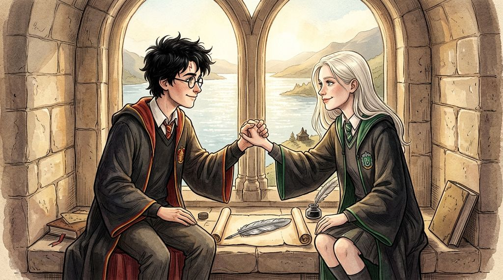

# Chương 36: Năm Ba: Quy Tắc Số Bốn
**Tên gốc:** *Third Year: Rule Four*  
**Tác giả:** [Sergio Xalambrí (`sergiodxa`)](https://www.wattpad.com/story/416871248-dracaena-malfoy-and-the-boy-who-lived)  
**Phiên bản:** Bản Dịch Chi Tiết (Sát nguyên tác từng phân cảnh & hội thoại)

*Buổi chiều cuối cùng của năm thứ ba bên khung cửa sổ đá tầng ba và việc thiết lập Quy tắc số Bốn giữa Harry và Dracaena.*

> "Quy tắc số Bốn: Dù bên ngoài hành lang kia có xảy ra chuyện gì đi nữa, không ai được phép rời bỏ căn phòng này mà không nghe người kia giải thích trước."

### Nắng tháng Sáu và bốn quy tắc của căn phòng cửa sổ
Chuyến tàu tốc hành Hogwarts đưa học sinh trở về London vào ngày cuối cùng của năm học thứ ba luôn đến nhanh hơn mọi người tưởng.

Tối hôm trước ngày lên tàu, trong bữa tiệc tổng kết năm học tại Đại Sảnh Đường được trang hoàng ngập tràn cờ biểu ngữ màu đỏ vàng của nhà Gryffindor — nhà vừa giành cú đúp cả Cúp Quidditch lẫn Cúp Nhà năm thứ ba liên tiếp — Dracaena ngồi ở dãy bàn Slytherin nhưng không còn cảm thấy chút cay cú nào như hồi năm thứ nhất nữa. Cách đó hai dãy bàn, Harry đang cười nói vui vẻ bên cạnh Ron và Hermione, gương mặt cậu đã hoàn toàn bình phục sau một năm học đầy bão tố.

Một tiếng trước giờ tiệc tối bắt đầu, hai người đã có buổi gặp gỡ cuối cùng của năm học trong căn phòng học bỏ trống trên tầng ba.

Cánh cửa gỗ sồi đã khép lại sau lưng họ. Harry ngồi ở phía bên trái bệ cửa sổ đá, Dracaena ngồi ở phía bên phải. Giữa họ là hai hộp Ếch Sô-cô-la vừa bóc và bốn tấm thẻ bài được xếp ngay ngắn trên phiến đá.

*"Năm nay cậu đã sưu tập được bao nhiêu thẻ trùng rồi, Malfoy?"* Harry hỏi, tay cầm con ếch sô-cô-la đang cố nhảy khỏi lòng bàn tay cậu.

*"Đủ để lấp đầy cả cái ngăn kéo bàn học ở Thái ấp rồi,"* Dracaena mỉm cười đáp, rồi ánh mắt cô chợt dịu lại khi nhìn ra mặt Hồ Đen phẳng lặng như gương dưới nắng chiều tháng Sáu. *"Sáng nay con cú nhỏ bé tí tẹo đó của cậu vừa mang thư của chú Sirius tới phải không? Trông nó bay vào Đại Sảnh Đường mà mình cứ tưởng nó sắp rơi thẳng vào bình nước bí ngô của nhà Hufflepuff đến nơi."*

Harry bật cười: *"Ừ, chú Sirius gửi thư báo rằng chú ấy và Buckbeak đã tới một nơi an toàn rất xa khỏi tầm mắt của Giám ngục rồi. Chú ấy còn gửi kèm cả tờ giấy bảo lãnh chính thức của cha đỡ đầu cho phép mình được đi thăm làng Hogsmeade vào năm học tới nữa. Với lại... mình nghĩ mùa hè năm nay dượng Vernon và dì Petunia sẽ không dám nhốt mình hay bắt nạt mình nữa đâu, khi họ biết cha đỡ đầu của mình là người vừa vượt ngục Azkaban và rất quan tâm xem mình sống ở đó có tốt không."*

Dracaena khẽ bật cười thành tiếng trước ý nghĩ về gương mặt kinh hãi của gia đình Muggle kia. Thế nhưng, chỉ một lát sau, nụ cười trên môi cô lắng xuống khi cô nhớ tới một chi tiết khác mà Harry đã kể cho cô nghe hôm trước — lời tiên tri kỳ quái của giáo sư Trelawney trong phòng thi môn Tiên Tri trước khi Peter Pettigrew trốn thoát:

*Kẻ đầy tớ bị xiềng xích suốt mười hai năm đã tự do đêm nay... Trước lúc nửa đêm, kẻ đầy tớ sẽ lên đường hội ngộ với chủ nhân của hắn. Chúa tể Hắc ám sẽ trỗi dậy một lần nữa với sự giúp đỡ của kẻ đầy tớ, vĩ đại và khủng khiếp hơn bao giờ hết...*

Không giống như những lời phán đoán mơ hồ hàng ngày của bà giáo dạy Tiên Tri, Dracaena đã lớn lên trong một gia đình từng phục vụ Chúa tể Hắc ám; cô cảm nhận được một cơn ớn lạnh rất thật khi nghĩ đến việc Peter Pettigrew đang trốn đi tìm tàn dư của chủ nhân hắn.

Nếu bóng tối thực sự đang âm ỉ quay trở lại, thì những năm học tiếp theo tại Hogwarts sẽ không còn chỉ là những trò chơi khăm trên sân Quidditch hay những cuộc cãi vã trẻ con ngoài hành lang nữa. Cha cô — Lucius Malfoy — chắc chắn sẽ lại bị kéo sâu vào những âm mưu nguy hiểm hơn gấp bội, và áp lực đè lên vai cả hai người sẽ ngày càng khắc nghiệt.

Dracaena xoay người trên bệ cửa sổ để đối diện hoàn toàn với Harry. Đôi mắt xám bạc của cô nhìn thẳng vào đôi mắt xanh của cậu với vẻ nghiêm túc hiếm có:

*"Harry này. Khi chúng ta bắt đầu gặp nhau ở căn phòng này vào mùa thu năm thứ nhất, cậu đã đặt ra ba quy tắc: một là không được dẫn bạn bè theo; hai là ai đến trước thì ngồi bên trái; và ba là mọi chuyện nói ra trong căn phòng này đều ở lại trong căn phòng này."*

*"Đúng vậy,"* Harry gật đầu, chăm chú nhìn cô. *"Sao thế?"*

*"Hôm nay, trước khi chúng ta kết thúc năm thứ ba, mình muốn thêm vào một quy tắc nữa,"* Dracaena nói rõ ràng từng chữ. ***"Quy tắc số Bốn***: *Trong những năm học tới, bất kể bên ngoài cánh cửa kia cha mình, gia đình mình, bạn bè của cậu hay cả Bộ Pháp thuật có làm ra chuyện gì đi chăng nữa... không ai trong hai chúng ta được phép tự ý kết tội người kia và bỏ đi như cuối năm thứ hai mà chưa đến căn phòng này để nghe đối phương nói rõ sự thật trước. Không có ngoại lệ."*

Harry nhìn cô thật lâu.

Trong ánh nắng vàng rực rỡ của buổi chiều mùa hạ chiếu qua khung cửa đá, cậu nhìn thấy cô gái mười ba tuổi đã từng kiêu kỳ chìa tay ra trên chuyến tàu tốc hành Hogwarts năm mười một tuổi, người đã run rẩy giương đũa phép bảo vệ cậu trong Rừng Cấm, người đã mang sô-cô-la cho cậu dưới cơn mưa bão và đã âm thầm chép từng trang án lệ để cứu một con Bằng mã vì cậu.

Không nói một lời, Harry vươn bàn tay phải của mình ra giữa phiến đá.

Lần này, không có Crabbe hay Goyle, không có Ron Weasley, cũng không có bất kỳ định kiến nào của hai gia tộc đứng giữa họ. Dracaena đặt bàn tay thon dài, ấm áp của mình vào lòng bàn tay của Harry.

*"Đồng ý. Quy tắc số Bốn,"* Harry mỉm cười, nắm chặt lấy tay cô một nhịp trước khi rút từ trong túi áo sơ mi ra một mảnh giấy da dê được gấp vuông vức đặt vào lòng bàn tay cô.

Dracaena mở mảnh giấy ra. Bên trong là một chiếc lông vũ nhỏ màu xám bạc ánh kim tuyệt đẹp của chú Bằng mã Buckbeak mà Harry đã nhặt được bên bờ hồ trước khi nó bay đi, phía dưới có một dòng chữ ngắn gọn bằng mực đen:

*Để cậu nhớ rằng năm nay không có ai phải chết vì lỗi của cậu cả. Hẹn gặp lại vào tháng Chín — Harry.*

Dracaena khẽ mím môi, cẩn thận gấp mảnh giấy có chiếc lông vũ lại rồi cất vào ngăn túi trong cùng sát ngực áo chùng của mình.

### Ánh nhìn qua biển người tại Ngã Tư Vua
Trưa hôm sau, đoàn tàu tốc hành Hogwarts từ từ tiến vào sân ga chín phần tư tại nhà ga Ngã Tư Vua ngập tràn ánh nắng mùa hè.

Học sinh từ các toa tàu ùa xuống sân ga trong tiếng gọi nhau í ới và tiếng cú kêu rộn rã. Khi Dracaena kéo chiếc rương của mình bước xuống bậc tàu, cha mẹ cô đã đứng đợi sẵn gần cột đá lớn.

Lucius Malfoy trông vẫn lạnh lùng và đạo mạo trong bộ áo choàng đen cài khuy bạc — dù tâm trạng ông có phần u ám sau thất bại ê chề của vụ kiện Buckbeak và sự biến mất của Sirius Black. Trong khi ông quay sang trao đổi vài câu với cha của Theodore Nott đứng gần đó, phu nhân Narcissa Malfoy bước tới đón con gái, nhẹ nhàng vuốt lại lọn tóc vàng bạch kim trên vai cô.

Ánh mắt tinh tế của người mẹ lướt qua gương mặt tươi tắn, bình yên của Dracaena — khác hẳn với vẻ trầm lặng đầy tổn thương khi cô bước xuống đúng sân ga này vào mùa hè năm ngoái.

*"Chào mừng con về nhà, Dracaena,"* Narcissa dịu dàng nói, rồi hạ giọng xuống thật khẽ chỉ để hai mẹ con nghe thấy: *"Năm học thứ ba của con thế nào? Con và... người bạn đó... hai đứa đã nói chuyện lại với nhau chưa?"*

Dracaena khẽ ngoái đầu nhìn qua đám đông học sinh đang hối hả đi về phía cổng rào chắn dẫn ra thế giới Muggle.

Cách đó khoảng hai mươi bước chân, Harry Potter đang đứng cạnh Ron và Hermione, tay đẩy chiếc xe chở rương hành lý và lồng của con cú Hedwig. Như cảm nhận được ánh nhìn của cô giữa biển người ồn ào, Harry dừng bước và quay đầu lại.

Ánh mắt xanh biếc sau tròng kính tròn của cậu bắt gặp đôi mắt xám bạc của Dracaena.

Không có lời chào lớn tiếng nào được thốt ra, cũng không cần bất kỳ cử chỉ phô trương nào trước mặt Lucius Malfoy hay gia đình Weasley. Harry chỉ khẽ mỉm cười và nghiêng đầu gật nhẹ với cô một cái — một lời tạm biệt ấm áp và một lời hẹn ước vững chắc cho mùa thu năm thứ tư.

Dracaena cũng khẽ gật đầu đáp lại cậu, rồi quay sang nhìn mẹ mình. Một nụ cười trong trẻo, nhẹ nhõm nở trên môi cô gái mười ba tuổi:

*"Rồi, mẹ ạ,"* Dracaena thì thầm. *"Lần này thì chúng con có Quy tắc số Bốn rồi. Chúng con sẽ không đánh mất nhau nữa đâu."*
